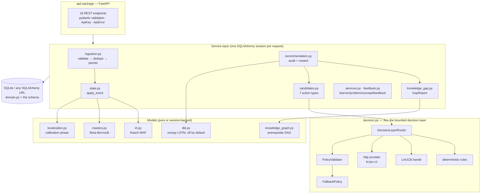

# Knowledge Tracer — Python replica: full project documentation

> **What this is:** a complete, tested Python port of the Spring Boot Knowledge Tracer
> backend (`../backend/`) and its DKT inference model, built so the whole system can be
> read and run in one language. Nothing here is a stub: every module is a working port
> with tests, verified against the Java behaviour and the recorded model fixture.
>
> **Status:** 268 tests passing · live server smoke-tested · demo loop verified.
> Built 2026-09-30. Python ≥ 3.9 (developed on CPython 3.9.6).

## Contents

1. [Architecture](#1-architecture)
2. [The learning loop, step by step](#2-the-learning-loop-step-by-step)
3. [Module-by-module Java → Python mapping](#3-module-by-module-java--python-mapping)
4. [The models](#4-the-models)
5. [The Jev decision layer](#5-the-jev-decision-layer)
6. [Data model](#6-data-model)
7. [HTTP API](#7-http-api)
8. [Configuration reference](#8-configuration-reference)
9. [Testing and parity verification](#9-testing-and-parity-verification)
10. [Known deltas and limitations](#10-known-deltas-and-limitations)
11. [Build record (multi-agent)](#11-build-record)

## 1. Architecture

Same layered architecture as the Java service (docs/architecture.md): controllers are
thin, all intelligence lives in services, the maths lives in pure functions, and Jev
is reachable only through the decision-layer interface.



`container.py` is the application context (the `@SpringBootApplication` equivalent):
one engine, one DKT predictor, one decision router, one bandit store per container;
per-request sessions wired with all services (`Container.session_scope()`).

## 2. The learning loop, step by step

The loop (master plan §6, docs/model-flow.md), with the exact code that runs each step:

1. **OBSERVE** — `POST /api/events` → `api/routes_events.py` → `EventIngestionService.ingest`
   (`ingestion.py`). Validates the payload (the Bean Validation rules), dedupes on the
   client `eventId` (identical replay → `duplicate=true`; reused id for another
   learner/problem → `ConflictError` 409 *before* any learner is created),
   auto-provisions the learner, persists the event.
2. **ESTIMATE** — `LearnerStateService.apply_event` (`state.py`), in the same
   transaction: IRT ability re-estimate (`irt.py`, first attempts only) → calibration
   progress (`localization.py`) → item difficulty recalibration → concept mastery
   update (`mastery.py`, every attempt, quality-weighted).
3. **REWARD** — `OutcomeRewardService.on_outcome` (`recommendation.py`) attributes the
   outcome to the pending recommendation for that learner+problem (336 h window) and
   updates the LinUCB arm from the stored context vector.
4. **EXPLAIN** — `GET /api/learners/{userId}/next-action` →
   `RecommendationService.next_action`: `KnowledgeGapService.detect`
   (`knowledge_gap.py`) produces a `GapReport` with evidence.
5. **GENERATE** — `CandidateGenerationService.generate` (`candidates.py`) builds the
   bounded candidate set (up to 7 action types), each scored with
   `SuccessEstimator.predict` (`success.py`: IRT, or 0.5·IRT + 0.5·DKT when enabled).
6. **DECIDE** — `DecisionLayerRouter` → the configured Jev provider →
   `PolicyValidator` (five checks) → `FallbackPolicy` on any failure. One audit row is
   written (`recommendations` table) with the candidate list, provider, confidence and
   the ability at decision time.
7. **OBSERVE AGAIN** — the learner's next attempt arrives as another event. Loop
   closes.

See it run: `PYTHONPATH=pylib:. python3 scripts/demo.py` — a simulated learner (true
ability 4.0) is localized by the calibration phase (5.0 → fail → 4.0 → fail → 3.3 →
pass …), is calibrated after 5 informative responses, and converges to
**3.98 ± 0.58** after 14 rounds, with a `CONCEPT_GAP(MATH)` detected and remediated
mid-run and all 14 recommendations rewarded.

## 3. Module-by-module Java → Python mapping

| Java (`com.knowledgetracer.*`) | Python module | What it does |
|---|---|---|
| `config.KnowledgeTracerProperties` | `config.py` | All feature flags and hyper-parameters as dataclasses; `Settings.from_env()` reads the same `KT_*` variables |
| `common.exception.*` | `errors.py` | `ValidationError` 400, `NotFoundError` 404, `ConflictError` 409, `BusinessRuleError` 422 |
| `common.Pseudonyms` | `pseudonyms.py` | HMAC-SHA256 pseudonyms (`L-` + 16 bytes hex), `is_insecure_salt` guard |
| all JPA entities | `domain.py` | 11 tables as SQLAlchemy models + `StaticDifficulty`, `InteractionResult`, `ActionType` enums |
| (Spring DataSource/JPA) | `db.py` | Engine/session factory, `transaction()` context manager (the `@Transactional` boundary) |
| `irt.IrtModel` | `irt.py` (functions) | Rasch σ(θ−b); MAP Newton–Raphson for ability and difficulty; clamp/sigmoid; invariants documented |
| `irt.IrtService` | `irt.py` (`IrtService`) | First-attempt windows (100 ability / 50 item), acceptance-adjusted priors, current-ability approximation |
| `mastery.ConceptMasteryService` | `mastery.py` | Beta-Bernoulli per concept; evidence weights hint 0.7×, solution 0.4×, low-confidence 0.8×, slow 0.8×, failure-after-solution 0.5× |
| `localization.AdaptiveLocalizationService` | `localization.py` | Calibrated when σ ≤ 0.9 or 8 first-attempt responses; calibration target = current ability |
| `state.LearnerStateService` | `state.py` | The per-event update order: ability → calibration → item recalibration → mastery |
| `event.EventIngestionService` + DTO | `ingestion.py` | Validate → dedupe → persist → state → reward; `InteractionEventRequest` dataclass |
| `concept.KnowledgeGraphService` + cycle check | `knowledge_graph.py` | Direct/transitive/downstream prerequisites (cycle-safe), `weakest_prerequisite`, `would_create_cycle` |
| `gap.KnowledgeGapService` + `GapReport`/`GapType` | `knowledge_gap.py` | 10 gap types, rule-ordered detection with evidence strings; `HIGH_ITEM_DIFFICULTY` kept defined-but-never-emitted, as in Java |
| `recommendation.CandidateGenerationService` | `candidates.py` | All seven candidate rules with the Java triggers, expected values and reason strings |
| `recommendation.SuccessEstimator` | `success.py` | `Estimate.irt/predict/dkt/source`; duck-typed DKT predictor (no import of `dkt.py`) |
| `decision.*` (whole package) | `decision.py` | See §5 |
| `recommendation.RecommendationService` / `OutcomeRewardService` + response DTOs | `recommendation.py` | `next_action`, `history`, reward attribution; camelCase `to_dict()` DTOs |
| `dkt.DktModel`/`DktSnapshot`/`LstmDktPredictor`/`UnavailableDktPredictor`/`DktConfiguration` | `dkt.py` | numpy LSTM forward pass from the JSON export; **1e-9 parity with the recorded fixture** |
| `research.ResearchExportService` | `research.py` | Pseudonymised NDJSON exports (`kt-events-v1`, `kt-decisions-v1`, catalog), gated |
| `learner/problem/concept` services | `services.py` | CRUD with the Java validation and error ordering (self-loop 422 → cycle 422 → duplicate 409) |
| `feedback.FeedbackService` | `feedback.py` | Self-report storage; learner must exist (no auto-provision) |
| `*.api.*` controllers + `GlobalExceptionHandler` + `ApiKeyFilter` + `WebConfig` | `api/` package (`app.py` + 7 `routes_*.py` + `auth.py` + `errors.py` + `schemas.py`) | The 18 endpoints, ApiError body, X-API-Key auth, X-Request-Id, CORS, `/actuator/health`, dashboard; one route module per Java controller |
| `@SpringBootApplication` wiring | `container.py` | `Container` + `session_scope()` |
| Flyway V3/V5 seed | `seed.py` + `scripts/seed_db.py` | Loads `../data/seed/catalog_1000.json` (25 concepts, 21 edges, 1000 problems, 2653 tags) |

## 4. The models

**IRT (Rasch 1PL).** `P(correct) = σ(θ − b)` on a 0–10 scale. MAP Newton–Raphson with
prior N(5, 2²); uncertainty = 1/√(Fisher information + prior precision). Only first
attempts count (retries are not independent). Item difficulty is recalibrated from the
50 most recent population responses, towards the label/acceptance prior. Invariants
(unit-tested): probability monotone in θ and −b; a success never lowers the estimate
relative to a failure; uncertainty non-increasing; outputs finite and clamped.

**Concept mastery (Beta-Bernoulli).** Prior (1,1); each event adds
`tag_weight × credit_weight` to α (correct) or β (incorrect). One failure moves 0.5 →
0.33 — mastery is never destroyed by a single event. Uncertainty computed, not stored.

**Adaptive localization.** While uncalibrated, the next item targets difficulty = θ̂
(maximum Fisher information), producing the step-down/step-up cold-start behaviour.
Ends at σ ≤ 0.9 or 8 first-attempt responses; never re-opens (documented limitation).

**Knowledge graph + gaps.** 25 concepts, 21 curated prerequisite edges. Gap rules in
order: `UNKNOWN` (no events) → concept weakness (mastery < 0.45 with ≥ 2 evidence) →
prerequisite weakness → struggle patterns (multiple attempts, time pressure, low
confidence) → `NONE`. `HIGH_ITEM_DIFFICULTY` exists in the enum but is never emitted —
same as Java.

**DKT (optional).** The `kt-dkt-v1` LSTM exported by `model/dkt/train_dkt.py`,
re-implemented in numpy from the JSON weights (PyTorch gate order i/f/g/o). Off by
default (`KT_DKT_ENABLED`); when on, candidate P(success) = 0.5·IRT + 0.5·DKT once the
learner has ≥ 3 events. The shipped model is trained on **synthetic** data — the same
caveat as the Java side.

## 5. The Jev decision layer

Jev chooses exactly one action from the generated candidate set (`decision.py`):

- **Providers** (`KT_JEV_PROVIDER`): `deterministic` (rule ordering, the default),
  `bandit` (LinUCB over an 8-feature context, guarded mode keeps deterministic gap
  remediation), `http` (POST to a `kt-jev-v1` service, 2 s timeout, `X-API-Key`;
  refuses to send while the pseudonym salt is blank or `change-me`).
- **Router**: unknown provider name raises → the service catches → fallback.
- **PolicyValidator**: rejects decisions outside the candidate set, referencing unknown
  problems, with difficulty outside [0,10]/NaN, targeting solved problems (unless
  RETRY/SPACED_REVIEW), or with confidence < 0.35.
- **FallbackPolicy**: candidates in *descending expected value*, first valid one wins
  (confidence 0.5); else the nearest-difficulty unsolved **free** problem (0.3); else
  `FEEDBACK_REQUEST` (0.1).
- **Rewards**: `reward = w·quality + (1−w)·growth` (default w = 0 — growth only, so the
  bandit cannot farm easy wins), attributed within 336 h, written once, and fed back
  into the bandit arm that made the decision.

Every decision is one `recommendations` audit row: candidates JSON, provider,
`decided_by` (JEV/FALLBACK), confidence, ability at decision, and later the reward.

## 6. Data model

Eleven tables, one SQLAlchemy model each in `domain.py` (the entities are the schema —
`create_all` replaces Flyway): `learners`, `problems` (reference data + item
calibration), `concepts`, `problem_concepts` (weighted tags), `prerequisites`,
`interaction_events` (append-only, globally unique `event_id`), `learner_states`
(current estimate only), `concept_masteries`, `recommendations` (decision audit +
outcome), `feedback`, `jev_bandit_arms`. Column-by-column classification (raw /
self-report / reference / model state / decision) is in `../docs/domain-model.md` and
applies unchanged.

## 7. HTTP API

All 18 Java endpoints with the same paths, camelCase JSON, `ApiError` error body and
status codes — the route table is in [README.md](README.md#api-summary), the contract
in `../docs/api-flow.md`. Auth: `X-API-Key` on `/api/**` when `KT_API_KEY` is set
(constant-time compare; blank disables). `X-Request-Id` on every response.
`/actuator/health`, `/dashboard` and `/docs` stay open. Run it:

```bash
cd KT_python
python3 scripts/run_server.py          # http://127.0.0.1:8081/dashboard
```

Verified live: health UP, 1000 problems seeded, learner registration 201, cold-start
`next-action` → `CALIBRATION_PROBLEM`, dashboard 200, API open when no key is set.

## 8. Configuration reference

All Java `KT_*` variables work with the same names and defaults
(`config.Settings.from_env()`): `KT_IRT_ENABLED`, `KT_DKT_ENABLED`,
`KT_DKT_MODEL_PATH`, `KT_DKT_BLEND_WEIGHT`, `KT_DKT_MIN_HISTORY`, `KT_GRAPH_ENABLED`,
`KT_LOCALIZATION_ENABLED`, `KT_JEV_ENABLED`, `KT_JEV_PROVIDER`, `KT_JEV_HTTP_URL`,
`KT_JEV_HTTP_API_KEY`, `KT_API_KEY`, `KT_RESEARCH_EXPORT`, `KT_PSEUDONYM_SALT`.
Python-only additions: `KT_DATABASE_URL` (default `sqlite:///./kt.db`;
`run_server.py` sets `sqlite:///./kt_python.db`), `KT_CATALOG_PATH`, `KT_HOST`,
`KT_PORT`. Hyper-parameters (priors, thresholds, windows, reward weights) are
dataclass fields in `config.py` with the Java defaults.

## 9. Testing and parity verification

```bash
cd KT_python && PYTHONPATH=pylib:. python3 -m pytest tests/ -q
```

| File | Tests | Covers |
|---|---|---|
| `test_foundation.py` | 18 | IRT invariants, priors, mastery weights, ingestion idempotency/409, calibration rules, real-catalog seed |
| `test_knowledge_graph.py` | 16 | direct/transitive/downstream prerequisites, cycle safety, `would_create_cycle` |
| `test_knowledge_gap.py` | 15 | every gap rule, evidence strings, graph ablation, UNKNOWN/NONE |
| `test_candidates.py` | 20 | all seven candidate rules and triggers |
| `test_decision.py` | 48 | deterministic ordering, validator checks, fallback fall-through/paid-skip/exhaustion, router, HTTP salt guard, LinUCB, bandit store |
| `test_recommendation.py` | 25 | next-action end-to-end, audit rows, reward formula/window/write-once |
| `test_dkt.py` | 15 | model load, forward-pass invariants, **1e-9 fixture parity**, predictor gating |
| `test_research.py` | 12 | export gating, pseudonym stability/rotation, NDJSON formats |
| `test_feedback.py` | 12 | feedback validation and storage |
| `test_reward_loop.py` | 3 | the closed loop proven end-to-end: audit row → reward → exact LinUCB rank-one update |
| `test_api.py` | 40 | all ApiContractIT + LearningLoopIT scenarios over HTTP: loop, idempotency, 400/404/405/409/415/422, API key, models, research, CORS, dashboard |
| `test_api_contract.py` | 39 | second, independent HTTP contract suite (written against the `api/` package; both suites run against it) |
| `test_learning_loop_e2e.py` | 5 | LearningLoopIT ported fully over HTTP: catalog seeded **through the API** (no ORM shortcuts), then observe → state → next-action → reward → history, plus duplicate/409 ingestion edges |
| **Total** | **268** | |

**Parity evidence.** The DKT forward pass replays the 12-step recorded fixture from
`../backend/src/test/resources/dkt/` and matches `predictionBefore` and every
`masteryAfter` element to **1e-9** — the same assertion as the Java `DktModelTest`.
The reward-loop test recomputes the LinUCB update by hand and matches the stored arm
exactly. Behavioural parity is otherwise established by porting the Java test
scenarios one-to-one.

## 10. Known deltas and limitations

Everything in `../docs/limitations.md` applies (synthetic-only evaluation, selection
bias, sticky calibration, …). Replica-specific deltas:

- SQLite + `create_all` instead of PostgreSQL + Flyway (any SQLAlchemy URL works).
- Single-process uvicorn; no optimistic-locking contention behaviour, no Actuator
  metrics endpoint, no Swagger springdoc (FastAPI `/docs` instead).
- pydantic validation messages differ in wording from Bean Validation; the status
  codes, error codes and field paths match.
- NDJSON exports are materialized through a bounded buffer instead of streamed
  (identical wire result).
- The dashboard defaults its API base URL to `http://127.0.0.1:8081` (configurable,
  persisted in `localStorage`) instead of same-origin relative paths.
- The uvicorn entry point is the **factory** string `knowledge_tracer.api.app:create_app`
  (used by `scripts/run_server.py`); importing `knowledge_tracer.api` has no side
  effects. Without a container, the factory creates the schema and seeds the catalog
  on first app build (CWD-relative paths); tests use `create_app(container)` with
  in-memory databases instead.

## 11. Build record

Built by coordinated parallel agents on 2026-09-30 (status files in `.agents/`,
render with `python3 scripts/monitor_agents.py`):

1. **Foundation** (config, domain, IRT, mastery, localization, state, ingestion,
   seeding) — 18 tests.
2. **Knowledge graph + gap detection** — 31 tests.
3. **DKT inference + research export** — 27 tests, including the 1e-9 parity test.
4. **Recommendation + decision layer** — 93 tests.
5. **FastAPI layer + container** — 40 tests.
6. **Feedback service + reward-loop proof; dashboard + launcher** — 15 tests and the
   static dashboard.

The HTTP layer was built twice, in competing shapes, and the rivalry took three
rounds to settle (a Python package shadows a same-named module, so
`knowledge_tracer/api/` and `knowledge_tracer/api.py` can never coexist):

1. The **api-layer agent** built an `api/` package; the **FastAPI-layer agent** built
   the specified single-module `api.py` with `create_app(container)`. The module won
   round 1 (specified shape; the package was missing `/actuator/health` and the
   correlation-id filter) and the package was preserved in `_attic/api_package/`.
2. The api-layer agent revived and recreated the package mid-build, breaking the
   suite (32 errors, 8 failures — the suite was the detection mechanism). Second
   copy attic'd (`api_package_v2/`).
3. The api-layer agent returned a final time and **converged**: it rebuilt the
   package on the shared foundation (`container.py`, `services.py`, `decision.py`,
   …), added a polymorphic `create_app` that accepts a `Container`, fixed every
   Java-faithfulness gap, and removed the shadowed `api.py`. Its final state passes
   **both** HTTP test suites — the 40 tests written against the module and its own
   39.

The package is the shipped layer: it is a strict superset in coverage, mirrors the
Java structure more closely (one `routes_*.py` per Spring controller), keeps the
per-request `@Transactional` session boundary (commit on success, rollback on
error), and makes the launcher's factory string `knowledge_tracer.api.app:create_app`
a real module path rather than an alias. Both earlier package iterations and the
contract-test duplicates remain byte-intact in `_attic/`; the deleted `api.py`
module is recoverable from the FastAPI-layer agent's transcript if ever wanted.
The full suite (268 tests, including two independent HTTP contract suites and the
HTTP-seeded end-to-end loop) guards against regression.

**Reconciliation note (final integration wave, e2e-integration agent).** The
end state above was independently verified and ratified: `knowledge_tracer/api/`
(the package) **is** the shipped HTTP implementation and `knowledge_tracer/api.py`
(the shadowed module) was removed as dead code. Evidence: (a) the full suite
passed with the module present-but-shadowed; (b) every import in the repo resolves
to the package — `from knowledge_tracer.api import create_app` (both HTTP test
suites), `from knowledge_tracer.api.routes_feedback import get_feedback_service`
(which only a package can satisfy), and the launcher's factory string
`knowledge_tracer.api.app:create_app`; the only reference to the module-form entry
point `knowledge_tracer.api:app` was the module's own docstring; (c) after
deletion the suite still passes — now **268 tests** (263 + 5 end-to-end
learning-loop tests in `tests/test_learning_loop_e2e.py`, which seed the catalog
through the API itself and drive the full loop over HTTP, including the rewarded
audit row).
