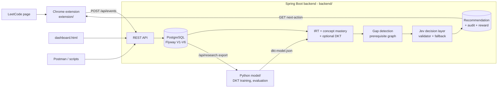
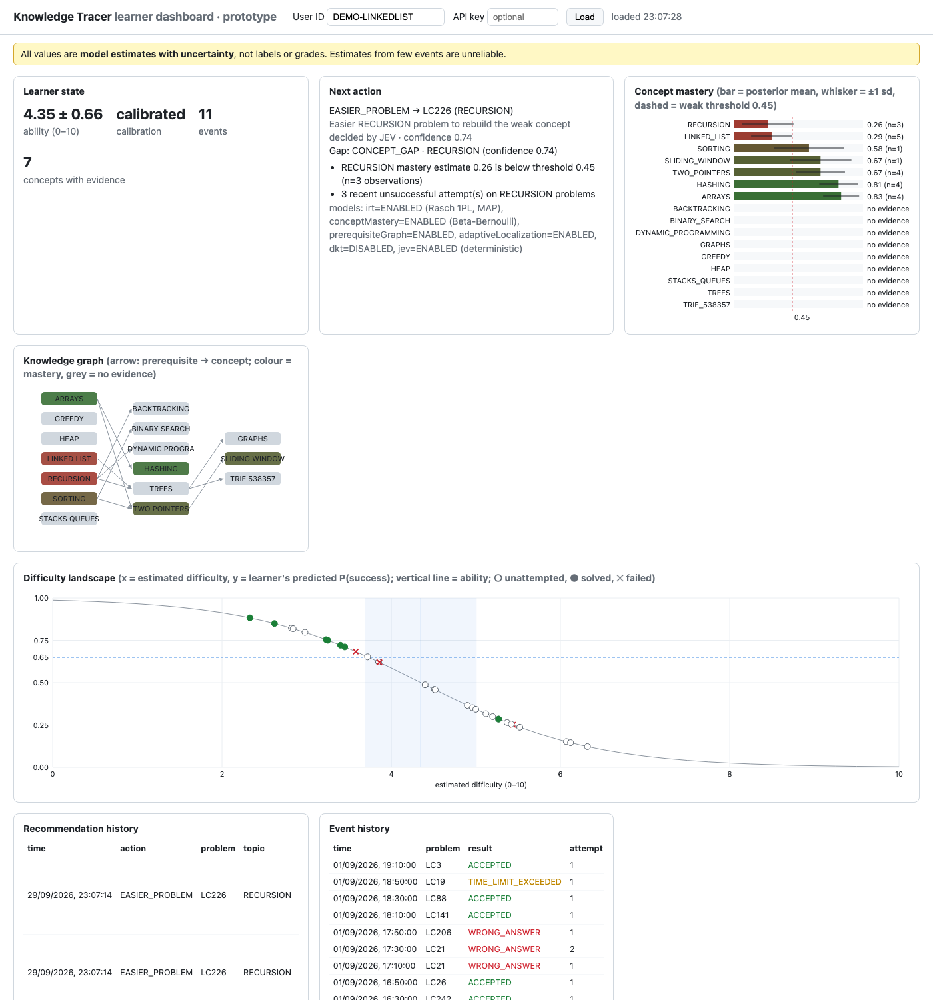

# Knowledge Tracer

> **Research prototype.** Not a hardened or deployed service. The shipped DKT model and every
> evaluation number in this repository come from **synthetic** learners; they validate
> implementation behaviour, not real learning outcomes. See [docs/limitations.md](docs/limitations.md)
> and [docs/project-status.md](docs/project-status.md).

Knowledge Tracer estimates what a learner knows from their LeetCode practice and recommends what to
do next. A Chrome extension observes submissions (verdict, attempt, time, hints, solution views) and
sends versioned events to a Spring Boot backend, which runs the evidence chain
`OBSERVE → STORE → ESTIMATE → TRACE → LOCALIZE → DETECT GAP → GENERATE OPTIONS → DECIDE → RECOMMEND → OBSERVE AGAIN`:
events are stored append-only in PostgreSQL, a Rasch IRT model estimates ability and item difficulty,
Beta-Bernoulli concept mastery (optionally blended with a DKT LSTM) traces per-concept knowledge,
gap detection uses the prerequisite graph, and the Jev decision layer (deterministic, LinUCB bandit
or an external HTTP service, always behind a policy validator and a deterministic fallback) picks the
next action. The learner's next attempt is the new evidence that closes the loop. Offline Python code
in `model/` mirrors the backend formulas, simulates learners, trains DKT and evaluates everything.



## Repository layout

| Path | Contents |
|---|---|
| `backend/` | Spring Boot 3 service (Java 21, Maven wrapper). Migrations in `src/main/resources/db/migration/` (`V1`–`V6`), dashboard in `src/main/resources/static/dashboard.html` |
| `model/` | Offline Python: reference IRT/mastery (`kt/`), DKT (`dkt/`), Jev simulation (`jev/`), evaluation (`evaluation/`), tests (`tests/`), trained artifact (`artifacts/dkt/`), reports (`reports/`). See [model/README.md](model/README.md) |
| `data/` | `seed/` catalogs (28-problem `catalog.json`, `catalog_1000.json`), `leetcode/` 1000-problem metadata catalog + tag→concept map, `synthetic/` generated datasets |
| `scripts/` | Dataset, catalog, Postman and notebook generators; replay / export clients; reference Jev HTTP service |
| `notebooks/` | Generated, self-contained Google Colab notebooks (DKT training, Jev bandit simulation) |
| `extension/` | Manifest V3 Chrome extension (`src/`, `popup/`, `options/`, `tests/`) |
| `postman/` | Generated Postman collection + local environment |
| `docs/` | Design and evaluation documentation ([index below](#documentation)) |
| `mdplans/` | Planning notes |

## Prerequisites

| Tool | Version | Source |
|---|---|---|
| JDK | 21 | `<java.version>` in `backend/pom.xml` |
| Spring Boot | 3.5.16 (parent POM) | `backend/pom.xml` |
| Maven | 3.9.16, downloaded by `./mvnw` | `backend/.mvn/wrapper/maven-wrapper.properties` |
| PostgreSQL | any recent server; integration tests use embedded PostgreSQL 17 | `embedded-postgres-binaries.version` 17.11.0 |
| Python | 3.9+ (standard library for everything except DKT training and figures) | `model/requirements-dkt.txt` |
| PyTorch, NumPy, matplotlib | torch ≥ 2.2, numpy ≥ 1.26, matplotlib ≥ 3.8, installed into `model/pylib/` | `model/requirements-dkt.txt` |
| Node.js | 18+ for the built-in `node:test` runner; `extension/package.json` has no dependencies and no `engines` field | `extension/package.json` |
| Chrome | any Manifest V3 capable version | `extension/manifest.json` |

Project-local install of the DKT dependencies (from the header of `model/requirements-dkt.txt`):

```bash
python3 -m pip install --target model/pylib -r model/requirements-dkt.txt
```

## Database setup (local PostgreSQL)

Defaults from `backend/src/main/resources/application.yml`: database `knowledge_tracer` on
`localhost:5432`, user `ktuser`, password `ktpass` (`application-dev.yml` does not change them).

```bash
createuser --pwprompt ktuser             # enter: ktpass
createdb --owner=ktuser knowledge_tracer
```

or equivalently with `psql`:

```bash
psql -d postgres -c "CREATE USER ktuser WITH PASSWORD 'ktpass';"
psql -d postgres -c "CREATE DATABASE knowledge_tracer OWNER ktuser;"
```

No manual schema step: Flyway applies `V1__core_domain.sql` … `V6__jev_bandit_and_rewards.sql` on
startup (`V3` seeds 28 curated problems and the initial concept graph, `V4` adds catalog metadata
and concepts, `V5` loads the 1000-problem catalog, `V6` adds bandit state and rewards).
Hibernate runs with `ddl-auto: validate`, so the schema is owned by the migrations.

## Environment variables

All are optional for local development. The `prod` profile requires the three `DATABASE_*` values and
`KT_API_KEY`, plus a non-default `KT_PSEUDONYM_SALT` when research export or the `http` Jev provider is on
(`ProductionSecretsCheck` refuses to start otherwise).
[.env.example](.env.example) lists them with placeholders. Spring Boot does not read `.env` itself:
load it with `set -a; source .env; set +a`.

| Variable | Default | Used by | Purpose |
|---|---|---|---|
| `DATABASE_URL` | `jdbc:postgresql://localhost:5432/knowledge_tracer` | backend | JDBC URL |
| `DATABASE_USERNAME` | `ktuser` | backend | DB user |
| `DATABASE_PASSWORD` | `ktpass` | backend | DB password |
| `SERVER_PORT` | `8080` | backend | HTTP port |
| `KT_API_KEY` | blank (check off) | backend, `extension/tests/live.test.js` | Shared `X-API-Key` required on `/api/**` when set |
| `KT_ALLOWED_ORIGINS` | blank; `chrome-extension://*,http://localhost:*` in `dev` | backend | CORS origin patterns for `/api/**` |
| `KT_DKT_ENABLED` | `false` | backend | Blend DKT into success predictions |
| `KT_DKT_MODEL_PATH` | `../model/artifacts/dkt/dkt-model.json` | backend | DKT model file, resolved against the working directory (run from `backend/`) |
| `KT_JEV_PROVIDER` | `deterministic` | backend | `deterministic` \| `bandit` \| `http` |
| `KT_JEV_HTTP_URL` | `http://localhost:8090/decide` | backend | Decision service for the `http` provider |
| `KT_JEV_HTTP_API_KEY` | blank | backend | `X-API-Key` sent to that service |
| `KT_RESEARCH_EXPORT` | `false` | backend | Enable `/api/research/*` exports |
| `KT_PSEUDONYM_SALT` | `change-me` | backend | Pseudonym HMAC salt; exports are refused (422) until it is changed |
| `JEV_API_KEY` | blank | `scripts/jev_llm_server.py` | Key the reference Jev service requires |
| `LLM_BASE_URL` | none (required with `--llm`) | `scripts/jev_llm_server.py` | OpenAI-compatible endpoint |
| `LLM_API_KEY` | blank | `scripts/jev_llm_server.py` | Bearer token for that endpoint |
| `LLM_MODEL` | `gpt-4o-mini` | `scripts/jev_llm_server.py` | Model name |
| `KT_WORKDIR` | `/content/knowledge_tracer` on Colab, else `kt_colab` | notebooks | Output directory |
| `KT_QUICK` | unset | notebooks | `1` = tiny smoke-test sizes |
| `KT_LIVE` | unset | `extension/tests/live.test.js` | Non-empty enables the live backend test |
| `KT_BASE_URL` | `http://localhost:8080` | `extension/tests/live.test.js` | Backend for the live test |

`SPRING_PROFILES_ACTIVE` (standard Spring Boot) selects a profile; see below.

## Running the backend

```bash
cd backend
./mvnw spring-boot:run                                        # base profile (application.yml)
./mvnw spring-boot:run -Dspring-boot.run.profiles=dev         # DEBUG logging, health details, extension/localhost CORS
SPRING_PROFILES_ACTIVE=prod DATABASE_URL=... DATABASE_USERNAME=... DATABASE_PASSWORD=... KT_API_KEY=... ./mvnw spring-boot:run
```

The `prod` profile has no datasource defaults, requires an API key (see above) and disables Swagger/OpenAPI. Once running:

| URL | What |
|---|---|
| `http://localhost:8080/actuator/health` | Health check (never needs the API key) |
| `http://localhost:8080/swagger-ui.html` | OpenAPI UI (not in `prod`) |
| `http://localhost:8080/dashboard.html` | Learner dashboard |

Optional components (backend commands from `backend/`, scripts from the repository root):

```bash
KT_DKT_ENABLED=true ./mvnw spring-boot:run                    # load model/artifacts/dkt/dkt-model.json (synthetic-trained)
KT_JEV_PROVIDER=bandit ./mvnw spring-boot:run                 # LinUCB decision provider

python3 scripts/jev_llm_server.py --port 8090                 # repo root: reference http provider (heuristic)
KT_JEV_PROVIDER=http ./mvnw spring-boot:run                   # backend/: use it (KT_JEV_HTTP_URL defaults to :8090/decide)
```

`scripts/jev_llm_server.py --llm` sends learner context (pseudonym, estimates, public problem keys) to
an external LLM; read [docs/privacy.md](docs/privacy.md) first. `--self-test` runs its offline checks.

## Tests

Full inventory, edge-case mapping and caveats: [docs/testing.md](docs/testing.md).

```bash
cd backend && ./mvnw test                     # unit tests (surefire, *Test)
cd backend && ./mvnw verify                   # unit + integration (failsafe, *IT; embedded PostgreSQL)
cd model && PYTHONPATH=pylib:. python3 -m unittest discover -s tests -t .
cd extension && node --test tests/            # live test skipped unless KT_LIVE is set
python3 scripts/build_colab_notebooks.py --smoke   # regenerates notebooks/*.ipynb, then executes both in quick mode
```

## Chrome extension

1. Open `chrome://extensions`, enable **Developer mode**, click **Load unpacked** and select the
   `extension/` directory (it contains `manifest.json`).
2. Open the extension's **Options** page (`options/options.html`): tick **Enable tracking** (off by
   default), set the **API base URL** (default `http://localhost:8080`), the **API key** only if the
   backend runs with `KT_API_KEY`, and keep or change the generated pseudonymous **user ID**.
3. Solve problems on `https://leetcode.com/problems/*`. The popup shows the next recommended action and
   has a **Send queued events** button; events are queued and retried when the backend is down.

The options page states what is collected (problem number, title, difficulty label, tags, verdict,
attempt number, time on page, solution/editorial opened) and what is not (code, account names, page
content). `host_permissions` in `manifest.json` cover only `https://leetcode.com/*` and
`http://localhost:8080/*`; a backend on another host or port needs a manifest edit.

## Dashboard

`backend/src/main/resources/static/dashboard.html` is served by the backend at `/dashboard.html`
(same origin, so no CORS setup). Enter a user ID (the extension's pseudonymous ID, or the `userId` of
a Postman run) and, if set, the API key, then **Load**. It shows learner state, concept mastery,
the current gap and recommendation, recommendation history and raw events.



## Postman

Import `postman/KnowledgeTracer.postman_collection.json` and
`postman/KnowledgeTracer.local.postman_environment.json` (variables `baseUrl`, `apiKey`), select the
environment and run the collection top to bottom in the Collection Runner. Folder 2 tells one fresh
learner's story (cold start → evidence → linked-list gap → remediation → new evidence); every request
has `pm.test` assertions, so a run is an API smoke test. Folders 5–6 cover model status and the
research export, which answers 404 unless `KT_RESEARCH_EXPORT=true` (the tests accept that). With
Newman installed: `newman run postman/KnowledgeTracer.postman_collection.json -e postman/KnowledgeTracer.local.postman_environment.json`.

Both files are generated; edit `scripts/build_postman_collection.py` and regenerate:

```bash
python3 scripts/build_postman_collection.py
```

## Data, evaluation and DKT

All commands are verified against each script's `argparse` block; defaults shown in brackets.
Scripts under `scripts/` run from the repository root; model code runs from `model/` with
`PYTHONPATH=pylib:.` so the project-local torch is found. Every path default is resolved from the
script location, so outputs land in the same place either way.

```bash
# Synthetic dataset over the 1000-problem catalog -> data/synthetic/v2/ [--learners 2500 --seed 20260929]
python3 scripts/generate_synthetic_dataset.py

# Held-out evaluation of all KT models -> model/reports/kt-evaluation.{json,md}, figures/
cd model && PYTHONPATH=pylib:. python3 evaluation/evaluate_kt.py

# Earlier offline evaluation (baselines, IRT recovery, policy ablation)
#   -> data/synthetic/interactions.jsonl, model/reports/evaluation-report.md [--seed 7 --train 300 --test 150 --sim 150]
cd model && PYTHONPATH=pylib:. python3 evaluation/run_evaluation.py

# Jev provider comparison -> model/reports/jev-simulation.{json,md} [--learners 300 --steps 40 --seed 7]
cd model && PYTHONPATH=pylib:. python3 jev/simulate_jev.py

# Train DKT on synthetic data (explicit opt-in flag) -> model/artifacts/dkt/
cd model && PYTHONPATH=pylib:. python3 dkt/train_dkt.py --allow-synthetic
```

Real data (backend running with `KT_RESEARCH_EXPORT=true` and a secret `KT_PSEUDONYM_SALT`):

```bash
python3 scripts/export_events.py --base http://localhost:8080 --out data/real     # [--api-key KEY]
cd model && PYTHONPATH=pylib:. python3 dkt/train_dkt.py --real \
    --events ../data/real/events.jsonl.gz --catalog ../data/real/catalog.json
```

Backend round-trips and regeneration:

```bash
python3 scripts/replay_synthetic.py            # replay synthetic learners through a running backend [--learners 30 --events 20]
python3 scripts/export_catalog.py              # refresh data/seed/catalog.json from a running backend
python3 scripts/build_colab_notebooks.py       # regenerate notebooks/*.ipynb after changing bundled code
python3 scripts/build_leetcode_catalog.py      # rebuild data/leetcode/*, catalog_1000.json AND the V5 migration
```

`build_leetcode_catalog.py` downloads the public metadata mirror into `data/leetcode/raw/`
(git-ignored) when it is missing, and rewrites `V5__leetcode_catalog_1000.sql`; never change an
applied migration on a database you want to keep. `python3 model/dkt/make_fixture.py` regenerates
the Java/Python DKT parity fixture in `backend/src/test/resources/dkt/`.

## Documentation

| Document | Topic |
|---|---|
| [architecture.md](docs/architecture.md) | Evidence chain, components, implementation status |
| [domain-model.md](docs/domain-model.md) | Entities and data classes |
| [api-flow.md](docs/api-flow.md) | Request flow through the REST API |
| [user-flow.md](docs/user-flow.md) | Learner journey through extension and dashboard |
| [data-flow.md](docs/data-flow.md) | Event → state → recommendation data flow |
| [model-flow.md](docs/model-flow.md) | How the models combine |
| [data.md](docs/data.md) | Datasets, catalogs, synthetic generator |
| [irt.md](docs/irt.md) | Rasch ability and item difficulty |
| [knowledge-graph.md](docs/knowledge-graph.md) | Concepts and prerequisite graph |
| [adaptive-localization.md](docs/adaptive-localization.md) | Cold-start calibration and target difficulty |
| [dkt.md](docs/dkt.md) | Deep Knowledge Tracing model |
| [jev.md](docs/jev.md) | Jev decision layer, bandit, HTTP protocol, reward |
| [recommendation.md](docs/recommendation.md) | Gap detection and recommendation |
| [security.md](docs/security.md) | API key, CORS, threat model |
| [privacy.md](docs/privacy.md) | Collected data, pseudonyms, research export |
| [evaluation.md](docs/evaluation.md) | Evaluation protocol and results |
| [testing.md](docs/testing.md) | Test strategy and inventory |
| [limitations.md](docs/limitations.md) | Known limitations |
| [future-work.md](docs/future-work.md) | Next steps |
| [project-status.md](docs/project-status.md) | Current status and verified results |
| [self-evaluation.md](docs/self-evaluation.md) | Self-assessment against the plan |
| [final-report.md](docs/final-report.md) | Final report |
