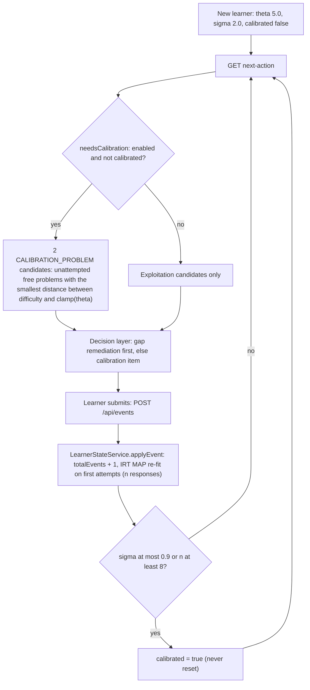

# Adaptive localization (cold start)

While a learner is uncalibrated, recommend the unattempted problems whose estimated
difficulty is closest to the current ability estimate. For the Rasch model the Fisher
information of an item, `p(1 − p)`, is maximal at `b = θ`, so each such response tells the
most about θ. Localization adds **no estimator of its own**: θ and its uncertainty come
from the IRT MAP fit ([irt.md](irt.md)); localization only decides *which item to ask next*
and *when to stop asking*.
Java: `localization/AdaptiveLocalizationService.java`, used by `CandidateGenerationService`,
`LearnerStateService` and `DeterministicDecisionLayer`.

> **This is not a complete knowledge-tracing model.** It estimates one global number
> (ability on the 0–10 scale) with an uncertainty. It knows nothing about concepts,
> prerequisites, forgetting or time; concept knowledge comes from concept mastery, DKT and
> gap detection ([knowledge-graph.md](knowledge-graph.md), [dkt.md](dkt.md)).

| setting | default | role |
|---|---|---|
| `adaptive-localization.enabled` | true | off → never uncalibrated, no calibration candidates |
| `adaptive-localization.calibration-uncertainty-threshold` | 0.9 | calibrated once σ ≤ this… |
| `adaptive-localization.calibration-min-events` | 8 | …or once this many first-attempt IRT responses were observed (retries do not count) |
| `irt.ability-prior-mean` / `ability-prior-sd` | 5.0 / 2.0 | cold-start θ and σ |
| `irt.first-attempts-only` | true | only first attempts enter θ (and so σ) |
| `irt.window-size` | 100 | most recent first attempts used for θ |

All keys live under `knowledge-tracer.` in `application.yml`. The thresholds are
experimental development values, not tuned constants (`KnowledgeTracerProperties`).

## Algorithm as implemented



1. **Cold start.** `LearnerStateService.getOrCreateState` creates `θ = 5.0`, `σ = 2.0`,
   `calibrated = false` (the `learner_states.calibrated` column default).
2. **Item selection.** `calibrationTargetDifficulty(state)` returns `IrtModel.clamp(θ)`.
   `CandidateGenerationService` takes all free problems, drops the ones the learner has
   attempted, sorts by `|estimatedDifficulty − target|` and keeps **2**. Each gets
   `expectedValue = 0.5 + IrtModel.information(θ, b)` (at most 0.75) and a pure-IRT
   `predictedSuccess` (information is an IRT quantity, so DKT is not blended in).
3. **Decision.** `DeterministicDecisionLayer`: a prerequisite gap or concept gap is
   remediated first (remediation items are informative responses too); otherwise, while
   uncalibrated, the calibration candidate with the highest expected value (the more
   informative one) is chosen with confidence 0.8.
4. **Update.** Every event triggers `IrtService.estimateAbility`: Newton–Raphson MAP over
   the learner's most recent first attempts with prior N(5, 2²), then
   `AdaptiveLocalizationService.updateCalibrationProgress(state, n)`, where `n` is the
   estimate's `sampleSize` (first-attempt responses in the IRT window).
5. **Stop rule.** `calibrated = true` as soon as `σ ≤ 0.9` **or** `n ≥ 8`,
   whichever comes first. The flag is sticky: once set, `updateCalibrationProgress`
   returns immediately and the learner is never re-localized.

The step-down / step-up behaviour of master plan §11 (5 → 3 → 4 → ≈ 4.1) is not
hard-coded as a binary search. It emerges because the target follows θ: a failure lowers
θ, so the next item is easier; a success raises it. Step sizes come from the MAP fit and
the prior. The plan's "pass slowly" nuance is not part of localization: Rasch ignores
time (slow successes only weigh less in concept mastery, see `ConceptMasteryService`).

## How uncertainty shrinks

```
σ = 1 / √( 1/σ0² + Σ p_i (1 − p_i) )        σ0 = 2  →  prior precision 0.25
```

Each first attempt adds at most 0.25 (when `b = θ`). Reaching `σ ≤ 0.9` needs total
information ≥ 1/0.81 ≈ 1.235, i.e. ≈ 0.985 from responses. Idealised arithmetic, holding
the item offset fixed (not a measurement):

| `|θ − b|` of each item | information per response | first attempts until σ ≤ 0.9 |
|---|---|---|
| 0 | 0.250 | 4 |
| 1 | 0.197 | 6 |
| 2 | 0.105 | 10 → the 8-response rule fires first |

So well-targeted items end calibration after about 4 responses; poorly targeted ones hit
the 8-response cap. σ shrinks as informative evidence accumulates
(`IrtModelTest.uncertaintyDecreasesAsInformativeEvidenceAccumulates`). Because information
is re-evaluated at the new θ after every fit, a single response can in principle leave σ
slightly higher than before; only the current σ is stored, not its history.

## Tests

| test | pins |
|---|---|
| `newLearnerNeedsCalibration` | fresh state (σ 2.0, 0 events) needs calibration |
| `targetDifficultyIsCurrentEstimateClamped` | target 4.1 for θ 4.1; θ −2.0 is clamped to 0.0 |
| `calibratedOnceUncertaintyLowEnough` | σ 0.85 after 3 responses → calibrated |
| `calibratedOnceEnoughResponsesObserved` | 8 responses with σ 1.5 → calibrated |
| `notCalibratedWithSparseEvidence` | σ 1.8 after 2 responses → still uncalibrated |
| `retriesOfOneProblemDoNotEndCalibration` | 8 events but 1 first-attempt response, σ 1.8 → still uncalibrated |
| `disabledLocalizationNeverRequestsCalibration` | `enabled = false` → no calibration phase |
| `failThenPassSequenceStepsDownThenUp` | fail at 5 lowers θ below 5; a pass at the new θ raises it but stays below 5 |

All in `AdaptiveLocalizationServiceTest`. `LearningLoopIT` checks that a new learner's
first recommendation is a `CALIBRATION_PROBLEM`.

## Exploration vs exploitation (master plan §38)

| | purpose | where |
|---|---|---|
| **Exploration** | collect information about the learner | `CALIBRATION_PROBLEM` while uncalibrated |
| | collect information about which action works | LinUCB width `α √(xᵀA⁻¹x)`, `jev.bandit.alpha` 0.5 ([jev.md](jev.md)) |
| **Exploitation** | help the learner now | `PREREQUISITE_REVIEW`, `EASIER_PROBLEM`, `SAME_LEVEL_PROBLEM` (target P = 0.65), `HARDER_PROBLEM`, `RETRY_PROBLEM`, `SPACED_REVIEW`; "highest expected value" |

The switch is **phase-based**, not a percentage: explore until calibrated, except that a
detected concept or prerequisite gap preempts calibration. There is no ε-random
exploration. Every constant involved (0.9, 8, target 0.65, the expected values 0.5 +
information / 0.8 / 0.75 / 1 − |P − 0.65| / 0.55 / 0.5 / 0.4, α 0.5, confidence threshold
0.35) is an experimental parameter.

Who actually explores depends on the decision path:

* Only the deterministic provider has an explicit "uncalibrated → calibration item" rule.
* `FallbackPolicy` (Jev disabled or invalid) takes the highest expected value; a
  calibration item scores ≤ 0.75 while the same-level candidate can reach 1.0, so the
  fallback rarely explores.
* The bandit learns from reward and mostly skips calibration items. In the offline Jev
  simulation (`model/reports/jev-simulation.md`, synthetic data) `CALIBRATION_PROBLEM` was
  chosen 1433 times by the deterministic provider, 4 times by guarded LinUCB and 8 times
  by unguarded LinUCB.

There is **no item-side exploration**: calibration items target the learner, and item
difficulty is recalibrated passively from whatever first attempts arrive (master plan §63,
[limitations.md](limitations.md#selection-and-exposure-bias)).

Offline ablation: `SystemPolicy(use_localization=...)` in `model/kt/policies.py`
(`irt-only` vs `irt+localization`). In `model/reports/evaluation-report.md` (synthetic
data) localization did **not** reduce final ability error: `|final ability estimate - true
ability|` 0.701 ± 0.07 for irt-only vs 0.734 ± 0.08 for irt+localization. The mirror
recomputes "calibrated" every step instead of keeping a sticky flag.

## Limitations

* Global ability only; not a knowledge-tracing model (see above).
* Item difficulties at cold start are catalog priors; errors in `b` transfer directly to θ.
* Sticky calibration: after drift, long breaks or a burst of learning the learner is not
  re-localized; θ keeps updating, but no more calibration items are offered.
* With `irt.enabled=false`, θ stays at 5.0 and σ at 2.0 and there are no IRT responses to
  count, so the 8-response rule falls back to counting all events (retries included), and
  every calibration item targets difficulty 5.
* Two candidates, ties broken by repository order; paid problems are never candidates.
* Rasch assumptions: equal discrimination, no guessing or slip, no time effects.
* Targeting items at θ means each item is answered mostly by learners near its
  difficulty, a source of selection bias for item calibration.

See also [recommendation.md](recommendation.md), [evaluation.md](evaluation.md),
[future-work.md](future-work.md).
