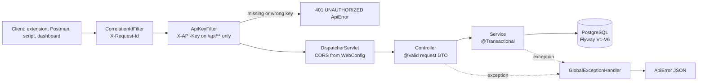
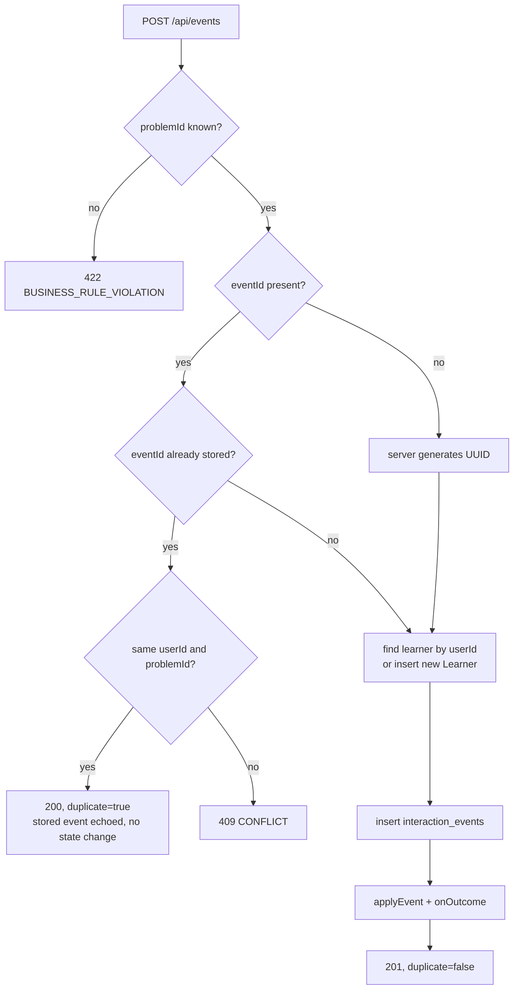

# API flow

Every HTTP endpoint the backend actually serves, with request/response shapes taken from
the DTO records, validation from their Bean Validation annotations and status codes from
`GlobalExceptionHandler` and the exceptions the services throw. Status codes marked ✔ are
asserted by an integration test (`ApiContractIT`, `ApiKeyIT`, `LearningLoopIT`,
`ResearchExportIT`); the others follow from reading the code.

Base URL `http://localhost:8080` (`SERVER_PORT`). JSON everywhere except the two NDJSON
research exports. Timestamps are ISO-8601 strings (`write-dates-as-timestamps: false`).

| non-API path | what | notes |
|---|---|---|
| `/swagger-ui.html` | Swagger UI (springdoc, `OpenApiConfig`: "Knowledge Tracer API" 0.1.0) | disabled together with the OpenAPI document in the `prod` profile (`application-prod.yml`) |
| `/actuator/health`, `/actuator/info`, `/actuator/metrics` | Spring Boot Actuator (`management.endpoints.web.exposure.include: health,info,metrics`) | health details shown only in the `dev` profile; not behind the API key ✔ |
| `/dashboard.html` | static research dashboard (`resources/static`) | calls the learner, problem and concept endpoints below with an optional `X-API-Key` |

A Postman collection covering the learning loop and the error cases is in
`postman/KnowledgeTracer.postman_collection.json`.

## 1. Request pipeline



Filter order: `CorrelationIdFilter` is `HIGHEST_PRECEDENCE`, `ApiKeyFilter` is
`HIGHEST_PRECEDENCE + 10`, so even a 401 carries an `X-Request-Id`. Controllers only map
DTOs; all rules live in services.

## 2. Headers

| header | direction | behaviour (code) |
|---|---|---|
| `X-Request-Id` | request, optional | accepted if it matches `[A-Za-z0-9._-]{1,64}`, otherwise replaced by a random UUID (log-injection guard); put in the logging MDC as `requestId` (`CorrelationIdFilter`) |
| `X-Request-Id` | response, always | the accepted or generated id; exposed to browsers via CORS `exposedHeaders` |
| `X-API-Key` | request | required on every `/api/**` request except `OPTIONS` **only when** `KT_API_KEY` is non-blank; compared in constant time (`MessageDigest.isEqual`). See [security.md](security.md) |
| `Content-Type: application/json` | request | required for POST bodies; any other type → 415 ✔ |

## 3. Error shape

Every error, including the filter's 401, is an `ApiError` record:

```json
{
  "timestamp": "2026-09-30T15:04:05.123Z",
  "status": 400,
  "error": "VALIDATION_ERROR",
  "message": "Invalid request body",
  "path": "/api/events",
  "details": ["attemptNumber: must be greater than or equal to 1", "timestamp: must not be null"]
}
```

`details` is always an array; it is non-empty only for body and query-parameter validation
errors (`"<field>: <constraint message>"`, order not guaranteed).

| trigger | status | `error` | `message` |
|---|---|---|---|
| `MethodArgumentNotValidException` (Bean Validation on `@Valid` body) | 400 | `VALIDATION_ERROR` | `Invalid request body` + `details` ✔ |
| `HttpMessageNotReadableException` (broken JSON, unknown enum value, unparsable UUID/Instant) | 400 | `MALFORMED_REQUEST` | `Request body is malformed or contains invalid values` ✔ |
| `MethodArgumentTypeMismatchException` (e.g. `?limit=abc`) | 400 | `VALIDATION_ERROR` | `Invalid value for parameter 'limit'` |
| `ConstraintViolationException` / `HandlerMethodValidationException` (`@Min(1)` on `limit`, e.g. `?limit=0`) | 400 | `VALIDATION_ERROR` | `Invalid request parameters` + `details` ✔ |
| `MissingServletRequestParameterException` (required query parameter absent) | 400 | `VALIDATION_ERROR` | `Missing required parameter '<name>'` |
| `ApiKeyFilter` | 401 | `UNAUTHORIZED` | `Missing or invalid API key` ✔ |
| `ResourceNotFoundException` | 404 | `NOT_FOUND` | service message, e.g. `Learner not found: ext-…` ✔ |
| `NoResourceFoundException` (no route) | 404 | `NOT_FOUND` | `No endpoint at this path` ✔ |
| `HttpRequestMethodNotSupportedException` | 405 | `METHOD_NOT_ALLOWED` | Spring's message ✔ |
| `HttpMediaTypeNotSupportedException` (POST with a non-JSON `Content-Type`) | 415 | `UNSUPPORTED_MEDIA_TYPE` | Spring's message ✔ |
| `ConflictException` | 409 | `CONFLICT` | service message ✔ |
| `DataIntegrityViolationException` (unique-constraint race) | 409 | `CONFLICT` | `Request conflicts with concurrently written data; retry` |
| `BusinessRuleException` | 422 | `BUSINESS_RULE_VIOLATION` | service message ✔ |
| any other `Exception` | 500 | `INTERNAL_ERROR` | `Unexpected internal error` (stack trace logged, not returned) |

Not mapped explicitly, so by code reading it reaches the catch-all 500 handler (no test
covers it): an optimistic-locking failure when two events for the same learner are ingested
concurrently (`LearnerState` has `@Version`).

## 4. Endpoint summary

| # | method | path | success | transaction | writes |
|---|---|---|---|---|---|
| 5.1 | POST | `/api/events` | 201 / 200 duplicate ✔ | `EventIngestionService.ingest` | events, learner, state, problem, mastery, reward, bandit |
| 5.2 | POST | `/api/learners` | 201 / 200 existing ✔ | `LearnerService.createIfAbsent` | `learners` |
| 5.3 | GET | `/api/learners/{userId}/state` | 200 ✔ | `LearnerService.stateView` (read-write) | `learner_states` on first read |
| 5.4 | GET | `/api/learners/{userId}/next-action` | 200 ✔ | `RecommendationService.nextAction` (read-write) | `recommendations` on **every** call |
| 5.5 | GET | `/api/learners/{userId}/recommendations` | 200 ✔ | read-only | — |
| 5.6 | GET | `/api/learners/{userId}/history` | 200 ✔ | read-only | — |
| 5.7 | POST | `/api/problems` | 201 ✔ | `ProblemService.create` | `problems`, `problem_concepts` |
| 5.8 | GET | `/api/problems` | 200 ✔ | read-only | — |
| 5.9 | GET | `/api/problems/{problemKey}` | 200 ✔ | read-only | — |
| 5.10 | POST | `/api/concepts` | 201 ✔ | `ConceptService.create` | `concepts` |
| 5.11 | GET | `/api/concepts` | 200 | read-only | — |
| 5.12 | GET | `/api/concepts/{code}` | 200 ✔ | read-only | — |
| 5.13 | POST | `/api/concepts/{code}/prerequisites` | 201 ✔ | `ConceptService.addPrerequisite` | `prerequisites` |
| 5.14 | POST | `/api/feedback` | 201 ✔ | `FeedbackService.submit` | `feedback` |
| 5.15 | GET | `/api/models/dkt` | 200 ✔ | none | — |
| 5.16 | GET | `/api/models/jev` | 200 ✔ | `BanditStore.snapshot` read-only | — |
| 5.17 | GET | `/api/research/events` | 200 NDJSON ✔ | `TransactionTemplate` per page | — |
| 5.18 | GET | `/api/research/catalog` | 200 ✔ | `TransactionTemplate` | — |
| 5.19 | GET | `/api/research/decisions` | 200 NDJSON ✔ | `TransactionTemplate` | — |

Identifiers: learners are addressed by their client-chosen **external reference**
(`userId` in events, feedback and paths; `externalRef` in `POST /api/learners`), problems by
`problemKey` (`LC<frontendId>`, returned as `problemId`), concepts by `code`
(`UPPER_SNAKE_CASE`). Internal UUID primary keys are never accepted as input, except
`recommendationId` in feedback.

## 5. Endpoints

### 5.1 `POST /api/events` — ingest one learning event

**Purpose.** The only write path for raw observations (`EventController.ingest` →
`EventIngestionService.ingest`). The extension, Postman and `scripts/replay_synthetic.py`
all use it.

**Request** (`InteractionEventRequest`, event schema v1):

```json
{
  "userId": "ext-3f2c9a4e-6b1d-4c1e-9d7a-0b2f4e6a8c10",
  "problemId": "LC21",
  "eventId": "7b0e5c1a-2d4f-4b8e-9c3a-1f6d2e8a9b10",
  "timestamp": "2026-09-30T15:04:05Z",
  "attemptNumber": 1,
  "result": "WRONG_ANSWER",
  "timeSpentSeconds": 840,
  "hintUsed": false,
  "solutionViewed": false,
  "confidence": 2,
  "perceivedDifficulty": 4,
  "blocker": "LINKED_LIST_CONCEPT",
  "sessionId": "sess-k3j9x2ab"
}
```

**Validation.**

| field | rule |
|---|---|
| `userId` | `@NotBlank`, `@Size(max = 64)` |
| `problemId` | `@NotBlank`, `@Size(max = 32)`; must exist (else 422) |
| `eventId` | UUID, optional; generated server-side when absent (duplicate protection is then lost) |
| `timestamp` | `@NotNull` `Instant`; no future/ordering check |
| `attemptNumber` | primitive `int`, `@Min(1)` (missing → 0 → 400) |
| `result` | `@NotNull` enum `ACCEPTED`, `WRONG_ANSWER`, `TIME_LIMIT_EXCEEDED`, `RUNTIME_ERROR`, `ABANDONED` (unknown value → 400 `MALFORMED_REQUEST`) |
| `timeSpentSeconds` | optional, `@Min(0)` |
| `hintUsed`, `solutionViewed` | primitive `boolean`, missing → `false` |
| `confidence`, `perceivedDifficulty` | optional, `@Min(1) @Max(5)` |
| `blocker` | optional free text, `@Size(max = 100)` |
| `sessionId` | optional, `@Size(max = 64)` |

**Response** (`InteractionEventResponse`) — 201 on first delivery, 200 on replay:

```json
{
  "id": "0c7d2a9e-5f3b-4e61-8a2d-3b9c1e7f4a55",
  "eventId": "7b0e5c1a-2d4f-4b8e-9c3a-1f6d2e8a9b10",
  "userId": "ext-3f2c9a4e-6b1d-4c1e-9d7a-0b2f4e6a8c10",
  "problemId": "LC21",
  "timestamp": "2026-09-30T15:04:05Z",
  "result": "WRONG_ANSWER",
  "duplicate": false
}
```

**Errors.** 400 `VALIDATION_ERROR` ✔ / `MALFORMED_REQUEST` ✔; 401; 405 on `GET /api/events` ✔;
415 for a non-JSON `Content-Type` ✔;
409 `CONFLICT` ✔ when the `eventId` is already stored for a different `userId` or `problemId`, or
when two first deliveries of the same `eventId` race on the unique index; 422
`Unknown problemId 'LC_NOPE': register the problem first` ✔.

**Idempotency.**



* The key is the **globally unique** `interaction_events.event_id` (V2), looked up with
  `findByEventId` regardless of learner. A replay must name the same `userId` and
  `problemId`, otherwise it is rejected with 409; the other fields of the replayed body are
  not compared, so a different result or timestamp under the same `eventId` still returns 200
  with the original event.
* The duplicate check runs **before** learner auto-provisioning, so a replay never creates a
  learner. Clients must generate fresh UUIDs per event (the extension uses
  `crypto.randomUUID()`).
* `LearningLoopIT.duplicateEventDoesNotCorruptLearnerState` replays one event 3× and
  asserts 200, `duplicate=true`, unchanged state and a single history entry.
  `LearningLoopIT.eventIdReusedForAnotherLearnerOrProblemIsAConflict` asserts 409 for a
  different learner or problem and that no learner is created.

**Database effects** (one transaction, rolled back as a whole on error):
`learners` insert (new `userId`); `interaction_events` insert; `learner_states` insert or
update; `problems.estimated_difficulty`, `difficulty_uncertainty`, `sample_size`,
`updated_at` (IRT enabled); `concept_masteries` insert/update per concept tag;
`recommendations.reward`, `rewarded_at`, `reward_event_id` for a pending recommendation of
this problem; `jev_bandit_arms` upsert under a row lock. A duplicate or a 409 writes nothing.

**Model effects.** IRT ability re-estimated, calibration progress updated, item
re-calibrated, Beta concept mastery updated, reward attributed and the LinUCB arm updated.
DKT is not updated here (it replays history at read time). Details in
[data-flow.md](data-flow.md) and [model-flow.md](model-flow.md).

### 5.2 `POST /api/learners` — register a learner

**Purpose.** Idempotent create of a pseudonymous learner (`LearnerService.createIfAbsent`).
Optional: `POST /api/events` auto-provisions learners.

**Request** (`CreateLearnerRequest`): `{"externalRef": "ext-3f2c9a4e-6b1d-4c1e-9d7a-0b2f4e6a8c10"}`

**Validation.** `externalRef`: `@NotBlank`, `@Size(max = 64)`. No format rule; it should not
contain personal data ([privacy.md](privacy.md)).

**Response** (`LearnerResponse`) — 201 new ✔, 200 already registered ✔:

```json
{"externalRef": "ext-3f2c9a4e-6b1d-4c1e-9d7a-0b2f4e6a8c10", "createdAt": "2026-09-30T15:00:00Z", "created": true}
```

**Errors.** 400; 401; 409 on a concurrent create race (`learners.external_ref` unique).

**Database effects.** `learners` insert. No `learner_states` row yet (created lazily).
**Model effects.** None.

### 5.3 `GET /api/learners/{userId}/state` — current estimated state

**Purpose.** Ability, uncertainty, calibration flag and per-concept Beta mastery
(`LearnerService.stateView`). Values are rounded to 2 decimals and are estimates.

**Response** (`LearnerStateResponse`; concept keys are `UPPER_SNAKE_CASE` codes, unlike
`next-action`, which uses camelCase):

```json
{
  "userId": "ext-3f2c9a4e-6b1d-4c1e-9d7a-0b2f4e6a8c10",
  "ability": 4.55,
  "uncertainty": 1.62,
  "calibrated": false,
  "totalEvents": 1,
  "concepts": {
    "LINKED_LIST": {"mastery": 0.33, "uncertainty": 0.24, "evidenceCount": 1},
    "RECURSION": {"mastery": 0.38, "uncertainty": 0.26, "evidenceCount": 1}
  }
}
```

A learner registered without events returns the cold-start prior: ability 5.0,
uncertainty 2.0, `calibrated: false`, empty `concepts` ✔ (`LearningLoopIT`).

**Errors.** 401; 404 `Learner not found` ✔.
**Database effects.** Inserts `learner_states` with the prior if the row does not exist yet
(`LearnerStateService.getOrCreateState`); otherwise read-only.
**Model effects.** None.

### 5.4 `GET /api/learners/{userId}/next-action` — recommend the next action

**Purpose.** Runs the full pipeline (gap → candidates → Jev → policy validation →
fallback) and stores an audit record (`RecommendationService.nextAction`). See
[recommendation.md](recommendation.md), [jev.md](jev.md), [model-flow.md](model-flow.md).

**Request.** Path only.

**Response** (`NextActionResponse`; example for a new learner after one wrong answer on
LC21, numbers illustrative):

```json
{
  "userId": "ext-3f2c9a4e-6b1d-4c1e-9d7a-0b2f4e6a8c10",
  "state": {"ability": 4.55, "uncertainty": 1.62, "calibrated": false, "totalEvents": 1},
  "knowledge": {"linkedList": 0.33, "recursion": 0.38},
  "gap": {
    "type": "INSUFFICIENT_PRACTICE",
    "concept": null,
    "prerequisite": null,
    "evidence": ["Only 1 observations so far; estimates are uncertain"],
    "confidence": 0.4
  },
  "recommendation": {
    "recommendationId": "5a1f0c3e-9b7d-4e2a-8c6f-1d3b5e7a9c02",
    "type": "CALIBRATION_PROBLEM",
    "problemId": "LC64",
    "topic": null,
    "difficulty": 4.52,
    "reason": "Cold-start calibration: item near current estimate 4.55 maximizes information",
    "evidence": ["Cold-start calibration: item near current estimate 4.55 maximizes information"],
    "confidence": 0.8,
    "expectedValue": 0.75,
    "predictedSuccess": 0.51,
    "decidedBy": "JEV",
    "provider": "deterministic",
    "fallbackUsed": false
  },
  "feedback": {"required": false, "questions": []},
  "models": {
    "irt": "ENABLED (Rasch 1PL, MAP)",
    "conceptMastery": "ENABLED (Beta-Bernoulli)",
    "prerequisiteGraph": "ENABLED",
    "adaptiveLocalization": "ENABLED",
    "dkt": "DISABLED",
    "successModel": "IRT",
    "jev": "ENABLED (deterministic)"
  },
  "dktKnowledge": {}
}
```

Field notes (from `RecommendationService.buildResponse`):

* `knowledge` keys are concept codes converted by `toCamelCase` (`LINKED_LIST` → `linkedList`).
* `recommendation.topic` is the candidate's concept code (set for `PREREQUISITE_REVIEW` and
  `EASIER_PROBLEM`). `evidence` is the gap evidence only when the chosen action targets the
  gap concept or prerequisite, otherwise `[reason]`.
* `decidedBy` is `JEV` or `FALLBACK`; on fallback `provider` is `null` and `fallbackUsed` is `true`.
* `feedback.required` is true for every gap type except `NONE`, `UNKNOWN` and
  `INSUFFICIENT_PRACTICE`; the questions are fixed strings per gap type.
* `problemId`, `difficulty`, `predictedSuccess` are `null` for the last-resort
  `FEEDBACK_REQUEST` fallback (empty problem pool).
* `dktKnowledge` is empty unless DKT is enabled, loaded and the learner has ≥ 3 events.

**Errors.** 401; 404 `Learner not found` ✔ (a learner must exist: send an event or
`POST /api/learners` first). 422 `No recommendation could be produced (empty problem pool?)`
is defensive: by code reading `FallbackPolicy` always returns a candidate, so it should not
occur. Decision-layer exceptions (unknown provider, HTTP timeout) are caught and lead to the
fallback, not to an error.

**Database effects.** Not a pure read: inserts `learner_states` if missing and **one
`recommendations` row per call** (action, problem, concept, difficulty, reason, confidence,
expected value, `decided_by`, `fallback_used`, `provider`, `ability_at_decision`,
`predicted_success`, `context_json`, `candidates_json`). Opening the extension popup or
refreshing the dashboard therefore adds audit rows.
**Model effects.** None persisted; reads IRT/mastery state, the DKT snapshot (if enabled)
and bandit statistics. The stored row later receives the reward (5.1).

### 5.5 `GET /api/learners/{userId}/recommendations?limit=20` — audit trail

**Purpose.** Past recommendations, newest first (`RecommendationService.history`).
**Request.** `limit` integer, default 20, `@Min(1)`, capped at 200.
**Response** (list of `NextActionResponse.HistoryEntry`):

```json
[{
  "recommendationId": "5a1f0c3e-9b7d-4e2a-8c6f-1d3b5e7a9c02",
  "createdAt": "2026-09-30T15:05:00Z",
  "type": "CALIBRATION_PROBLEM",
  "problemId": "LC64",
  "topic": null,
  "difficulty": 4.52,
  "reason": "Cold-start calibration: item near current estimate 4.55 maximizes information",
  "confidence": 0.8,
  "decidedBy": "JEV",
  "provider": "deterministic",
  "fallbackUsed": false,
  "reward": 0.62
}]
```

`reward` is `null` until an outcome on that problem is attributed.
**Errors.** 400 non-integer or non-positive `limit` ✔; 401; 404 ✔. **Database / model effects.** None.

### 5.6 `GET /api/learners/{userId}/history?limit=50` — raw observations

**Purpose.** Stored events, newest first (`LearnerService.history`); observations only, no estimates.
**Request.** `limit` integer, default 50, `@Min(1)`, capped at 200.
**Response** (list of `LearnerHistoryEntry`):

```json
[{
  "eventId": "7b0e5c1a-2d4f-4b8e-9c3a-1f6d2e8a9b10",
  "problemId": "LC21",
  "timestamp": "2026-09-30T15:04:05Z",
  "attemptNumber": 1,
  "result": "WRONG_ANSWER",
  "timeSpentSeconds": 840,
  "hintUsed": false,
  "solutionViewed": false,
  "confidence": 2,
  "perceivedDifficulty": 4,
  "blocker": "LINKED_LIST_CONCEPT"
}]
```

**Errors.** 400 non-integer or non-positive `limit` ✔; 401; 404 ✔. **Database / model effects.** None.

### 5.7 `POST /api/problems` — register a problem

**Purpose.** Add a catalog problem with weighted concept tags (`ProblemService.create`).
The extension calls it when an event is rejected with 422 (unknown problem). The 1000-problem
LeetCode catalog is loaded by Flyway (V3, V5), not through this endpoint.

**Request** (`CreateProblemRequest`):

```json
{
  "problemKey": "LC9999",
  "title": "Example problem outside the seeded catalog",
  "url": "https://leetcode.com/problems/example-problem/",
  "staticDifficulty": "MEDIUM",
  "concepts": [
    {"conceptCode": "LINKED_LIST", "weight": 1.0},
    {"conceptCode": "TWO_POINTERS", "weight": 1.0}
  ],
  "acceptanceRate": 0.58,
  "paidOnly": false,
  "topicTags": ["Linked List", "Two Pointers"]
}
```

**Validation.** `problemKey` `@NotBlank @Size(max = 32)`; `title` `@NotBlank @Size(max = 255)`;
`url` `@Size(max = 512)`; `staticDifficulty` `@NotNull` `EASY|MEDIUM|HARD`; `concepts[]`
each `@Valid`: `conceptCode` `@NotBlank`, `weight` optional `[0.0, 1.0]` (default 1.0);
`acceptanceRate` optional `[0.0, 1.0]`; `topicTags` at most 30 entries of ≤ 64 characters.
No pattern is enforced on `problemKey` (the extension only produces `LC<n>`).

**Response** (`ProblemResponse`, also returned by 5.8 and 5.9):

```json
{
  "problemId": "LC9999",
  "title": "Example problem outside the seeded catalog",
  "url": "https://leetcode.com/problems/example-problem/",
  "staticDifficulty": "MEDIUM",
  "estimatedDifficulty": 4.94,
  "difficultyUncertainty": 1.5,
  "sampleSize": 0,
  "source": "LEETCODE",
  "concepts": ["LINKED_LIST", "TWO_POINTERS"],
  "conceptTags": [{"code": "LINKED_LIST", "weight": 1.0}, {"code": "TWO_POINTERS", "weight": 1.0}],
  "priorDifficulty": 4.94,
  "frontendId": null,
  "slug": null,
  "acceptanceRate": 0.58,
  "likes": null,
  "paidOnly": false,
  "topicTags": ["Linked List", "Two Pointers"]
}
```

`frontendId`, `slug` and `likes` are only populated for catalog problems loaded by the
migrations. `conceptTags` is ordered by weight (primary first) ✔ (`LC104`: TREES 1.0, RECURSION 0.8).

**Errors.** 400; 401; 404 `Concept not found` ✔ (whole transaction rolls back, no partial
problem); 409 `Problem already exists` ✔.
**Database effects.** `problems` insert (`estimated_difficulty = prior_difficulty = IrtService.prior(...)`,
`difficulty_uncertainty = irt.difficulty-prior-sd`); `problem_concepts` insert per tag.
**Model effects.** Acceptance-adjusted IRT prior computed ([irt.md](irt.md)); the problem
becomes a candidate unless `paidOnly`.

### 5.8 `GET /api/problems` — list the catalog

All problems (≥ 1000 with the V5 catalog ✔), ordered by `frontendId` (nulls last) then
`problemKey`, as `ProblemResponse[]`. No paging. Errors: 401. No side effects.

### 5.9 `GET /api/problems/{problemKey}` — one problem

`ProblemResponse`, including the current calibrated `estimatedDifficulty` next to the
static label and prior ✔. Errors: 401; 404 `Problem not found` ✔. No side effects.

### 5.10 `POST /api/concepts` — create a concept

**Request** (`CreateConceptRequest`):
`{"code": "MONOTONIC_QUEUE", "name": "Monotonic queue", "description": "Deque that keeps a monotone order"}`

**Validation.** `code` `@NotBlank`, `@Pattern("^[A-Z0-9_]+$")` (message `must be UPPER_SNAKE_CASE`),
`@Size(max = 64)`; `name` `@NotBlank @Size(max = 128)`; `description` `@Size(max = 1024)`.

**Response** (`ConceptResponse`, also used by 5.11–5.13), 201 ✔:

```json
{"code": "MONOTONIC_QUEUE", "name": "Monotonic queue", "description": "Deque that keeps a monotone order",
 "directPrerequisites": [], "allPrerequisites": []}
```

**Errors.** 400 ✔ (`lower case`); 401; 409 `Concept already exists` ✔.
**Database effects.** `concepts` insert. **Model effects.** None until problems are tagged with it.

### 5.11 `GET /api/concepts` — list concepts

`ConceptResponse[]` sorted by `code`, each with direct and transitive prerequisites
(`KnowledgeGraphService`, breadth-first, cycle-safe). Errors: 401. No side effects.

### 5.12 `GET /api/concepts/{code}` — one concept

`ConceptResponse`; e.g. `GRAPHS` lists `TREES` directly and `TREES`, `LINKED_LIST`,
`RECURSION` transitively ✔. Errors: 401; 404 `Concept not found`. No side effects.
The graph itself is described in [knowledge-graph.md](knowledge-graph.md).

### 5.13 `POST /api/concepts/{code}/prerequisites` — add a prerequisite edge

**Purpose.** Declare "`{code}` requires `prerequisiteCode`" (`ConceptService.addPrerequisite`).
**Request** (`AddPrerequisiteRequest`): `{"prerequisiteCode": "TREES"}` — `@NotBlank`.
**Response.** 201 ✔ with the `ConceptResponse` of `{code}` (updated prerequisite lists).

**Errors** (checked in this order):

| check | status |
|---|---|
| `code == prerequisiteCode` | 422 `A concept cannot be its own prerequisite` ✔ (before any existence check) |
| `{code}` unknown / `prerequisiteCode` unknown | 404 `Concept not found` |
| edge would close a cycle | 422 `Adding A -> B would create a cycle` ✔ |
| edge already exists | 409 `Prerequisite edge already exists` ✔ |

**Database effects.** `prerequisites` insert. **Model effects.** From the next
`next-action`, `KnowledgeGapService` may report `PREREQUISITE_GAP` through the new edge
(if `prerequisite-graph.enabled`).

### 5.14 `POST /api/feedback` — learner self-report

**Purpose.** Store answers to the questions returned in `next-action.feedback`
(`FeedbackService.submit`). The extension does not call this endpoint; use Postman or a script.

**Request** (`FeedbackRequest`):

```json
{
  "userId": "ext-3f2c9a4e-6b1d-4c1e-9d7a-0b2f4e6a8c10",
  "problemId": "LC21",
  "recommendationId": "5a1f0c3e-9b7d-4e2a-8c6f-1d3b5e7a9c02",
  "answers": [{"question": "What prevented you from solving the problem?", "answer": "pointer updates"}],
  "freeText": "I keep losing the head node."
}
```

**Validation.** `userId` `@NotBlank @Size(max = 64)`; `problemId` optional `@Size(max = 32)`;
`recommendationId` optional UUID; `answers` `@NotEmpty`, each `question` `@NotBlank @Size(max = 512)`,
`answer` `@NotBlank @Size(max = 1024)`; `freeText` `@Size(max = 2048)`.

**Response** (`FeedbackResponse`), 201 ✔: `{"feedbackId": "9e4c…", "status": "RECORDED"}`

**Errors.** 400 ✔ (empty `answers`); 401; 404 for unknown learner ✔, problem or
recommendation. Unlike events, feedback does **not** auto-provision learners. The service
does not check that `recommendationId` belongs to `userId`.
**Database effects.** `feedback` insert (`answers_json`, `free_text`).
**Model effects.** None: no model reads the `feedback` table today. (The event field
`confidence` does feed mastery and gap detection; see [model-flow.md](model-flow.md).)

### 5.15 `GET /api/models/dkt` — DKT status

`ModelStatusController.dkt`: `enabled`, `available`, `status` (`DISABLED` ✔, `UNAVAILABLE (<reason>)`
or `ENABLED (LSTM kt-dkt-v1, …)`), `modelPath`, `blendWeight`, `minHistory`; when an LSTM is
loaded also `concepts`, `hiddenSize`, `maxSequenceLength`, `trainedOn`, `createdAt`, `testAuc`.

```json
{"enabled": false, "available": false, "status": "DISABLED",
 "modelPath": "../model/artifacts/dkt/dkt-model.json", "blendWeight": 0.5, "minHistory": 3}
```

Errors: 401. No side effects. See [dkt.md](dkt.md).

### 5.16 `GET /api/models/jev` — decision-layer status

`ModelStatusController.jev`: configuration plus per-arm LinUCB statistics for all 8
`ActionType`s ✔ (arms without data show the prior, `updates: 0`, `meanReward: null`).

```json
{
  "enabled": true,
  "provider": "deterministic",
  "providers": ["deterministic", "bandit", "http"],
  "confidenceThreshold": 0.35,
  "bandit": {
    "alpha": 0.5, "lambda": 1.0, "guarded": true,
    "features": ["bias", "predictedSuccess", "information", "relativeDifficulty",
                 "abilityUncertainty", "calibrated", "gapMatch", "expectedValue"],
    "arms": [{"arm": "CALIBRATION_PROBLEM", "updates": 0, "meanReward": null,
              "theta": [0.0, 0.0, 0.0, 0.0, 0.0, 0.0, 0.0, 1.0]}]
  },
  "http": {"url": "http://localhost:8090/decide", "timeoutMs": 2000}
}
```

(`arms` shortened to one entry.) Errors: 401. No side effects. See [jev.md](jev.md).

### 5.17 `GET /api/research/events` — pseudonymised event export

**Purpose.** Stream all events as `kt-events-v1` JSON Lines for DKT training and offline
evaluation ([data.md](data.md)). `Content-Type: application/x-ndjson`,
`Content-Disposition: attachment; filename="events.jsonl"`.

One line per event, grouped by learner, chronological within a learner:

```json
{"schema": "kt-events-v1", "learnerId": "L-9f2c4b1a0e8d7c6b5a4f3e2d1c0b9a88", "seq": 0,
 "eventId": "7b0e5c1a-2d4f-4b8e-9c3a-1f6d2e8a9b10", "problemId": "LC21", "timestamp": "2026-09-30T15:04:05Z",
 "sessionId": "sess-k3j9x2ab", "attemptNumber": 1, "result": "WRONG_ANSWER", "correct": 0,
 "timeSpentSeconds": 840, "hintUsed": false, "solutionViewed": false}
```

`confidence`, `perceivedDifficulty` and `blocker` are not exported.

**Errors** (checked by `ResearchExportService.requireEnabled` before streaming starts):
404 while `KT_RESEARCH_EXPORT` is not `true` ✔; 422 `Set a secret KT_PSEUDONYM_SALT before
exporting research data` while the salt is blank or `change-me`; 401.
**Database effects.** Read only, pages of 2000 events, each page in its own
`TransactionTemplate` transaction. **Model effects.** None.

### 5.18 `GET /api/research/catalog` — catalog export

Same guards as 5.17. JSON document in the `data/seed/catalog_1000.json` schema:
`_note`, `concepts[]` (`code`, `name`, `prerequisites[]`) and `problems[]` (`problemId`,
`title`, `staticDifficulty`, `priorDifficulty`, `estimatedDifficulty`, `acceptanceRate`,
`likes`, `paidOnly`, `concepts[]`, `conceptWeights{}`). ✔ 25 concepts, ≥ 1000 problems.

### 5.19 `GET /api/research/decisions?limit=10000` — rewarded decision log

Same guards as 5.17. NDJSON (`decisions.jsonl`), **only recommendations that already have a
reward**, newest reward first; `limit` `@Min(1)` (non-positive → 400 ✔, checked before the
export guards), capped at 100 000. One `kt-decisions-v1` line:

```json
{"schema": "kt-decisions-v1", "recommendationId": "5a1f0c3e-…", "learnerId": "L-9f2c…",
 "createdAt": "2026-09-30T15:05:00Z", "action": "CALIBRATION_PROBLEM", "problemId": "LC64",
 "provider": "deterministic", "decidedBy": "JEV", "confidence": 0.8, "expectedValue": 0.75,
 "predictedSuccess": 0.51, "abilityAtDecision": 4.55,
 "contextFeatures": ["bias", "predictedSuccess", "information", "relativeDifficulty",
                     "abilityUncertainty", "calibrated", "gapMatch", "expectedValue"],
 "context": [1.0, 0.51, 1.0, -0.01, 0.81, 0.0, 0.0, 0.75],
 "reward": 0.62, "rewardedAt": "2026-09-30T15:30:00Z"}
```

`scripts/export_events.py` downloads 5.17–5.19 into `data/real/`.

## 6. Related

[user-flow.md](user-flow.md) (who calls what), [data-flow.md](data-flow.md) (call chain and
tables per endpoint), [security.md](security.md), [testing.md](testing.md),
[limitations.md](limitations.md).
