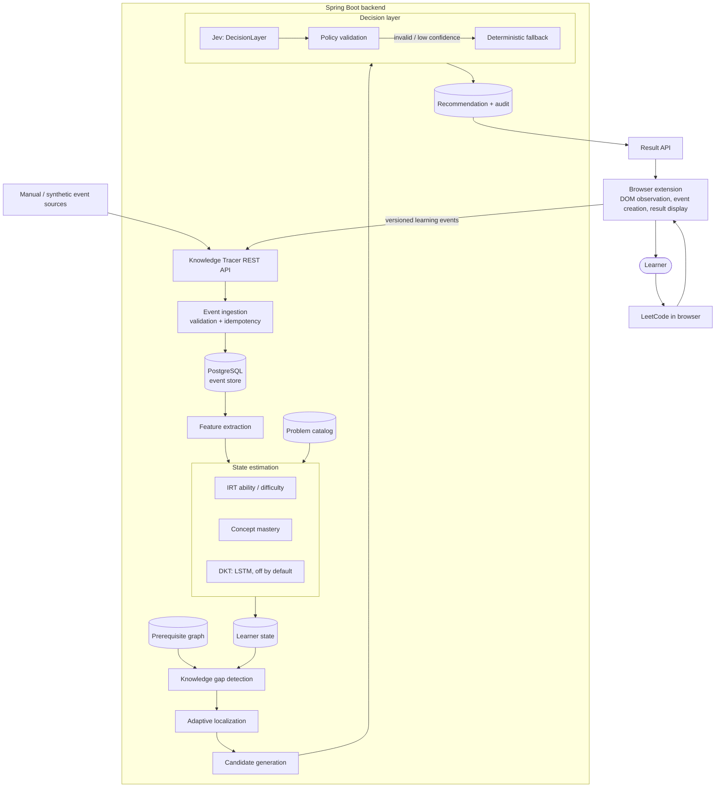
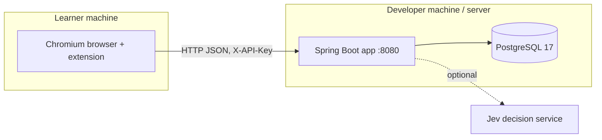
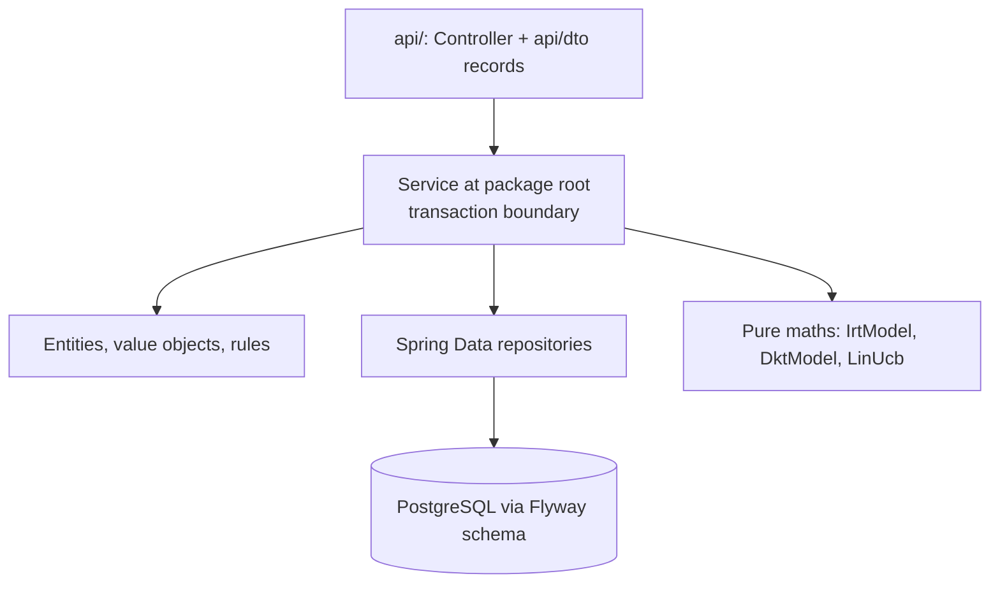
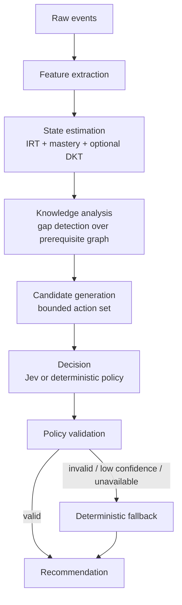

# Architecture

> Status: research prototype. This document describes the target architecture and marks which
> parts are implemented. See [project-status.md](project-status.md) for the live phase status.

## 1. Guiding principle

Knowledge Tracer is an **intelligence layer**, not a CRUD application. Every module is placed on the
evidence chain:

```
OBSERVE → STORE → ESTIMATE → TRACE → LOCALIZE → DETECT GAP → GENERATE OPTIONS → DECIDE → RECOMMEND → OBSERVE AGAIN
```

and every piece of data is classified as one of:

| Class | Meaning | Mutable? | Regenerable? |
|---|---|---|---|
| Raw observation | What a platform/extension observed (submission result, hint opened) | No (append-only) | No — source of truth |
| Self-report | What the learner told us (confidence, blocker) | No (append-only) | No |
| Reference data | Curated catalog: concepts, prerequisites, problem metadata | Yes (curation) | From seed files |
| Derived feature | Computed from observations (e.g. hints used before a submission) | — | Yes |
| Model state | Estimates: ability, mastery, item difficulty, uncertainty | Yes | In principle, by replaying events (no rebuild command yet) |
| Decision | Which candidate was chosen, by whom (Jev / fallback), why | No (audit) | No |

## 2. System architecture



## 3. Deployment view (prototype)



Single deployable. No message broker, cache, or microservices; see [future-work.md](future-work.md).
The app has no TLS configuration and serves plain HTTP on port 8080, which is fine for local use.
Any non-local deployment would need TLS terminated by a reverse proxy in front of it (future work).

## 4. Backend package structure (package-by-feature)

```
com.knowledgetracer
├── common          Pseudonyms; error/ (ApiError, GlobalExceptionHandler), exception/, web/ (ApiKeyFilter, CorrelationIdFilter)
├── config          KnowledgeTracerProperties (feature flags + hyper-parameters), OpenApiConfig, WebConfig
├── learner         Learner identity (pseudonymous externalRef); api/ serves state, next-action, recommendations, history
├── problem         Problem catalog entries and StaticDifficulty labels; api/ to create, list and get problems
├── concept         Concepts, prerequisite edges, Problem↔Concept tags; KnowledgeGraphService traversals
├── event           InteractionEvent ingestion (append-only, idempotent); api/ + api/dto/
├── feedback        Learner feedback on recommendations
├── state           LearnerState + ConceptMastery entities; LearnerStateService orchestrates per-event updates
├── irt             Rasch model: IrtModel (pure maths) + IrtService (ability, item recalibration, priors)
├── mastery         ConceptMasteryService: Beta-Bernoulli concept mastery
├── dkt             DKT inference: DktModel, LstmDktPredictor, UnavailableDktPredictor, DktConfiguration
├── localization    AdaptiveLocalizationService: cold-start calibration
├── gap             KnowledgeGapService, GapReport, GapType: gap detection with evidence
├── recommendation  CandidateGenerationService, SuccessEstimator, RecommendationService, OutcomeRewardService; api/ModelStatusController
├── decision        DecisionLayer, DecisionLayerRouter, DeterministicDecisionLayer, PolicyValidator, FallbackPolicy; bandit/ (LinUCB), http/
└── research        Pseudonymised research exports (ResearchExportController, ResearchExportService)
```

DKT is an LSTM trained offline on synthetic data (`model/dkt/train_dkt.py`), exported to
JSON and run in Java by `LstmDktPredictor`; it is off by default (`KT_DKT_ENABLED`, see
[dkt.md](dkt.md)).

Inside a feature package, entities, Spring Data repositories and services sit side by side
at the package root; the HTTP layer lives in `api/` (controllers) and `api/dto/` (request and
response records), e.g. `concept/api/ConceptController`, `event/api/dto/InteractionEventRequest`.
The pure maths classes `IrtModel`, `DktModel` (Jackson only, to load its JSON) and
`decision/bandit/LinUcb` have **no Spring or JPA dependencies**, so they can be unit tested
deterministically; `model/` holds Python reference ports of the same formulas.

### Layer flow



Rules:

- Controllers only map HTTP ↔ DTO and delegate. No business logic.
- Repositories only query. No business logic.
- Entities are never returned from controllers; services map them to response DTOs (`toResponse` methods, no separate mapper classes).
- The pure maths classes never touch repositories; services pass them plain values.
- Jev is only reachable through the `DecisionLayer` interface in `decision`; `DecisionLayerRouter`
  (the `@Primary` implementation) dispatches to the provider named by `knowledge-tracer.jev.provider`.

### Intelligence flow



## 5. Component toggles (ablation)

IRT, DKT, the prerequisite graph, adaptive localization and Jev are switchable via `knowledge-tracer.*` properties
(`KnowledgeTracerProperties`), so the same pipeline can run as "IRT only", "IRT + graph", and so on. Concept mastery has no toggle.
See [evaluation.md](evaluation.md).

```yaml
knowledge-tracer:
  irt:
    enabled: true
  dkt:
    enabled: ${KT_DKT_ENABLED:false}
  prerequisite-graph:
    enabled: true
  adaptive-localization:
    enabled: true
  jev:
    enabled: true
    provider: ${KT_JEV_PROVIDER:deterministic}   # deterministic | bandit | http
```

## 6. Key architectural decisions

| # | Decision | Rationale |
|---|---|---|
| AD-1 | Modular monolith (Spring Boot) | One developer, one DB; module boundaries enforced by packages, not network hops. |
| AD-2 | Events are append-only and idempotent by a client-generated `eventId` (globally unique `interaction_events.event_id`); a repeat returns the stored event and does not update state again, and its payload is not compared ([domain-model.md](domain-model.md#invariants-and-where-they-are-enforced)) | Duplicate delivery from the extension must not corrupt state; keeping every observation makes model state rebuildable by replay (no rebuild command exists yet; see [future-work.md](future-work.md)). |
| AD-3 | Model state is stored separately from observations | Estimates are regenerable; observations are not. Enables re-running a new model on old evidence. |
| AD-4 | Pure-Java model packages | Deterministic unit tests, reuse in offline evaluation, no framework coupling. |
| AD-5 | Jev is a bounded chooser behind an interface with a deterministic fallback | Jev can never be a single point of failure or produce an action outside the candidate set. |
| AD-6 | Problems are identified publicly by a unique `problem_key` (e.g. `LC21`); `slug` and `frontend_id` are optional metadata, not keys | One short, platform-prefixed key works for the extension, the seed data and the API; `problems.source` leaves room for other platforms. |
| AD-7 | Integration tests use embedded PostgreSQL (zonky), not Testcontainers | Development machine has no Docker daemon; embedded PostgreSQL is still a real PostgreSQL 17 server. Testcontainers can be swapped in later. |
| AD-8 | Flyway owns the schema; Hibernate runs `ddl-auto=validate` | Explicit, reviewable migrations; the app refuses to start on schema drift. |
| AD-9 | Pseudonymous learners (UUID + required, unique, client-chosen opaque `external_ref`) | Data minimization; no names/emails/LeetCode usernames required. See [privacy.md](privacy.md). |

## 7. Cross-cutting concerns

- **Errors:** one JSON error shape produced by `GlobalExceptionHandler`. See [api-flow.md](api-flow.md).
- **Observability:** `X-Request-Id` correlation id placed in the logging MDC; structured log lines for
  event receipt (no payload bodies logged). Actuator exposes `health`, `info` and `metrics` under
  `/actuator/**`.
- **Security:** optional shared API key (`KT_API_KEY`) for `/api/**`, CORS restricted by configuration,
  secrets only via environment variables. `ApiKeyFilter` only checks paths starting with `/api/`, so
  the Actuator endpoints (including `metrics`) are reachable without the key. See [security.md](security.md).
- **Transactions:** declared at application-service methods only, where atomicity is required.
  See [domain-model.md](domain-model.md#transactions).
