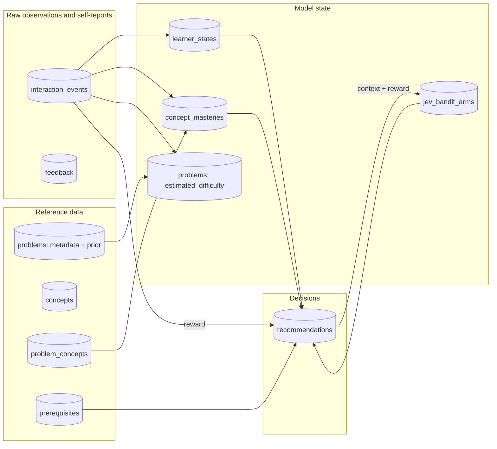
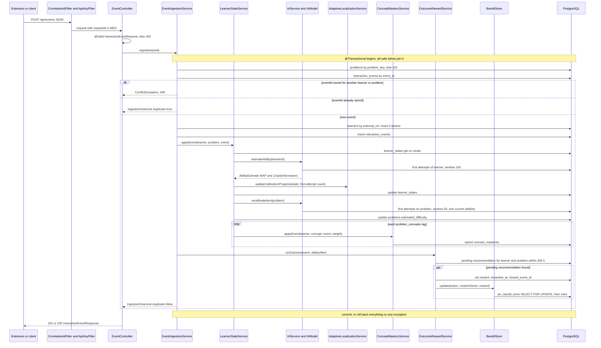
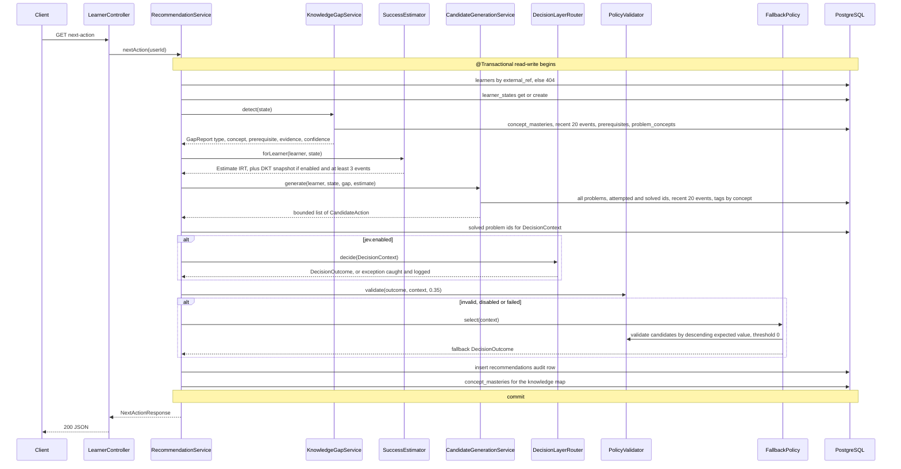

# Data flow

How one observation travels from the LeetCode DOM to a stored recommendation, with the
actual classes, methods, transaction boundaries and tables. Tables come from the Flyway
migrations `V1`–`V6`; the data classes are those of [architecture.md](architecture.md#1-guiding-principle).

```
DOM → content.js → background.js queue → POST /api/events → validation → persistence
    → state update (IRT ability, calibration, item difficulty, concept mastery) → reward
GET next-action → gap detection → success estimate → candidates → decision
    → policy validation → (fallback) → audit row → response
```

The two halves are separate requests: ingestion never produces a recommendation, and
`next-action` never changes model state.

## 1. Tables and data classes

| table (migration) | class | written by | mutable? |
|---|---|---|---|
| `interaction_events` (V2) | raw observation; `confidence`, `perceived_difficulty`, `blocker` are self-reports carried on the event | `EventIngestionService.ingest` | no, insert only |
| `feedback` (V2) | self-report | `FeedbackService.submit` | no, insert only |
| `learners` (V1) | pseudonymous identity (`external_ref`) | `EventIngestionService.ingest`, `LearnerService.createIfAbsent` | no |
| `problems` (V1, V4) | reference data (`title`, `static_difficulty`, `prior_difficulty`, `acceptance_rate`, `paid_only`, …) **and** model state (`estimated_difficulty`, `difficulty_uncertainty`, `sample_size`) in one row | Flyway V3/V5, `ProblemService.create`, `IrtService.recalibrateItem` | model-state columns only |
| `concepts`, `problem_concepts`, `prerequisites` (V1, V3–V5) | reference data | Flyway, `ConceptService`, `ProblemService` | curation only |
| `learner_states` (V2) | model state (ability, uncertainty, calibrated, total_events; optimistic `version`) | `LearnerStateService` | yes |
| `concept_masteries` (V2) | model state (Beta α, β, mastery, evidence_count) | `ConceptMasteryService.applyEvent` | yes |
| `recommendations` (V2, V6) | decision (candidate set, chosen action, provider, confidence, context vector) + outcome attribution (`reward`, `rewarded_at`, `reward_event_id`) | `RecommendationService.persistAudit`, `OutcomeRewardService.onOutcome` | decision columns no; reward columns set once, later |
| `jev_bandit_arms` (V6) | model state of the decision layer (LinUCB `A`, `b`, pulls, reward sum) | `BanditStore.update` | yes, under row lock |

Derived features are **not stored**; they are recomputed per request from events:
first-attempt windows (IRT), recent-20 windows (gap detection, streaks), evidence credit
weights (mastery), attempted/solved sets, the DKT input sequence. The one exception is the
bandit context vector (`BanditFeatures.of`), frozen into `recommendations.context_json` so
the later reward updates the arm with the context that was actually decided on.

Model state is regenerable from `interaction_events` in principle; no replay/rebuild job
exists in the code yet ([future-work.md](future-work.md)).



`feedback` has no outgoing arrow on purpose: nothing reads it yet.

## 2. From the DOM to the request

`content.js` reads the verdict node, the title (`LC<n>`), difficulty and topic tags; the
service worker builds the event (`KTExtract.buildEvent`), persists it in the
`chrome.storage` queue and POSTs it (`KTQueue.EventQueue.flush` → `KTApi.ApiClient.postEvent`).
An unknown problem (422) is registered with `POST /api/problems` and the event is re-sent.
Full client-side flow: [user-flow.md](user-flow.md#4-submit--event--state-update).

## 3. Ingestion: `POST /api/events`



Step by step (all inside the single `@Transactional` of `EventIngestionService.ingest`):

| # | step | class.method | tables | data class |
|---|---|---|---|---|
| 1 | Bean Validation of the body | `EventController.ingest` (`@Valid`) | — | — |
| 2 | resolve problem, else `BusinessRuleException` → 422 | `ProblemRepository.findByProblemKey` | read `problems` | reference |
| 3 | idempotency: stored `eventId` → return it and stop, or `ConflictException` → 409 if it belongs to another learner or problem | `InteractionEventRepository.findByEventId` | read `interaction_events` | raw |
| 4 | resolve or auto-provision learner | `LearnerRepository.findByExternalRef` / `save` | `learners` | identity |
| 5 | persist event (`schema_version` 1) | `InteractionEventRepository.save` | insert `interaction_events` | raw |
| 6 | cold-start state if missing (N(5, 2²)) | `LearnerStateService.getOrCreateState` | `learner_states` | model state |
| 7 | re-estimate ability (if `irt.enabled`) | `IrtService.estimateAbility` → `IrtModel.estimateAbility` | read `interaction_events`, `problems` | model state |
| 8 | `total_events + 1`, calibration flag | `LearnerStateService.applyEvent`, `AdaptiveLocalizationService.updateCalibrationProgress` | update `learner_states` | model state |
| 9 | re-calibrate this item (if `irt.enabled`) | `IrtService.recalibrateItem` → `IrtModel.estimateDifficulty` | read `interaction_events`, `learner_states`; update `problems` | model state |
| 10 | Beta mastery per concept tag | `ConceptMasteryService.applyEvent` | read `problem_concepts`; upsert `concept_masteries` | model state |
| 11 | attribute outcome to latest un-rewarded recommendation of this problem | `OutcomeRewardService.onOutcome` | update `recommendations` | decision (outcome) |
| 12 | LinUCB arm update | `BanditStore.update` (`Propagation.REQUIRED`, pessimistic write lock) | upsert `jev_bandit_arms` | model state |

Notes from the code:

* `LearnerStateService.applyEvent` and `BanditStore.update` declare `Propagation.REQUIRED`
  and `OutcomeRewardService.onOutcome` is `@Transactional`; `IrtService`,
  `ConceptMasteryService` and `AdaptiveLocalizationService` have no annotation. All of them
  run in the ingestion transaction, so an event, its state transition and its reward are
  atomic.
* Order matters: ability (step 7) is estimated with item difficulties **before** this
  item's re-calibration (step 9); the re-calibration then uses the new ability. Item
  calibration uses each responder's *current* ability, a documented approximation
  (`IrtService.recalibrateItem` Javadoc).
* The reward attribution window is computed from the event's client `timestamp`
  (`occurredAt − 336 h`) and compared with the recommendation's server `created_at`.
* DKT state is not persisted; `LstmDktPredictor` replays the last 200 events at read time.
* A duplicate returns before any write, and a reused `eventId` for another learner or
  problem is rejected with 409 before any write. See [api-flow.md](api-flow.md#51-post-apievents--ingest-one-learning-event).

## 4. Recommendation: `GET /api/learners/{userId}/next-action`



| # | step | class.method | tables | output class |
|---|---|---|---|---|
| 1 | learner lookup, else 404 | `LearnerService.getByExternalRef` | read `learners` | — |
| 2 | state (cold-start insert if missing) | `LearnerStateService.getOrCreateState` | `learner_states` | model state |
| 3 | gap detection (rules in [recommendation.md](recommendation.md)) | `KnowledgeGapService.detect`, `KnowledgeGraphService.weakestPrerequisite` | read `concept_masteries`, `interaction_events`, `prerequisites`, `problem_concepts` | derived (`GapReport`, not stored except inside the response) |
| 4 | success model | `SuccessEstimator.forLearner`; `DktPredictor.snapshot` | read `interaction_events`, `problems`, `problem_concepts` (DKT only) | derived |
| 5 | candidate set | `CandidateGenerationService.generate`, `AdaptiveLocalizationService.needsCalibration` / `calibrationTargetDifficulty` | read `problems`, `interaction_events`, `problem_concepts` | derived |
| 6 | decision (if `jev.enabled`) | `DecisionLayerRouter.decide` → `DeterministicDecisionLayer` / `BanditDecisionLayer` (+ `BanditStore.snapshot`) / `HttpDecisionLayer` | read `jev_bandit_arms` (bandit) | decision |
| 7 | policy validation | `PolicyValidator.validate` | read `problems` | decision |
| 8 | fallback when invalid | `FallbackPolicy.select` | read `problems` | decision |
| 9 | audit | `RecommendationService.persistAudit`, `BanditFeatures.of` | insert `recommendations` | decision |
| 10 | response | `RecommendationService.buildResponse` | read `concept_masteries` | — |

Notes:

* The whole request is one read-write transaction, so the `http` provider's outbound call
  (`HttpDecisionLayer`, connect/read timeout 2000 ms each) happens while the transaction is
  open.
* `candidates_json` stores the full candidate list; `context_json` the 8-feature vector of the
  chosen candidate (only when it references a problem); `provider` is `null` when the
  fallback decided.
* Calling `next-action` twice creates two audit rows; the reward goes to the most recent
  un-rewarded one for the problem the learner then attempts (`findPendingReward`).

## 5. Other endpoints

| endpoint | transaction | reads | writes |
|---|---|---|---|
| `POST /api/learners` | `LearnerService.createIfAbsent` | `learners` | `learners` |
| `GET …/state` | `LearnerService.stateView` (read-write) | `learner_states`, `concept_masteries` | `learner_states` if missing |
| `GET …/history` | `LearnerService.history` (read-only) | `interaction_events` | — |
| `GET …/recommendations` | `RecommendationService.history` (read-only) | `recommendations` | — |
| `POST /api/problems` | `ProblemService.create` | `concepts` | `problems`, `problem_concepts` |
| `POST /api/concepts`, `…/prerequisites` | `ConceptService.create`, `addPrerequisite` | `concepts`, `prerequisites` | `concepts` / `prerequisites` |
| `POST /api/feedback` | `FeedbackService.submit` | `learners`, `problems`, `recommendations` | `feedback` |
| `GET /api/research/*` | `TransactionTemplate` in `ResearchExportService` (per 2000-event page for events) | all event, catalog and rewarded recommendation tables | — |

## 6. What leaves the backend

| sink | data | pseudonymised? |
|---|---|---|
| HTTP responses | the caller's own state, raw history (incl. `blocker`), recommendations | no: addressed by `externalRef` |
| research exports | events (no `confidence`, `perceivedDifficulty`, `blocker`), catalog, rewarded decisions | yes, `Pseudonyms.of(externalRef, KT_PSEUDONYM_SALT)` |
| `http` Jev provider | pseudonym, ability, uncertainty, calibrated, gap summary, candidate list | yes |
| logs | event id, learner ref, problem key, result, state numbers; no request bodies | no |

See [privacy.md](privacy.md) and [security.md](security.md).
