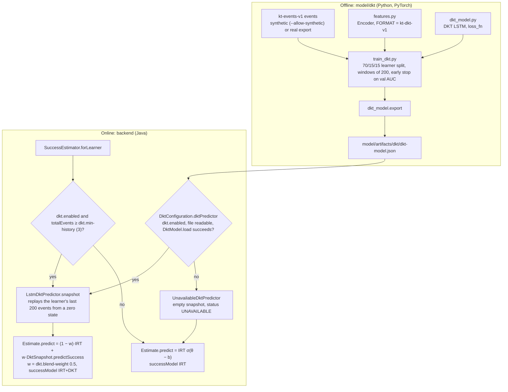

# Deep Knowledge Tracing (DKT)

Status: **implemented end to end** (training, export, Java inference, evaluation). The
shipped model is trained on **synthetic** data, so it is **disabled by default**
(`KT_DKT_ENABLED=false`). Retrain on real exports before relying on it.

Training is offline in Python; the backend only loads the exported JSON and runs inference:



## Model contract `kt-dkt-v1`

The specification lives in `model/dkt/features.py`; PyTorch (`model/dkt/dkt_model.py`),
Java (`backend/.../dkt/DktModel.java`), NumPy (`model/evaluation/evaluate_kt.py`) and the
Colab notebook all implement it. Parity is tested: Java vs. Python to 1e-9
(`DktModelTest` with `backend/src/test/resources/dkt/fixture-*.json`), PyTorch vs. the
stdlib reference to 1e-10 (`model/tests/test_dkt_reference.py`).

Input for attempt t on problem q with outcome y (K = 25 concepts):

```
x_t = [ w_q * y , w_q * (1 - y) , d_q , a_t ]          size 2K + 2
w_q   catalog concept weights of q (strongest = 1.0, except LC53: 0.8 / 0.8)
d_q   (priorDifficulty(q) - 5) / 2
a_t   1 if a hint was used or the solution was viewed
```

One LSTM layer (hidden 64, PyTorch gate order i, f, g, o, zero initial state), concept
head `y = W_out h + b_out`. Prediction for the next attempt on problem q:

```
logit = (Σ_k w_qk y_k) / (Σ_k w_qk) - γ d_q - δ_q + ρ r_q + bias
r_q = 1 if the learner attempted q before, δ_q = learned item offset (0 for unseen problems)
```

Concept mastery readout: `σ(y_k + bias)` (first attempt at average difficulty).
`conceptBaseline` (mean training logit per concept) is exported so consumers can report
*relative* weakness, because raw readouts are confounded by how hard a concept's problems are.

## Training (`model/dkt/train_dkt.py`)

* Data: `kt-events-v1` (see [data.md](data.md)), synthetic or real export.
* Split: 70/15/15 by salted learner hash (no learner in two splits).
* Windows of 200 attempts, batch 64, Adam 1e-3, weight decay 1e-5, dropout 0.2.
* Loss: BCE on the next attempt + DKT+ terms: reconstruction λr = 0.1, waviness
  λw1 = 0.003 (L1) and λw2 = 3.0 (L2), item-offset shrinkage λitem = 0.05.
* Early stopping on validation AUC (patience 5). Refuses to train on < 1000 learners or
  < 50 000 attempts, and on synthetic data without `--allow-synthetic`.
* Outputs `model/artifacts/dkt/{dkt-model.json, dkt-model.pt, history.json, metrics.json}`.

```bash
python3 -m pip install --target model/pylib -r model/requirements-dkt.txt
PYTHONPATH=model/pylib python3 model/dkt/train_dkt.py --allow-synthetic     # ~40 s on a laptop CPU
PYTHONPATH=model/pylib python3 model/evaluation/evaluate_kt.py
```

Or open `notebooks/DKT_train_and_visualize.ipynb` in Google Colab (self-contained).

## Results on the synthetic benchmark (held-out learners, 15 534 attempts)

| model | AUC | log loss | ECE |
|---|---|---|---|
| simulator truth (ceiling) | 0.779 | 0.496 | 0.010 |
| IRT, catalog priors | 0.723 | 0.577 | 0.084 |
| IRT, calibrated | 0.718 | 0.562 | 0.062 |
| **DKT** | **0.731** | **0.536** | **0.016** |

Concept-mastery recovery (Spearman with true mastery): Beta-Bernoulli 0.45, DKT 0.66.
Identifying the *single weakest* concept stays hard for every estimator (hit rates 0.08–0.17
vs. 0.85 for the truth): per-concept evidence is sparse. Full report:
`model/reports/kt-evaluation.md`.

## Backend integration

* `DktConfiguration` loads the JSON at startup; missing or invalid file → `UnavailableDktPredictor`
  (status reported, never a crash).
* `LstmDktPredictor` replays the learner's last 200 events per request.
* `SuccessEstimator`: candidate success = `(1 - blendWeight)·IRT + blendWeight·DKT`
  (default 0.5) once the learner has ≥ `minHistory` (3) events; pure IRT before.
* `next-action` returns `dktKnowledge` (per-concept DKT mastery) and `models.successModel`
  (`IRT` or `IRT+DKT`); `GET /api/models/dkt` shows the loaded model. `IRT+DKT` means a DKT
  snapshot exists for the learner; a problem whose concepts DKT does not cover still gets the
  pure IRT estimate.

```bash
KT_DKT_ENABLED=true KT_DKT_MODEL_PATH=../model/artifacts/dkt/dkt-model.json ./mvnw spring-boot:run
```

## Limits

Trained on simulator data, DKT learns the simulator. Item offsets exist only for problems
seen in training. The model has no notion of time between attempts (forgetting is only
implicit). See [limitations.md](limitations.md).
