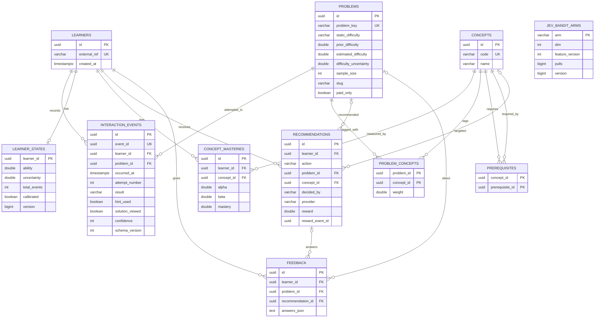

# Domain model

The entities that exist, the ones from master plan §9 that were merged or never created, and
the transaction boundaries. Sources of truth, in this order: the Flyway migrations
(`V1__core_domain.sql`, `V2__events_and_state.sql`, `V4__catalog_metadata_and_concepts.sql`,
`V6__jev_bandit_and_rewards.sql`; V3 and V5 only insert seed data), the JPA entities, Bean
Validation on the `api/dto/*Request` records, and the `@Transactional` methods. Hibernate runs
with `ddl-auto: validate`, so entities and migrations cannot drift apart without the app
failing at startup.

Every column is classified as raw observation, self-report, reference data, model state or
decision (see [architecture.md](architecture.md#1-guiding-principle)). The classification is
per column, not per table: `interaction_events` holds both raw observations and self-reports.

## Entity decisions (master plan §9)

| §9 candidate | Decision | Where the concept lives now |
|---|---|---|
| User | `Learner` → `learners` | `user` is reserved in PostgreSQL. Pseudonymous: surrogate UUID plus a required, unique `external_ref` (opaque client id, no personal data). |
| Problem | `Problem` → `problems` | Reference metadata **and** the IRT item calibration (`estimated_difficulty`, `difficulty_uncertainty`, `sample_size`); see ItemCalibration. |
| Concept | `Concept` → `concepts` | Surrogate UUID `id`; `code` (e.g. `LINKED_LIST`) is unique and is what the API and explanations use. |
| ProblemConcept | `ProblemConcept` → `problem_concepts` | Join entity with one attribute, `weight`, so a plain `@ManyToMany` would not do. Composite key via `@IdClass(ProblemConceptId)`. |
| Prerequisite | `Prerequisite` → `prerequisites` | Directed edge "`concept` requires `prerequisite`". No attributes beyond the two keys (`@IdClass(PrerequisiteId)`). |
| InteractionEvent | `InteractionEvent` → `interaction_events` | One row per reported attempt, shaped like the §8 example event (plus `eventId`, `sessionId`). There is no event type: every row is an attempt outcome. |
| Attempt | **Not created** | An attempt *is* an `interaction_events` row. `attempt_number` is client-reported and not cross-checked. "First attempt on a problem" is derived at query time (`InteractionEventRepository.findFirstAttemptsByLearner` / `findFirstAttemptsByProblem`), not stored. |
| Feedback | `Feedback` → `feedback` | Free-form question/answer pairs (`answers_json`), optionally linked to a problem and a recommendation. The numeric self-reports (`confidence`, `perceived_difficulty`, `blocker`) are **not** here: they are columns on `interaction_events`. |
| LearnerState | `LearnerState` → `learner_states` | One row per learner holding the *current* estimate only: no snapshots, no history, no model version. |
| ConceptMastery | `ConceptMastery` → `concept_masteries` | One row per (learner, concept), Beta-Bernoulli `alpha`/`beta`. |
| ItemCalibration | **Not created; merged into `problems`** | `estimated_difficulty`, `difficulty_uncertainty`, `sample_size`, recalibrated towards `prior_difficulty`. One value per problem, overwritten in place, not model-versioned. |
| Recommendation + Decision | **Merged into `recommendations`** | They are 1:1 and created together, so one audit row per decision. Columns are grouped below into *decision*, *issued recommendation* and *observed outcome*. |
| CalibrationSession | **Not created** | Cold-start progress is `learner_states.calibrated` plus the ability `uncertainty`; `AdaptiveLocalizationService` computes the next calibration target from the current state on each request. Per-step history exists only as `recommendations` rows with action `CALIBRATION_PROBLEM`. See [adaptive-localization.md](adaptive-localization.md). |
| *(not in §9)* | `BanditArm` → `jev_bandit_arms` (V6) | LinUCB sufficient statistics per action type for the `bandit` Jev provider. See [jev.md](jev.md). |

`GapType` (from `KnowledgeGapService`) and candidate sets are computed per request and not
stored as entities; the candidate set is kept inside `recommendations.candidates_json`.

## Schema

The diagram shows key and characteristic columns only; the full column lists are below.
Composite primary keys (`problem_concepts`, `prerequisites`) are also foreign keys, and
`learner_states.learner_id` is both primary key and foreign key (`@MapsId`).
`recommendations.reward_event_id` stores the rewarding event's `event_id` but has **no**
foreign key, so it is not drawn. `jev_bandit_arms` has no foreign keys; `arm` holds an
`ActionType` name.

## Tables and fields

### `learners` — identity

| Column | Class | Null | Constraint / notes |
|---|---|---|---|
| `id` | identity | no | UUID PK, generated by Hibernate. |
| `external_ref` | identity | no | `varchar(64)`, unique. Request field `externalRef` (`POST /api/learners`) or `userId` (events, feedback), `@NotBlank @Size(max = 64)`. |
| `created_at` | server clock | no | |

Learners are created by `LearnerService.createIfAbsent` or auto-provisioned by
`EventIngestionService.ingest` on the first event. `FeedbackService.submit` does **not**
auto-provision: the learner must already exist.

### `problems` — reference data plus item calibration

| Column | Class | Null | Constraint / notes |
|---|---|---|---|
| `id` | identity | no | UUID PK. |
| `problem_key` | reference | no | `varchar(32)`, unique, e.g. `LC21`. The public identifier used by every API (`problemId` in events). |
| `title` | reference | no | `varchar(255)`. |
| `url` | reference | yes | `varchar(512)`. |
| `static_difficulty` | reference | no | `StaticDifficulty`: `EASY`, `MEDIUM`, `HARD` (stored as string, no DB check). Used only as a prior. |
| `source` | reference | no | `varchar(32)`, default `LEETCODE`. Not settable through the API. |
| `frontend_id` | reference | yes | V4. Set by the V5 catalog migration; not settable through the API. |
| `slug` | reference | yes | V4, `varchar(160)`. **Not unique and not a key**; set by V5 only. |
| `acceptance_rate` | reference | yes | V4, check `0 ≤ x ≤ 1`; API `@DecimalMin("0.0") @DecimalMax("1.0")`. |
| `likes` | reference | yes | V4; set by V5 only. |
| `paid_only` | reference | no | V4, default `false`. Premium problems are never recommended. |
| `topic_tags` | reference | yes | V4, `varchar(1024)`, comma-separated platform tags as observed. API: at most 30 tags of ≤ 64 chars. |
| `prior_difficulty` | reference (computed once) | no | V4. IRT prior from the label and acceptance rate (`IrtService.prior`, [irt.md](irt.md)); fixed after creation. |
| `estimated_difficulty` | model state | no | Rasch item difficulty on 0–10 (no DB range check). Starts at `prior_difficulty`. |
| `difficulty_uncertainty` | model state | no | Starts at `difficulty-prior-sd` (1.5). |
| `sample_size` | model state | no | Responses behind the current estimate, default 0. |
| `created_at`, `updated_at` | server clock | no | `updated_at` is touched on every recalibration. |

Indexes: `(paid_only, estimated_difficulty)`. `CreateProblemRequest` sets `problemKey`,
`title`, `url`, `staticDifficulty`, `acceptanceRate`, `paidOnly`, `topicTags` and the concept
tags; everything else comes from defaults or migrations.

### `concepts`, `problem_concepts`, `prerequisites` — the knowledge graph

| Table | Columns | Constraint / notes |
|---|---|---|
| `concepts` | `id` (PK), `code`, `name`, `description` | `code` unique, `varchar(64)`; API `@Pattern("^[A-Z0-9_]+$")`. `name` ≤ 128, `description` ≤ 1024. No category column. |
| `problem_concepts` | `problem_id`, `concept_id` (composite PK), `weight` | Both FKs `on delete cascade`. `weight` defaults to 1.0; **no DB check**, the API accepts `[0, 1]` (0 included) and defaults to 1.0. Index on `concept_id`. |
| `prerequisites` | `concept_id`, `prerequisite_id` (composite PK) | Row means "`concept_id` requires `prerequisite_id`". `check (concept_id <> prerequisite_id)`; both FKs `on delete cascade`. |

Seeding (V3, V4, V5) and the graph itself are described in
[knowledge-graph.md](knowledge-graph.md).

### `interaction_events` — raw observations and self-reports

Request record: `InteractionEventRequest` (event schema v1, master plan §8).

| Column | Request field | Class | Null | Constraint / notes |
|---|---|---|---|---|
| `id` | — | identity | no | UUID PK, server-generated. |
| `event_id` | `eventId` | raw (client key) | no | **Globally unique** (not per learner). Optional in the request: if absent the server generates a random UUID and duplicate protection is lost for that event. |
| `learner_id` | `userId` | raw | no | FK → `learners`; resolved by `external_ref`, auto-provisioned. |
| `problem_id` | `problemId` | raw | no | FK → `problems`; resolved by `problem_key`, must already exist. |
| `occurred_at` | `timestamp` | raw (client clock) | no | `@NotNull`. Stored as sent; there is no clock-skew or future-timestamp check. |
| `attempt_number` | `attemptNumber` | raw (client-reported) | no | `@Min(1)`, DB check `≥ 1`. Not verified against earlier events. |
| `result` | `result` | raw | no | `InteractionResult`: `ACCEPTED`, `WRONG_ANSWER`, `TIME_LIMIT_EXCEEDED`, `RUNTIME_ERROR`, `ABANDONED`. Only `ACCEPTED` counts as correct. |
| `time_spent_seconds` | `timeSpentSeconds` | raw (client-measured) | yes | `@Min(0)`, DB check `≥ 0`. |
| `hint_used` | `hintUsed` | raw | no | Default `false` (absent in JSON = `false`). |
| `solution_viewed` | `solutionViewed` | raw | no | Default `false`. |
| `confidence` | `confidence` | self-report | yes | `@Min(1) @Max(5)`, DB check 1–5. |
| `perceived_difficulty` | `perceivedDifficulty` | self-report | yes | `@Min(1) @Max(5)`, DB check 1–5. |
| `blocker` | `blocker` | self-report | yes | Free text, `@Size(max = 100)`; not an enum. |
| `session_id` | `sessionId` | raw | yes | `@Size(max = 64)`. |
| `schema_version` | — | raw | no | Default 1. Not part of the request; always `InteractionEvent.CURRENT_SCHEMA_VERSION` (1). |
| `created_at` | — | server clock | no | Insertion time; the only server-side timestamp (there is no separate "received at" column). |

Indexes: `(learner_id, occurred_at desc)`, `(problem_id, occurred_at desc)`.

No cross-field rule is enforced (for example `solution_viewed = true` with `ACCEPTED` is
accepted). Hints and solution views are flags on the attempt, not separate events; how they
reduce the evidence weight is in `ConceptMasteryService.creditWeight` and
`OutcomeRewardService.reward`.

### `learner_states` — model state (one row per learner)

| Column | Notes |
|---|---|
| `learner_id` | PK and FK → `learners` (`@MapsId`). |
| `ability`, `uncertainty` | Rasch ability MAP estimate and `1/√information` on the 0–10 scale; prior N(5, 2²). |
| `total_events` | Count of non-duplicate events, retries included. |
| `calibrated` | Set once by `AdaptiveLocalizationService.updateCalibrationProgress`; never reset. |
| `version` | `@Version` optimistic-locking counter. |
| `updated_at` | |

The row is created lazily by `LearnerStateService.getOrCreateState`, which also runs on
`GET /api/learners/{userId}/state` and `/next-action`, so those GETs can insert a row.

### `concept_masteries` — model state (one row per learner and concept)

`id` (PK), `learner_id`, `concept_id`, `alpha`, `beta`, `mastery` (DB check 0–1,
`alpha / (alpha + beta)`), `evidence_count`, `updated_at`; unique `(learner_id, concept_id)`.
The mastery uncertainty is computed by `ConceptMastery.uncertainty()`, not stored.

### `recommendations` — decision audit

| Group | Columns | Notes |
|---|---|---|
| Decision | `decided_by`, `fallback_used`, `provider`, `confidence`, `candidates_json`, `context_json`, `ability_at_decision` | `decided_by` is `JEV` or `FALLBACK` (free `varchar(16)`, no check). `provider` is `deterministic`, `bandit` or `http`, and `null` when the fallback decided. `context_json` (bandit feature vector) is set only when the chosen action has a problem. Policy-validation violations are logged, not stored. |
| Issued recommendation | `action`, `problem_id`, `concept_id`, `difficulty`, `reason`, `expected_value`, `predicted_success` | `action` is an `ActionType`: `CALIBRATION_PROBLEM`, `EASIER_PROBLEM`, `SAME_LEVEL_PROBLEM`, `HARDER_PROBLEM`, `PREREQUISITE_REVIEW`, `RETRY_PROBLEM`, `SPACED_REVIEW`, `FEEDBACK_REQUEST`. `problem_id` and `concept_id` are nullable FKs. |
| Observed outcome | `reward`, `rewarded_at`, `reward_event_id` | V6. `null` until the first matching event arrives inside the attribution window (`OutcomeRewardService`). `reward` has DB check 0–1. `reward_event_id` = the event's `event_id`, no FK. |
| — | `id`, `learner_id`, `created_at` | |

Indexes: `(learner_id, created_at desc)` and the partial index
`(learner_id, problem_id, created_at desc) where reward is null` used to find the pending
recommendation.

### `feedback` — self-report

`id` (PK), `learner_id` (FK, required), `problem_id` (FK, nullable), `recommendation_id` (FK,
nullable), `answers_json` (text, required: JSON array of `{question, answer}`), `free_text`
(≤ 2048), `created_at`. Request (`FeedbackRequest`): `userId` required, `problemId` optional
(must exist if given), `recommendationId` optional (must exist if given), `answers` non-empty
with `question` ≤ 512 and `answer` ≤ 1024, `freeText` ≤ 2048.

Feedback has **no idempotency key**: each successful POST inserts a new row. No model, gap
detector or research export reads this table yet; it is stored for later analysis.

### `jev_bandit_arms` — model state of the `bandit` provider

`arm` (PK, an `ActionType` name), `dim`, `feature_version`, `a_matrix` and `b_vector` (JSON
text), `pulls`, `reward_sum`, `version` (`@Version`), `updated_at`. Arms are global, not per
learner. A row whose `dim` or `feature_version` does not match `BanditFeatures` is reset to
the prior on its next update.

## Relationship cardinalities

- Learner 1 — N InteractionEvent, Recommendation, Feedback, ConceptMastery.
- Learner 1 — 0..1 LearnerState (created on first access).
- Problem N — M Concept via `problem_concepts`.
- Concept N — M Concept via `prerequisites` (self-referential, intended to be a DAG).
- Problem 1 — N InteractionEvent; Problem 0..1 — N Recommendation and Feedback.
- Recommendation 0..1 — N Feedback; Recommendation → at most one rewarding event (by
  `event_id`, not a foreign key).

## Raw, derived and model state: what is regenerable

| Data | Class | Changed by the app after insert? | Regenerable? |
|---|---|---|---|
| `interaction_events` | raw observation + self-report | No (no update or delete path in code; not enforced in the DB) | No — source of truth. |
| `feedback` | self-report | No | No. |
| `learners` | identity | No | No. |
| `concepts`, `prerequisites`, `problem_concepts`, reference columns of `problems` | reference data | Only by the create endpoints | Seeded rows: yes, from V3–V5. API-created rows: no. |
| `problems.estimated_difficulty`, `difficulty_uncertainty`, `sample_size` | model state | Overwritten on every event for that problem | In principle by replay. Not bit-exact: `IrtService.recalibrateItem` uses each responder's *current* ability, so the result depends on replay order ([limitations.md](limitations.md)). |
| `learner_states`, `concept_masteries` | model state | Updated on every event | In principle by replaying events in `occurred_at` order. Mastery also depends on the `problem_concepts` weights at replay time. |
| `jev_bandit_arms` | model state | Updated on every reward | In principle from `recommendations` rows with non-null `reward` and `context_json`, in `rewarded_at` order. |
| `recommendations` | decision | Only the three outcome columns, written once | No: depends on provider, bandit state and time. |
| Derived features (first attempt, evidence weights, DKT inputs) | derived | Not stored | Yes, recomputed on every use. |

No rebuild command exists yet ([future-work.md](future-work.md)). Model state is kept only as
its current value; there are no snapshots, so a learner's ability trajectory can be seen only
through `recommendations.ability_at_decision` or by replaying events.

## Invariants and where they are enforced

| Invariant | Enforced by |
|---|---|
| `event_id` is globally unique. A repeated `eventId` with the same `userId` and `problemId` returns the stored event with `duplicate = true` and does not touch learners, learner state, rewards or bandit arms; with a different `userId` or `problemId` it is rejected with 409. The rest of the repeated payload is **not** compared. | DB unique constraint + `EventIngestionService.ingest` lookup. |
| A concurrent duplicate that passes the lookup is rejected by the unique constraint; the transaction rolls back and a retry returns the stored event. | DB + `GlobalExceptionHandler` (status codes in [api-flow.md](api-flow.md)). |
| `external_ref`, `problem_key` and `concepts.code` are unique. | DB unique constraints + existence checks in the services. |
| Value ranges (attempt ≥ 1, time ≥ 0, confidence and perceived difficulty 1–5, acceptance rate and mastery 0–1, reward 0–1). | DB `check` constraints and Bean Validation. |
| A concept is never its own prerequisite. | DB `check` + `ConceptService.addPrerequisite`. |
| The prerequisite graph is acyclic. | `ConceptService.addPrerequisite` only (rejects an edge that closes a cycle). No DB constraint; migrations insert edges directly. `KnowledgeGraphService` traversals track visited nodes, so a cycle would not loop forever. |
| A recommendation is rewarded at most once, by the first matching event. | `RecommendationRepository.findPendingReward` filters `reward is null`. |
| Concurrent updates of one bandit arm are serialised. | Pessimistic row lock (`BanditArmRepository.findForUpdate`) + `@Version`. |
| Concurrent updates of one learner state do not silently overwrite each other. | `@Version` on `LearnerState` (the losing transaction fails). |

Not enforced anywhere: consistency between fields of one event, monotonic `attempt_number`,
or a bound on how far `occurred_at` may be from the server clock.

## Transactions

`@Transactional` sits on service methods only, never on controllers or repositories.
`spring.jpa.open-in-view` is `false`, so nothing is lazily loaded after a service returns.

**Writes**

| Method | What it groups | Why atomicity is needed |
|---|---|---|
| `EventIngestionService.ingest` | Duplicate lookup, learner auto-provisioning, event insert, then (joined) `LearnerStateService.applyEvent`, `OutcomeRewardService.onOutcome` and `BanditStore.update` | Master plan §54. The event, the state transition it causes, the recommendation reward and the bandit update must commit or roll back together: state must never reflect an event that does not exist, and an event must never exist without its state update, otherwise a client retry would be treated as a duplicate and the update would be lost for good. |
| `LearnerStateService.applyEvent` (`Propagation.REQUIRED`) | Ability, calibration flag, item recalibration, concept masteries | Always runs inside `ingest`; declared so it cannot run outside a transaction. |
| `LearnerStateService.getOrCreateState` | Lookup + insert of the cold-start row | Joins the caller's transaction; when called on its own it makes the lookup and insert one unit. |
| `OutcomeRewardService.onOutcome` | Reward columns on `recommendations` + `BanditStore.update` | Joins `ingest`. The reward row and the arm statistics must agree, or the bandit would learn from a reward that was never recorded (or the reverse). |
| `BanditStore.update` (`Propagation.REQUIRED`) | Locked read-modify-write of one arm | The read and write of `A`/`b` must not interleave with another update of the same arm. |
| `RecommendationService.nextAction` | Cold-start state creation, gap detection, candidate generation, decision, audit insert | The audit row must describe the state and candidates the decision actually saw. Trade-off: with the `http` provider the remote call (timeout `jev.http.timeout-ms`, 2000 ms) happens while the transaction holds a DB connection. |
| `ProblemService.create` | Problem insert + its `problem_concepts` rows | An unknown concept code rolls back the problem too, so a problem never exists without the tags it was submitted with. |
| `ConceptService.create` | Existence check + insert | Check-then-insert; the unique constraint guards the race. |
| `ConceptService.addPrerequisite` | Cycle check + existence check + edge insert | The cycle check must see the graph the insert is applied to. Under PostgreSQL's default `READ COMMITTED` two concurrent inserts could still close a cycle together; accepted at prototype scale (edges are curated, not user-generated). |
| `LearnerService.createIfAbsent` | Lookup + insert | Idempotent create; the unique constraint guards the race. |
| `LearnerService.stateView` | State read, may insert the cold-start row | Read-write only because of `getOrCreateState`. |
| `FeedbackService.submit` | Learner / problem / recommendation lookups + one insert | A single-row insert; the transaction only keeps the lookups and the insert consistent. No idempotency. |

**Read-only** (`readOnly = true`, no dirty checking): `ProblemService.list`, `getByKey`;
`ConceptService.list`, `getByCode`; `LearnerService.history`; `RecommendationService.history`;
`LearnerStateService.masteriesOf`; `BanditStore.snapshot`.

**Programmatic:** `ResearchExportService` uses a `TransactionTemplate` per page of the event
export and per call for the catalog and decision exports, so the event export is not a single
snapshot if events arrive while it runs.

**Deliberately not transactional:** `ConceptMasteryService`, `IrtService` and
`KnowledgeGraphService` always run inside a caller's transaction and declare none of their own.
