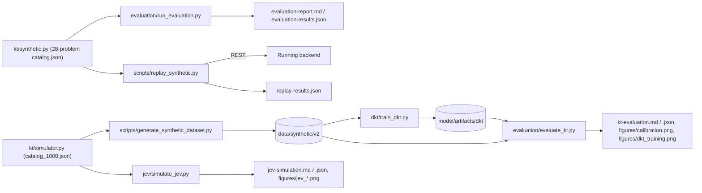
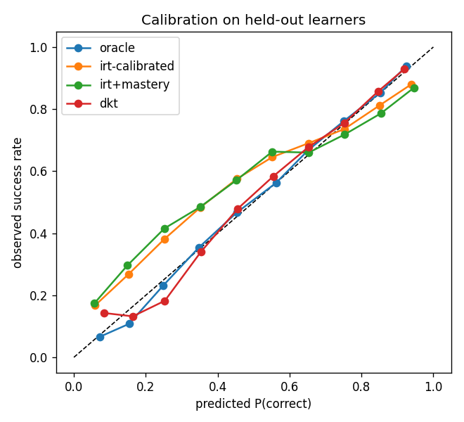
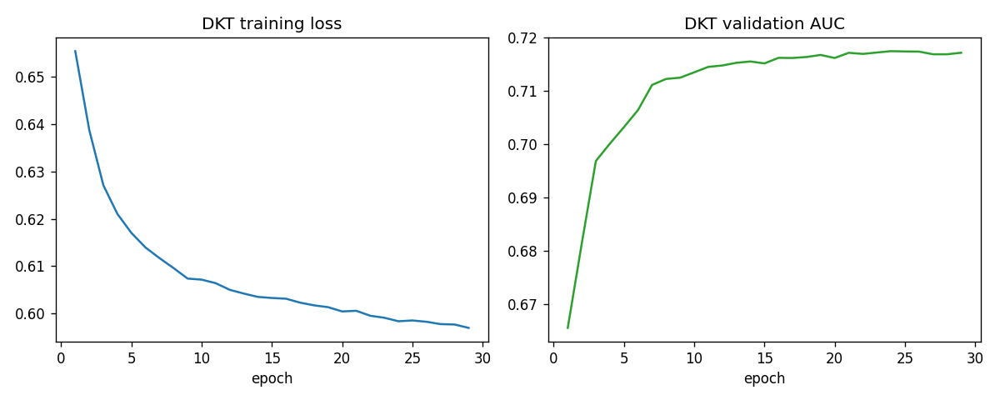
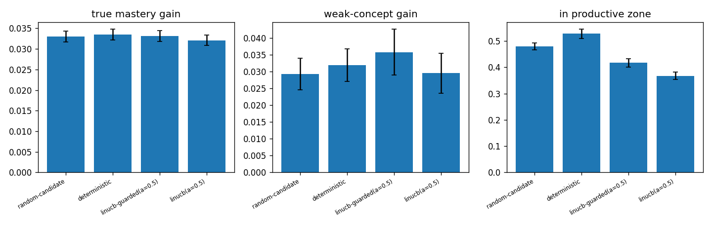
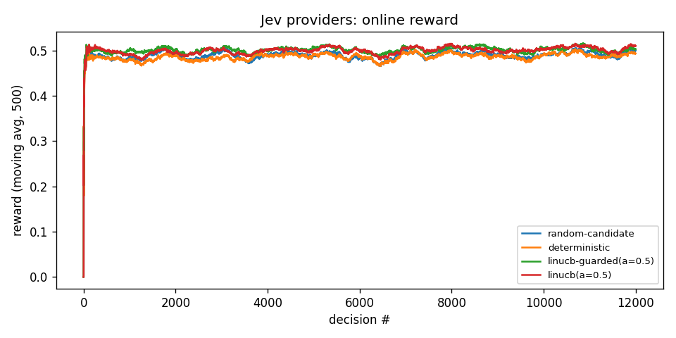
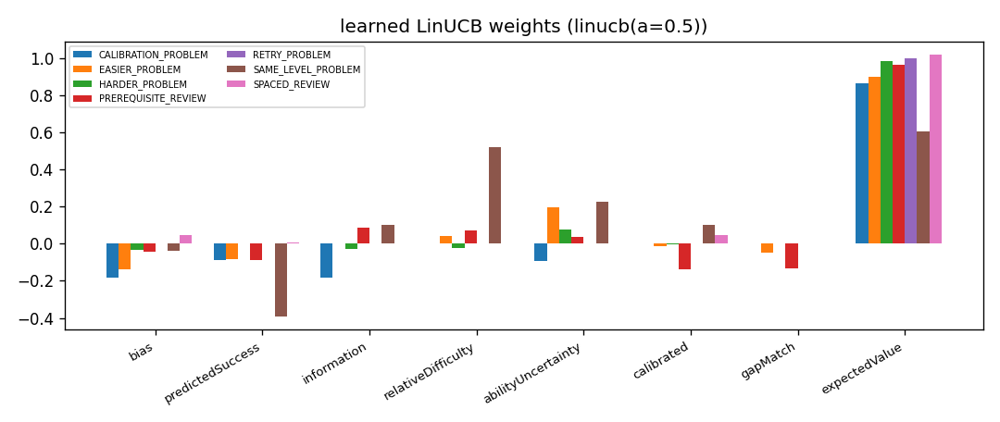

# Evaluation

> **Every number in this document is on synthetic data.** It describes how the
> implementation behaves under the simulator's assumptions. It is not evidence about real
> learners and not evidence that the system improves learning (master plan §60). On real
> learner data the system is **not evaluated**.

Four offline harnesses plus backend ablation tests. All reports are generated files in
`model/reports/`; re-running a harness overwrites them.



| harness | data | measures | writes |
|---|---|---|---|
| `model/evaluation/run_evaluation.py` | `kt/synthetic.py`, 28 problems / 15 concepts (`data/seed/catalog.json`), 300 train + 150 test + 150 simulation learners, seed 7 | item and ability recovery, gap detection, 6 next-response predictors, 8 recommendation policies | `evaluation-report.md`, `evaluation-results.json`, `data/synthetic/interactions.jsonl` |
| `model/evaluation/evaluate_kt.py` | `data/synthetic/v2` (`kt/simulator.py`, 1000 problems), learner split 70/15/15 | 7 predictors on held-out learners, concept-mastery recovery, weakest-concept hit rate, item recovery | `kt-evaluation.md`, `kt-evaluation.json`, `figures/calibration.png`, `figures/dkt_training.png` |
| `model/jev/simulate_jev.py` | `kt/simulator.World`, 1000 problems, 300 learners × 40 decisions | Jev providers: reward vs true learning | `jev-simulation.md`, `jev-simulation.json`, `figures/jev_*.png` |
| `scripts/replay_synthetic.py` | `kt/synthetic.py` learners POSTed to a running backend | end-to-end ability recovery and gap types through the REST API | `replay-results.json` |

The two simulators differ (catalog size, learner model, behaviour), so numbers from
`evaluation-report.md` and `kt-evaluation.md` are **not comparable** with each other.
Shared code: `model/kt/metrics.py` (metrics), `model/kt/predictors.py` (predictors of
`run_evaluation.py`), `model/kt/policies.py` (policies, including `SystemPolicy`, a Python
mirror of the Java decision path).

## Baselines (master plan §34)

| baseline | implemented? | where |
|---|---|---|
| 1 Static difficulty | yes | policy `StaticLadderPolicy` (`static-difficulty`); predictor `StaticDifficultyPredictor`; `prior-only` in `evaluate_kt.py` (θ = 5, catalog prior) |
| 2 Simple success rate | yes | policy `SuccessRatePolicy`; predictor `SuccessRatePredictor`; `success-rate` in `evaluate_kt.py` |
| 3 IRT only | yes | policy `SystemPolicy("irt-only")`; predictor `IrtMasteryPredictor("irt-only")`; `irt-prior`, `irt-calibrated` in `evaluate_kt.py` |
| 4 IRT + prerequisite graph | partly | prediction: `IrtMasteryPredictor("irt+graph")`. Policies: the graph only acts through a detected mastery gap, so its effect is `full-system` vs `irt+mastery`; there is no "IRT + graph without mastery" policy |
| 5 IRT + knowledge tracing | partly | Beta-Bernoulli mastery: `irt+knowledge-tracing` (`run_evaluation.py`), `irt+mastery` (`evaluate_kt.py`). DKT: `dkt` row in `evaluate_kt.py`, **standalone**. The backend's 0.5 IRT + 0.5 DKT blend (`SuccessEstimator`) is **not** evaluated offline |
| Full system | partly | prediction `full (irt+kt+graph)`; policy `full-system` (deterministic decision path, no DKT); Jev providers compared separately in `simulate_jev.py`. No run combines IRT + DKT + graph + bandit |

`run_evaluation.py` always prints the DKT row as `UNAVAILABLE`: `kt.dkt.availability`
rejects its 300-learner / 6000-interaction dataset (minimums 1000 / 50 000) and flags it as
synthetic. The trained DKT is evaluated in `evaluate_kt.py` instead.

## Metrics (master plan §35)

| group | metric | implementation | reported in |
|---|---|---|---|
| Prediction | accuracy, AUC (rank-sum, ties averaged), log loss, Brier | `metrics.accuracy`, `auc`, `log_loss`, `brier`, `summary` | evaluation-report §4, kt-evaluation |
| | MAE, RMSE, Spearman | `metrics.mae`, `rmse`, `spearman` | item / ability / mastery recovery |
| | AUC on first, unassisted attempts | `summarise` in `evaluate_kt.py` | kt-evaluation |
| Calibration | predicted vs observed per bin, ECE (10 bins) | `metrics.calibration_bins`, `expected_calibration_error` | ECE columns, `figures/calibration.png` |
| Learning effectiveness | simulated skill gain per concept, gain on the weak concept | `simulate` in `run_evaluation.py` | evaluation-report §5 |
| | true mastery gain, weak-concept gain | `jev/tutor.py` | jev-simulation |
| | repeated failures | 3-failure streaks per learner | evaluation-report §5 |
| | successful completion | next-problem success, first-attempt solve rate | evaluation-report §5, jev-simulation |
| | time to mastery | **not implemented** | — |
| Recommendation quality | targeting error, too easy / too hard shares, productive-zone rate | `simulate`, `jev/tutor.py` | evaluation-report §5, jev-simulation |
| | concept-gap recovery | gap-detection hit rates, weakest-concept hit rate, weak-concept gain | evaluation-report §3b, kt-evaluation |

Learning-effectiveness metrics exist only in simulation, where the true skill is known.
No single metric here shows educational effectiveness.

## Ablation (master plan §36)

Backend components are switched in `application.yml`:

```yaml
knowledge-tracer:
  irt:
    enabled: true
  dkt:
    enabled: ${KT_DKT_ENABLED:false}
  prerequisite-graph:
    enabled: true
  adaptive-localization:
    enabled: true
  jev:
    enabled: true
    provider: ${KT_JEV_PROVIDER:deterministic}   # deterministic | bandit | http
```

Concept mastery has no switch. `next-action` reports the active configuration in
`models` (`irt`, `conceptMastery`, `prerequisiteGraph`, `adaptiveLocalization`, `dkt`,
`successModel`, `jev`).

| test | property | asserts |
|---|---|---|
| `ablation/IrtDisabledIT` | `irt.enabled=false` | ability stays 5.0, LINKED_LIST mastery still drops below 0.5, `models.irt = DISABLED` |
| `ablation/GraphDisabledIT` | `prerequisite-graph.enabled=false` | same evidence gives `CONCEPT_GAP` on TREES and `EASIER_PROBLEM` |
| `ablation/JevDisabledIT` | `jev.enabled=false` | `decidedBy = FALLBACK`, `models.jev` starts with `DISABLED`, a problem is still recommended |
| `dkt/DktEnabledIT` | `dkt.enabled=true` + fixture model | `successModel` is `IRT` early and `IRT+DKT` once history suffices; 25 `dktKnowledge` values in [0, 1] |
| `AdaptiveLocalizationServiceTest.disabledLocalizationNeverRequestsCalibration` | `adaptive-localization.enabled=false` (unit test) | no calibration phase |

These tests check **behaviour**, not metrics. Metric ablations run offline:

| §36 configuration | offline evaluation |
|---|---|
| IRT only | policy `irt-only`, predictors `irt-only` / `irt-calibrated` |
| IRT + Graph | predictor `irt+graph` |
| IRT + DKT | `dkt` alone (no blend) |
| IRT + Graph + DKT | not evaluated (backend can be configured this way) |
| Full system | predictor `full (irt+kt+graph)`, policy `full-system`, Jev providers |

## Results — next-attempt prediction, 1000-problem benchmark (synthetic data)

From `model/reports/kt-evaluation.md`: 384 test learners, 15534 test events. All values:
synthetic data.

| model | AUC | AUC (first, unassisted) | log loss | Brier | ECE | accuracy |
|---|---|---|---|---|---|---|
| oracle | 0.7792 | 0.7699 | 0.4955 | 0.1623 | 0.0096 | 0.7678 |
| prior-only | 0.6876 | 0.6816 | 0.6107 | 0.1986 | 0.0961 | 0.7231 |
| success-rate | 0.6083 | 0.6056 | 0.6120 | 0.2107 | 0.0549 | 0.6853 |
| irt-prior | 0.7231 | 0.7166 | 0.5768 | 0.1909 | 0.0840 | 0.7198 |
| irt-calibrated | 0.7178 | 0.7113 | 0.5617 | 0.1867 | 0.0624 | 0.7285 |
| irt+mastery | 0.7171 | 0.7114 | 0.5741 | 0.1893 | 0.0769 | 0.7289 |
| dkt | 0.7309 | 0.7275 | 0.5362 | 0.1786 | 0.0164 | 0.7406 |

Concept-mastery recovery vs simulator ground truth (synthetic data):

| estimator | pairs | Spearman | MAE |
|---|---|---|---|
| beta | 5329 | 0.4512 | 0.1951 |
| dkt | 5329 | 0.6578 | 0.1391 |

Weakest-concept hit rate over 253 learners (synthetic data): truth 0.8458, beta 0.166,
irt-residual 0.1739, dkt 0.083, dkt-relative 0.0949, random 0.0966. Item-difficulty
recovery over 796 items with ≥ 20 train responses (synthetic data): Spearman catalog
prior 0.9102, calibrated 0.9022.



*Calibration on held-out learners (synthetic data): observed success rate per predicted
bin for oracle, irt-calibrated, irt+mastery and dkt.*



*DKT training loss and validation AUC per epoch (synthetic data).*

## Results — 28-problem harness (synthetic data)

From `model/reports/evaluation-report.md` (seed 7). All values: synthetic data.

Item difficulty recovery: static label prior MAE 0.603 / RMSE 0.751 / Spearman 0.823;
IRT calibrated MAE 0.251 / RMSE 0.309 / Spearman 0.939. Ability recovery after 20
responses: Spearman **0.950**, MAE 0.754, mean reported uncertainty 0.671. Gap detection:
flagged for 102/150 learners; when flagged it was the designated weak concept 0.147 of the
time (chance 0.067); designated weak concept among the 3 lowest: 0.307 (chance 0.200).

| Model | Accuracy | AUC | Log loss | Brier | ECE |
|---|---|---|---|---|---|
| static-difficulty | 0.637 | 0.631 | 0.691 | 0.238 | 0.106 |
| success-rate | 0.784 | 0.840 | 0.488 | 0.158 | 0.047 |
| irt-only | 0.811 | 0.890 | 0.407 | 0.130 | 0.014 |
| irt+graph | 0.811 | 0.890 | 0.407 | 0.130 | 0.014 |
| irt+knowledge-tracing | 0.815 | 0.891 | 0.405 | 0.129 | 0.015 |
| full (irt+kt+graph) | 0.815 | 0.891 | 0.405 | 0.129 | 0.015 |
| dkt | UNAVAILABLE | – | – | – | – |

Fitted weights (train, synthetic data): mastery term w_m = 0.25, prerequisite term
w_g = 0.0 (graph only) / 0.0 (with mastery). With w_g = 0.0 the graph rows equal the rows
without the graph.

Policy simulation, 150 learners × 20 recommended problems, mean ± 95 % CI (synthetic data):

| Metric | better | random | static-difficulty | success-rate | irt-only | irt+localization | irt+mastery | full-system | full+retry-guard |
|---|---|---|---|---|---|---|---|---|---|
| next-problem success rate | context | 0.577 ± 0.05 | 0.638 ± 0.05 | 0.580 ± 0.05 | 0.623 ± 0.05 | 0.626 ± 0.05 | 0.621 ± 0.04 | 0.623 ± 0.04 | 0.617 ± 0.05 |
| mean \|true P - 0.65\| (targeting error) | lower | 0.338 ± 0.02 | 0.313 ± 0.02 | 0.318 ± 0.02 | 0.294 ± 0.02 | 0.301 ± 0.02 | 0.289 ± 0.02 | 0.288 ± 0.01 | 0.304 ± 0.02 |
| share of attempts with true P > 0.9 | lower | 0.333 ± 0.06 | 0.390 ± 0.06 | 0.305 ± 0.05 | 0.321 ± 0.05 | 0.323 ± 0.05 | 0.310 ± 0.05 | 0.309 ± 0.05 | 0.325 ± 0.05 |
| share of attempts with true P < 0.2 | lower | 0.267 ± 0.05 | 0.189 ± 0.05 | 0.232 ± 0.04 | 0.174 ± 0.04 | 0.186 ± 0.04 | 0.168 ± 0.04 | 0.166 ± 0.04 | 0.194 ± 0.04 |
| 3-failure streaks per learner | lower | 0.887 ± 0.17 | 0.807 ± 0.17 | 0.980 ± 0.18 | 0.787 ± 0.19 | 0.813 ± 0.19 | 0.773 ± 0.16 | 0.760 ± 0.16 | 0.813 ± 0.18 |
| mean simulated skill gain per concept | higher | 0.471 ± 0.04 | 0.495 ± 0.04 | 0.528 ± 0.03 | 0.567 ± 0.04 | 0.556 ± 0.04 | 0.579 ± 0.04 | 0.591 ± 0.04 | 0.550 ± 0.04 |
| simulated gain on the weak concept | higher | 0.484 ± 0.08 | 0.507 ± 0.09 | 0.492 ± 0.08 | 0.557 ± 0.09 | 0.565 ± 0.08 | 0.794 ± 0.16 | 0.749 ± 0.14 | 0.559 ± 0.08 |
| \|final ability estimate - true ability\| | lower | 0.664 ± 0.08 | 0.718 ± 0.08 | 0.624 ± 0.07 | 0.701 ± 0.07 | 0.734 ± 0.08 | 0.782 ± 0.08 | 0.776 ± 0.08 | 0.708 ± 0.07 |

Many confidence intervals overlap. The learning-gain rows depend entirely on the
simulator's learning rule (gain ∝ p(1 − p)).

## Results — Jev providers (synthetic data)

From `model/reports/jev-simulation.md`: 300 learners × 40 decisions per provider, reward
= 0.0 quality + 1.0 growth. All values: synthetic data.

| provider | mean reward | true mastery gain | weak-concept gain | first-attempt solve | productive zone |
|---|---|---|---|---|---|
| random-candidate | 0.4898 | 0.0330 ± 0.0013 | 0.0292 ± 0.0046 | 0.3508 ± 0.0077 | 0.4797 ± 0.0133 |
| deterministic | 0.4865 | 0.0335 ± 0.0013 | 0.0319 ± 0.0049 | 0.6297 ± 0.0113 | 0.5273 ± 0.0171 |
| linucb-guarded(a=0.5) | 0.5014 | 0.0331 ± 0.0013 | 0.0357 ± 0.0068 | 0.3710 ± 0.0114 | 0.4165 ± 0.0156 |
| linucb(a=0.5) | 0.5004 | 0.0321 ± 0.0013 | 0.0295 ± 0.0060 | 0.1891 ± 0.0093 | 0.3670 ± 0.0139 |







*Outcomes per provider, moving-average reward, learned LinUCB weights (synthetic data).
Interpretation and the reward-weight sweep: [jev.md](jev.md).*

## Results — end-to-end replay through the backend (synthetic data)

From `model/reports/replay-results.json` (run `87901A`): 30 learners × 20 events.
Ability Spearman 0.947, ability MAE 0.759, mean uncertainty 0.669; the designated weak
concept was flagged by the backend for 1/30 learners; gap types CONCEPT_GAP 15, NONE 11,
MULTIPLE_ATTEMPTS 2, TIME_PRESSURE 1, PREREQUISITE_GAP 1. All values: synthetic data.

## Reproduce

Python convention: run from `model/` with `PYTHONPATH=pylib:.` (PyTorch, NumPy and
matplotlib installed into `model/pylib`, see [model/README.md](../model/README.md)). The
scripts resolve the repository root from their own path, so output locations do not
depend on the working directory.

```bash
cd model
PYTHONPATH=pylib:. python3 -m unittest discover -s tests -t .
PYTHONPATH=pylib:. python3 evaluation/run_evaluation.py               # --seed 7 --train 300 --test 150 --sim 150
PYTHONPATH=pylib:. python3 ../scripts/generate_synthetic_dataset.py   # --learners 2500 --seed 20260929 -> data/synthetic/v2
PYTHONPATH=pylib:. python3 dkt/train_dkt.py --allow-synthetic         # overwrites model/artifacts/dkt/
PYTHONPATH=pylib:. python3 evaluation/evaluate_kt.py                  # reads model/artifacts/dkt/dkt-model.json by default (--dkt)
PYTHONPATH=pylib:. python3 jev/simulate_jev.py                        # --learners 300 --steps 40 --seed 7
```

End to end and backend ablations:

```bash
cd backend && ./mvnw spring-boot:run                                   # terminal 1
cd model && PYTHONPATH=pylib:. python3 ../scripts/replay_synthetic.py --base-url http://localhost:8080
cd backend && ./mvnw verify -Dit.test='*DisabledIT'                    # failsafe runs *IT classes
```

Notes: `train_dkt.py` without PyTorch, below the minimum dataset size, or on synthetic data
without `--allow-synthetic` prints an availability report and exits with code 2.
`evaluate_kt.py` falls back to a pure-Python DKT forward pass without NumPy and skips
figures without matplotlib. `replay_synthetic.py` exits non-zero if the ability Spearman is
below 0.6. The Colab notebooks (`notebooks/DKT_train_and_visualize.ipynb`,
`notebooks/Jev_bandit_simulation.ipynb`) bundle the same code.

## How to read this

* The simulator encodes our assumptions; models that share them (IRT, DKT) look good by
  design. [data.md](data.md) documents the generative model.
* A single seed per report; confidence intervals are across learners within that seed.
* No real learner data and no controlled study exist. Real-data evaluation needs consented
  exports (`GET /api/research/events`, `GET /api/research/decisions`, [privacy.md](privacy.md))
  and a held-out protocol; until then every claim above stays "evaluated on synthetic data".
* Known gaps are listed in [limitations.md](limitations.md); planned work in
  [future-work.md](future-work.md). Test layout: [testing.md](testing.md).
