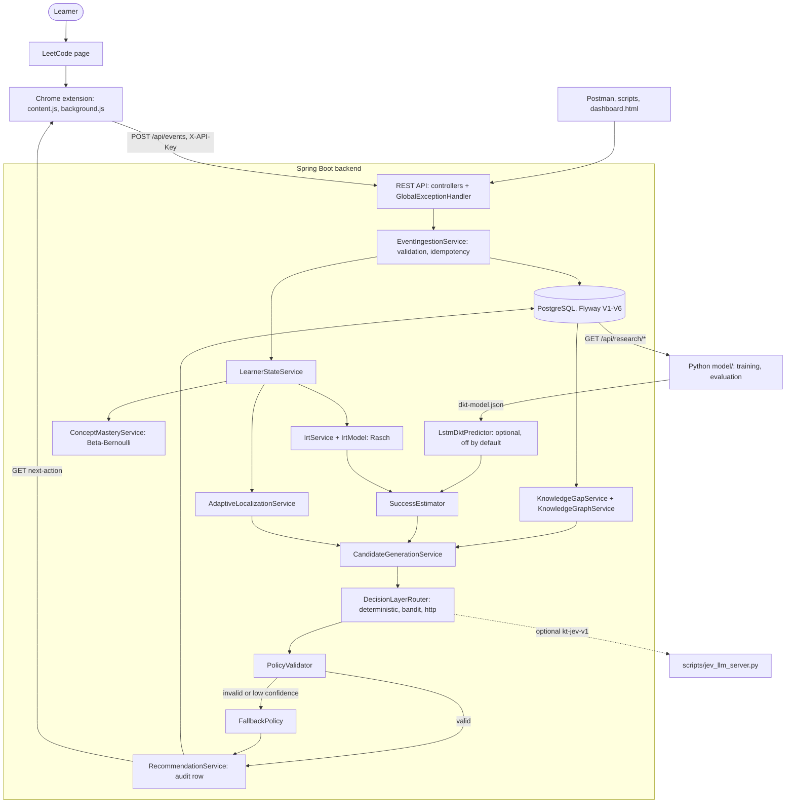
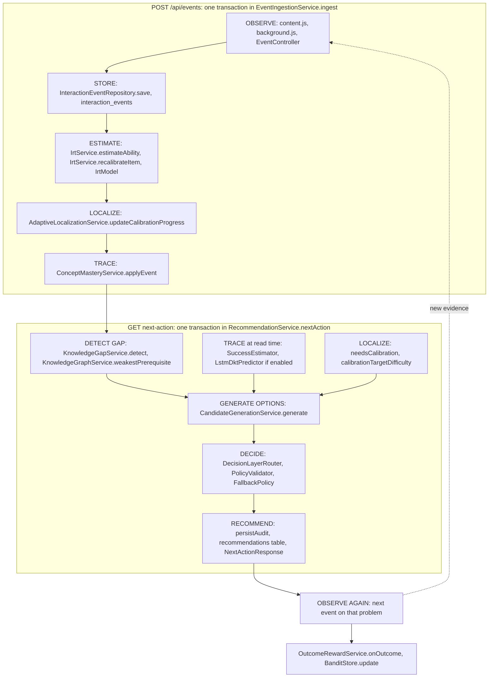

# Knowledge Tracer — Final Report

> **Research prototype**, report date 2026-09-30. Knowledge Tracer is a college major project, not a
> hardened or deployed service. Every evaluation number in this report comes from **synthetic
> learners**. There is no real-learner evaluation and no user study, and nothing here shows that the
> system improves learning.

This report follows the structure in master plan §75. It summarises the system and links each section
to the detailed document that describes it. The current phase status and the test run log are in
[project-status.md](project-status.md). The scorecard against the master plan is in
[self-evaluation.md](self-evaluation.md). Setup and repository layout are in the root
[README.md](../README.md).

| Part | Location | Detail docs |
|---|---|---|
| Spring Boot 3 + PostgreSQL backend (Java 21) | `backend/` | [architecture.md](architecture.md), [domain-model.md](domain-model.md), [api-flow.md](api-flow.md) |
| Python models, simulators, evaluation | `model/` | [model-flow.md](model-flow.md), [evaluation.md](evaluation.md) |
| Catalogs and synthetic datasets | `data/` | [data.md](data.md) |
| Google Colab notebooks | `notebooks/` | [dkt.md](dkt.md), [jev.md](jev.md) |
| Manifest V3 Chrome extension | `extension/` | [user-flow.md](user-flow.md), [privacy.md](privacy.md) |
| Postman collection and environment | `postman/` | [testing.md](testing.md) |

---

## 1. Problem Statement

Knowledge Tracer answers one question (master plan §1): *given what this learner has done recently,
what does the system currently believe the learner knows, what are they struggling with, and what
should they do next?* The first domain is DSA practice on LeetCode.

The system does not give a learner a fixed label such as "Beginner". It keeps a learner state that
changes with each event: an ability estimate with an uncertainty, and a mastery estimate for each of
25 concepts. The system uses that state, together with a prerequisite graph over the concepts, to
detect a likely knowledge gap and choose the next action from a bounded set of options. The
learner's next attempt then becomes new evidence.

## 2. Motivation

LeetCode's Easy/Medium/Hard labels are coarse, and a failed submission can mean different things:
low overall ability, one weak concept, or a weak prerequisite of that concept. Knowledge Tracer
treats the platform label as **prior metadata** and estimates a continuous item difficulty on a
0–10 scale, with an uncertainty for each problem (master plan §2). A learner who fails repeatedly on
linked lists should get a linked-list or prerequisite exercise. That learner does not need a lower
global label.

A second goal is to show that an AI decision component ("Jev") can be used safely. Jev may only pick
one option from the candidate list the deterministic pipeline builds. A policy validator checks its
choice, and a deterministic fallback takes over when it fails (master plan §6). The design separates
**observations** (what happened) from **estimates** (what the model believes), so every
recommendation can be traced back to its evidence (§64–65).

## 3. System Architecture

The system is a modular monolith: one Spring Boot app, one PostgreSQL database, and code organised
by feature package (`event`, `irt`, `mastery`, `dkt`, `localization`, `gap`, `recommendation`,
`decision`, …). The browser extension only collects data and shows results. Every estimate and every
decision is made in the backend. The Python code in `model/` works offline. It generates synthetic
learners, trains DKT, and exports the trained model as JSON, which the Java class `LstmDktPredictor`
runs. Details: [architecture.md](architecture.md).



### 3.1 Core learning loop mapped to classes

The master-plan cycle (§78) runs as two HTTP requests. `POST /api/events` records an observation and
updates the model state in one transaction. `GET /api/learners/{userId}/next-action` reads that state
and stores one recommendation. The recommendation's outcome arrives as the next event.



`LearningLoopIT.nextInteractionBecomesNewEvidence` and folder 2 of the Postman collection run this
loop end to end.

## 4. Data Architecture

Every stored value is one of five classes. Only observations and decisions are a source of truth;
model state can in principle be rebuilt from the events
([architecture.md](architecture.md#1-guiding-principle), [domain-model.md](domain-model.md)).

| Class | Examples | Mutable | Regenerable |
|---|---|---|---|
| Raw observation / self-report | `interaction_events` (result, attempt, time, hint, solution viewed, confidence, blocker), `feedback` | no, append-only | no |
| Reference data | `problems` metadata and `prior_difficulty`, `concepts`, `prerequisites`, `problem_concepts` | curation only | seeded rows from V3–V5 |
| Derived feature | first-attempt windows, credit weights, DKT inputs | not stored | yes, recomputed per request |
| Model state | `learner_states`, `concept_masteries`, `problems.estimated_difficulty`, `jev_bandit_arms` | yes | by replay in principle; no rebuild command exists |
| Decision | `recommendations` (candidates, choice, provider, confidence, context vector, later reward) | reward columns set once | no |

Datasets ([data.md](data.md)):

| Dataset | Content |
|---|---|
| `data/leetcode/` | Public metadata mirror of 4068 problems; 1000 selected free *Algorithms* problems with concepts and priors; `tag_concept_map.json` |
| `data/seed/catalog.json`, `catalog_1000.json` | The 28 curated seed problems; the 1000-problem catalog used by the simulator, DKT and notebooks |
| `data/synthetic/v2/` | **Synthetic** benchmark from `model/kt/simulator.py`, seed 20260929: 2500 learners / 106 506 events, all 1000 problems covered |
| `data/real/` | Pseudonymised exports from a running backend (not committed; none exist) |

Events use the `kt-events-v1` JSON Lines format. The simulator and `GET /api/research/events` produce
it identically, so every training and evaluation script accepts either source. Data splits are by
learner (70/15/15 on a salted hash), never by event. Only pseudonyms leave the backend:
`Pseudonyms.of` is `L-` plus HMAC-SHA256 of the external ref, keyed by `KT_PSEUDONYM_SALT`
([privacy.md](privacy.md)).

## 5. Knowledge Graph

The graph is curated reference data. It holds **25 concepts**, **21 directed prerequisite edges** and
2653 weighted problem→concept tags over the 1000 catalog problems. It stores nothing about learners.
V3 seeds 15 concepts and 10 edges, V4 adds 10 concepts and 11 edges, and V5 adds generated tags for
972 problems. The 28 seed problems keep their hand-curated tags. `KnowledgeGraphService` provides
breadth-first traversals with a visited set (direct and transitive prerequisites, downstream
concepts, weakest prerequisite). `ConceptService.addPrerequisite` rejects self-loops and cycles with
HTTP 422. Details: [knowledge-graph.md](knowledge-graph.md).

Gap detection uses the graph for only one step. If the weakest concept (at least 2 observations,
mastery below 0.45) has a **direct** prerequisite that is also weak, the gap is a `PREREQUISITE_GAP`
and a `PREREQUISITE_REVIEW` candidate is offered. `knowledge-tracer.prerequisite-graph.enabled=false`
switches this off, which `GraphDisabledIT` pins. The graph has not been validated against learner
data, and concept grouping is not implemented.

## 6. IRT

The item response theory (IRT) component is a Rasch (1PL) model on a 0–10 scale,
`P(correct | θ, b) = σ(θ − b)`. Ability θ and item difficulty b are MAP estimates, computed by
Newton–Raphson with Gaussian priors. Uncertainty is `1/√information`. The code is in `IrtModel`
(pure maths, no Spring dependencies) and `IrtService`, with a Python port in `model/kt/irt.py`
([irt.md](irt.md)).

| Setting | Default |
|---|---|
| Ability prior | N(5, 2²) |
| Difficulty prior | the problem's `prior_difficulty`, sd 1.5 |
| Windows | last 100 first attempts per learner, last 50 per item |
| `irt.first-attempts-only` | `true`: only a learner's first attempt on a problem enters IRT |

Rasch assumes independent responses. Counting retries would let "retry until accepted" inflate
ability, so IRT uses first attempts only. Concept mastery and DKT still see every attempt. The
difficulty prior combines the LeetCode label (Easy 3, Medium 5, Hard 7) with the problem's
acceptance rate compared with other problems of that label. The same formula is in
`scripts/build_leetcode_catalog.py`, `IrtService.prior()` and the tests (`IrtPriorTest`,
`test_catalog_1000.py`).

## 7. Knowledge Tracing

Two estimators trace per-concept knowledge ([model-flow.md](model-flow.md), [dkt.md](dkt.md)):

- **Beta-Bernoulli concept mastery** (`ConceptMasteryService`, always on). The prior is Beta(1, 1).
  Each event adds `tagWeight × creditWeight` to α on success or to β on failure, and mastery is
  α/(α+β). The credit weight reduces the evidence from assisted or doubtful outcomes: hint 0.7×,
  solution viewed 0.4×, confidence ≤ 2 0.8×, success after more than 45 min 0.8×, failure after
  viewing the solution 0.5×.
- **Deep Knowledge Tracing (DKT)** (`kt-dkt-v1`). An LSTM with hidden size 64, trained offline by
  `model/dkt/train_dkt.py` and exported to JSON. In the backend, `LstmDktPredictor` replays the
  learner's last 200 events on each request. `DktModelTest` checks the Java forward pass against
  Python to 1e-9. When enabled, `SuccessEstimator` blends the two models 0.5·IRT + 0.5·DKT once a
  learner has at least 3 events.

**DKT is trained on synthetic data only** (`"trainedOn": "synthetic"` in
`model/artifacts/dkt/dkt-model.json`) and is therefore **off by default** (`KT_DKT_ENABLED=false`).
The training script refuses to run below 1000 learners or 50 000 attempts, and refuses synthetic
data unless `--allow-synthetic` is passed. The deployed 0.5/0.5 blend has not been evaluated
offline. Results are in §16.

## 8. Adaptive Localization

This component handles the cold start. While a learner is uncalibrated, the candidate set includes
two unattempted free problems whose estimated difficulty is closest to the current ability estimate.
At that point the Rasch information `p(1 − p)` is at its maximum, so each response tells the most
about θ. There is no separate estimator: θ and σ come from IRT. The target follows θ, so a failure
leads to an easier item and a success to a harder one, without a hard-coded binary search. Details:
[adaptive-localization.md](adaptive-localization.md).

A learner becomes calibrated once σ ≤ 0.9 **or** once 8 first-attempt IRT responses exist, whichever
comes first. Retries do not count (`retriesOfOneProblemDoNotEndCalibration`). The flag is sticky and
never reset. The deterministic provider handles a detected concept or prerequisite gap before
calibration. This is a global-ability mechanism, not a knowledge-tracing model. In the offline
ablation it did not reduce final ability error (§16).

## 9. Recommendation Engine

`GET /api/learners/{userId}/next-action` runs gap detection, success estimation, candidate generation,
the decision layer, policy validation and the audit write, in that order
([recommendation.md](recommendation.md), [data-flow.md](data-flow.md)).

`KnowledgeGapService` applies rules in a fixed order, and the first match wins: `PREREQUISITE_GAP`,
`CONCEPT_GAP`, `LOW_GLOBAL_ABILITY`, `MULTIPLE_ATTEMPTS`, `TIME_PRESSURE`, `LOW_CONFIDENCE`,
`INSUFFICIENT_PRACTICE`, `NONE`. A learner with no events gets `UNKNOWN`. Each gap carries evidence
strings and a heuristic confidence `min(0.9, 0.5 + 0.08·n)`, and the wording is "evidence suggests".
`CandidateGenerationService` builds a bounded list over free problems only:

| Action | When | Expected value |
|---|---|---|
| `CALIBRATION_PROBLEM` (×2) | learner uncalibrated | 0.5 + information |
| `PREREQUISITE_REVIEW` | prerequisite gap | 0.8 |
| `EASIER_PROBLEM` | concept gap | 0.75 |
| `SAME_LEVEL_PROBLEM` | always | 1 − \|P − 0.65\| |
| `HARDER_PROBLEM` | ≥ 3 recent successes in a row | 0.55 |
| `RETRY_PROBLEM` | a recent failure exists | 0.5 |
| `SPACED_REVIEW` | a solved problem not seen recently | 0.4 |

Every response includes the action, problem, concept, difficulty, reason, evidence, confidence,
predicted success, who decided (`JEV` or `FALLBACK`), and which models were active (`models`). Each
call stores the full candidate list in `recommendations.candidates_json`.

## 10. Jev Decision Layer

Jev is a **bounded chooser**. It is reachable only through the `DecisionLayer` interface, and it can
only return one of the candidates it was given ([jev.md](jev.md)).

| Provider (`KT_JEV_PROVIDER`) | Class | Behaviour |
|---|---|---|
| `deterministic` (default) | `DeterministicDecisionLayer` | prerequisite gap → review; concept gap → easier problem; uncalibrated → calibration item; else highest expected value |
| `bandit` | `BanditDecisionLayer`, `LinUcb`, `BanditStore` | disjoint LinUCB per `ActionType` (α 0.5, λ 1, 8 bounded features), state in `jev_bandit_arms`; **guarded** by default, so gaps are remediated by the rules |
| `http` | `HttpDecisionLayer` | `kt-jev-v1` POST to an external service (reference: `scripts/jev_llm_server.py`), 2 s timeout; refuses to send pseudonyms keyed with the default salt |

`DecisionLayerRouter` dispatches each request to the configured provider. `PolicyValidator` rejects
an empty choice, a choice outside the candidate set, an unknown problem, a difficulty outside
[0, 10], an already-solved problem (except retry or spaced review) and confidence below 0.35. On any
rejection, exception or timeout, `FallbackPolicy` takes the highest-expected-value valid candidate. If
none is valid, it takes the nearest unsolved free problem, and if there is none, `FEEDBACK_REQUEST`.

`OutcomeRewardService` attributes the learner's first outcome on the recommended problem within 336 h
to the recommendation and updates the bandit arm. The default reward is ability growth only
(`quality-weight` 0). In simulation, any weight on "accepted" let the bandit farm retries.
Rewards are logged for every provider, which allows offline comparison
(`GET /api/research/decisions`).

## 11. Browser Extension

The Manifest V3 extension (`extension/`) observes and displays; it makes no estimates
([user-flow.md](user-flow.md)). `content.js` runs on `https://leetcode.com/problems/*` and watches for
the submission verdict. It reads the problem number and title (`"21. …"` → `LC21`), the difficulty
label and the topic tags, and notes hint toggles and solution/editorial views. `background.js` builds
a schema-v1 event with a `crypto.randomUUID()` `eventId` and a local attempt counter. It stores the
event in a durable `chrome.storage` queue (at most 500 items) and flushes the queue to
`POST /api/events`.

The queue handles backend answers as follows:
- Network errors, 5xx, 408 and 429 are retried with backoff.
- On a 422 for an unknown problem, the extension registers the problem with `POST /api/problems` and
  re-sends the event.
- On 401/403 it **keeps** the events, records `kt.authError` and pauses sending until the settings
  change or the user forces a flush.
- Other 4xx answers drop the event.

The popup shows the next action, the reason, the gap evidence, and the ability with its uncertainty.
Tracking is **off by default**. The extension never sends code, account names or page content. Its
permissions are `storage` and `alarms`, with host permissions for `https://leetcode.com/*` and
`http://localhost:8080/*` only ([privacy.md](privacy.md), [security.md](security.md)).

## 12. API Architecture

REST/JSON on port 8080. A request passes `CorrelationIdFilter` (adds `X-Request-Id`), then
`ApiKeyFilter` (optional shared `X-API-Key` on `/api/**`), then CORS from `WebConfig`, then a
controller with `@Valid` request records, then a `@Transactional` service. Controllers only map DTOs.
All errors use one `ApiError` shape produced by `GlobalExceptionHandler`. Full contract:
[api-flow.md](api-flow.md).

| Area | Endpoints |
|---|---|
| Events | `POST /api/events` (201 new, 200 duplicate, 409 reused `eventId` for another learner or problem, 422 unknown problem) |
| Learners | `POST /api/learners`; `GET /api/learners/{userId}/state`, `/next-action`, `/recommendations?limit`, `/history?limit` |
| Catalog | `POST`/`GET /api/problems`, `GET /api/problems/{problemKey}`; `POST`/`GET /api/concepts`, `GET /api/concepts/{code}`, `POST /api/concepts/{code}/prerequisites` |
| Feedback | `POST /api/feedback` |
| Model status | `GET /api/models/dkt`, `GET /api/models/jev` |
| Research export | `GET /api/research/events`, `/catalog`, `/decisions` (404 unless `KT_RESEARCH_EXPORT=true`, 422 while the salt is the default) |
| Operations | `/actuator/health`, `/info`, `/metrics`; `/swagger-ui.html` (off in `prod`); `/dashboard.html` |

Status codes: 400 for validation, malformed JSON or a non-positive `limit`; 401 for a missing or wrong
key; 404; 405; 409; 415 for a non-JSON body; 422 for business-rule violations; 500 only for
unexpected errors, with no stack trace returned. The `prod` profile (`ProductionSecretsCheck`) refuses
to start without `KT_API_KEY`, or with a blank or default salt while research export or the `http`
provider is on. Security controls and their limits are in [security.md](security.md).

## 13. Database

PostgreSQL. Flyway owns the schema, and Hibernate runs with `ddl-auto: validate`, so the app refuses
to start if the entities and the schema disagree. Details: [domain-model.md](domain-model.md).

| Migration | Content |
|---|---|
| `V1__core_domain.sql` | `learners`, `problems`, `concepts`, `problem_concepts`, `prerequisites` |
| `V2__events_and_state.sql` | `interaction_events`, `learner_states`, `concept_masteries`, `recommendations`, `feedback` |
| `V3__seed_dev_data.sql` | 28 curated problems, 15 concepts, 10 edges |
| `V4__catalog_metadata_and_concepts.sql` | catalog columns on `problems` (`slug`, `acceptance_rate`, `paid_only`, `prior_difficulty`, …), 10 more concepts, 11 more edges |
| `V5__leetcode_catalog_1000.sql` | the 1000-problem LeetCode catalog and its concept tags |
| `V6__jev_bandit_and_rewards.sql` | `jev_bandit_arms`; provider, context and reward columns on `recommendations` |

Design decisions:
- *Attempt* is not a separate entity; each attempt is one `interaction_events` row.
- *ItemCalibration* was merged into `problems`.
- *Recommendation* and *Decision* are one audit row.
- There is no *CalibrationSession*; the `learner_states.calibrated` flag and σ replace it.
- `event_id` is globally unique and makes ingestion idempotent.

Transactions sit on service methods only. `EventIngestionService.ingest` groups the event insert, the
state update, the reward and the bandit update, so they commit or roll back together.
`BanditStore.update` locks the arm row. `LearnerState` uses `@Version` for optimistic locking.

## 14. Testing

Three suites, one per language, plus the Postman collection as an API smoke test
([testing.md](testing.md)). Results of the verified run on 2026-09-30:

| Suite | Runner | Result |
|---|---|---|
| Backend unit (`*Test`) | JUnit 5, surefire | 92 / 92 pass |
| Backend integration (`*IT`) | JUnit 5, failsafe, embedded PostgreSQL 17 (zonky) | 45 / 45 pass |
| Python model | `unittest`, `model/tests/` | 66 / 66 pass |
| Extension | `node:test`, `extension/tests/` | 31 tests: 30 pass, 1 skipped (opt-in `live.test.js`) |
| API smoke | Postman / Newman | 36 requests with `pm.test` assertions; needs a running backend; not run automatically |

The integration tests need permission to
extract and run `initdb`/`postgres`; in a restricted sandbox they fail at startup, not in an
assertion.

Coverage by kind:
- The models have deterministic unit tests: Rasch values and invariants, MAP conditions, Beta mastery
  bounds, LinUCB convergence, and Java/Python DKT parity.
- `LearningLoopIT` and `SyntheticRecoveryIT` cover the whole loop and the master-plan edge cases: new
  learner, sparse data, repeated failure and success, concept-specific failure, duplicate event,
  missing metadata.
- `ApiContractIT` and `ApiKeyIT` cover status codes and response shapes.
- Three ablation ITs switch off IRT, the graph and Jev; `DktEnabledIT` switches DKT on.
- The extension's DOM-free libraries (`extract.js`, `queue.js`, `api.js`) are unit tested.

```bash
cd backend && ./mvnw test        # unit
cd backend && ./mvnw verify      # unit + integration
cd model && PYTHONPATH=pylib:. python3 -m unittest discover -s tests -t .
cd extension && node --test tests/
```

## 15. Evaluation

Four offline harnesses write generated reports to `model/reports/`, and backend ablation tests check
behaviour. Protocol, baselines and ablation mapping: [evaluation.md](evaluation.md).

| Harness | Data | Measures | Report |
|---|---|---|---|
| `model/evaluation/evaluate_kt.py` | `data/synthetic/v2` (1000 problems), held-out learners | 7 next-attempt predictors, concept-mastery recovery, weakest-concept hit rate, item recovery | `kt-evaluation.md` |
| `model/evaluation/run_evaluation.py` | `kt/synthetic.py`, 28 problems / 15 concepts, seed 7 | item and ability recovery, gap detection, 6 predictors, 8 recommendation policies | `evaluation-report.md` |
| `model/jev/simulate_jev.py` | `kt/simulator.World`, 300 learners × 40 decisions | Jev providers: reward vs true learning | `jev-simulation.md` |
| `scripts/replay_synthetic.py` | simulated learners sent through a running backend | end-to-end ability recovery and gap types | `replay-results.json` |

Baselines implemented: static difficulty, simple success rate, IRT only. IRT + graph and
IRT + knowledge tracing are partly implemented. The metrics are AUC, log loss, Brier score,
accuracy, calibration error (ECE), Spearman correlation, MAE, simulated learning gain and targeting
error. Not evaluated: real learners, the backend's IRT+DKT blend, an IRT + graph + DKT
configuration, and time to mastery. The two simulators differ, so their numbers **cannot be compared
with each other**. Each report uses a single seed. The simulator encodes the authors' assumptions,
so models that share those assumptions (IRT, DKT) look good by design.

## 16. Results

> **All numbers in this section are synthetic data.** They are copied verbatim from
> `model/reports/*.md` and [evaluation.md](evaluation.md). They describe how the implementation behaves
> under the simulator's assumptions. **There is no real-learner evaluation and no user study.** DKT is
> trained on synthetic data only. None of these numbers shows that Knowledge Tracer improves
> learning.

**Next-attempt prediction, 1000-problem benchmark.** Source:
[`model/reports/kt-evaluation.md`](../model/reports/kt-evaluation.md). 384 test learners, 15534 test
events. Data: synthetic.

| Model | AUC | AUC (first, unassisted) | Log loss | Brier | ECE | Accuracy | Data |
|---|---|---|---|---|---|---|---|
| oracle | 0.7792 | 0.7699 | 0.4955 | 0.1623 | 0.0096 | 0.7678 | synthetic |
| prior-only | 0.6876 | 0.6816 | 0.6107 | 0.1986 | 0.0961 | 0.7231 | synthetic |
| success-rate | 0.6083 | 0.6056 | 0.6120 | 0.2107 | 0.0549 | 0.6853 | synthetic |
| irt-prior | 0.7231 | 0.7166 | 0.5768 | 0.1909 | 0.0840 | 0.7198 | synthetic |
| irt-calibrated | 0.7178 | 0.7113 | 0.5617 | 0.1867 | 0.0624 | 0.7285 | synthetic |
| irt+mastery | 0.7171 | 0.7114 | 0.5741 | 0.1893 | 0.0769 | 0.7289 | synthetic |
| dkt | 0.7309 | 0.7275 | 0.5362 | 0.1786 | 0.0164 | 0.7406 | synthetic |

**Concept mastery and item difficulty.** Same source. Data: synthetic.

| Quantity | Value | Data |
|---|---|---|
| Concept-mastery Spearman vs truth (5329 pairs): beta / dkt | 0.4512 / 0.6578 | synthetic |
| Concept-mastery MAE: beta / dkt | 0.1951 / 0.1391 | synthetic |
| Weakest-concept hit rate over 253 learners: truth / beta / irt-residual / dkt / dkt-relative / random | 0.8458 / 0.166 / 0.1739 / 0.083 / 0.0949 / 0.0966 | synthetic |
| Item-difficulty Spearman over 796 items: catalog prior / calibrated | 0.9102 / 0.9022 | synthetic |

**The weakest-concept hit rates are low.** No estimator comes close to the truth (0.8458). Beta
(0.166) and irt-residual (0.1739) reach less than twice the random baseline (0.0966). DKT (0.083) and
dkt-relative (0.0949) are at or below random. Concept-level gap reports should therefore be read as
low-confidence (synthetic data).

**28-problem harness.** Source: [`model/reports/evaluation-report.md`](../model/reports/evaluation-report.md),
seed 7. Data: synthetic.

| Quantity | Value | Data |
|---|---|---|
| Item difficulty, static label prior: MAE / RMSE / Spearman | 0.603 / 0.751 / 0.823 | synthetic |
| Item difficulty, IRT calibrated: MAE / RMSE / Spearman | 0.251 / 0.309 / 0.939 | synthetic |
| Ability recovery after 20 responses: Spearman / MAE / mean uncertainty | 0.950 / 0.754 / 0.671 | synthetic |
| Gap flagged / flagged gap is the designated weak concept (chance) | 102/150 / 0.147 (0.067) | synthetic |
| Next-response AUC: static-difficulty / success-rate / irt-only / irt+knowledge-tracing | 0.631 / 0.840 / 0.890 / 0.891 | synthetic |
| Fitted prerequisite-term weight w_g (graph only / with mastery) | 0.0 / 0.0 | synthetic |
| Mean simulated skill gain per concept: random / irt-only / full-system | 0.471 ± 0.04 / 0.567 ± 0.04 / 0.591 ± 0.04 | synthetic |
| \|final ability estimate − true ability\|: irt-only / irt+localization | 0.701 ± 0.07 / 0.734 ± 0.08 | synthetic |

In this harness the graph added no predictive signal (w_g = 0.0), and localization did not reduce the
final ability error. Many confidence intervals overlap. The learning-gain rows depend entirely on the
simulator's learning rule (synthetic data).

**Jev providers.** Source: [`model/reports/jev-simulation.md`](../model/reports/jev-simulation.md).
300 learners × 40 decisions per provider; reward = 0.0 quality + 1.0 growth. Data: synthetic.

| Provider | Mean reward | True mastery gain | Weak-concept gain | First-attempt solve | Productive zone | Data |
|---|---|---|---|---|---|---|
| random-candidate | 0.4898 | 0.0330 ± 0.0013 | 0.0292 ± 0.0046 | 0.3508 ± 0.0077 | 0.4797 ± 0.0133 | synthetic |
| deterministic | 0.4865 | 0.0335 ± 0.0013 | 0.0319 ± 0.0049 | 0.6297 ± 0.0113 | 0.5273 ± 0.0171 | synthetic |
| linucb-guarded(a=0.5) | 0.5014 | 0.0331 ± 0.0013 | 0.0357 ± 0.0068 | 0.3710 ± 0.0114 | 0.4165 ± 0.0156 | synthetic |
| linucb(a=0.5) | 0.5004 | 0.0321 ± 0.0013 | 0.0295 ± 0.0060 | 0.1891 ± 0.0093 | 0.3670 ± 0.0139 | synthetic |

The guarded bandit is about equal to the rules on overall mastery gain. Neither bandit chose
calibration items: `CALIBRATION_PROBLEM` was chosen 1433 times by the deterministic provider, 4 times
by guarded LinUCB and 8 times by unguarded LinUCB (synthetic data).

**End-to-end replay through the backend.** Source: [evaluation.md](evaluation.md), from
`model/reports/replay-results.json`: 30 learners × 20 events. Ability Spearman 0.947, ability MAE
0.759, mean uncertainty 0.669. The designated weak concept was flagged for 1/30 learners (synthetic
data).

## 17. Limitations

The living list is [limitations.md](limitations.md). The main research limitations:

- **No real learner data and no controlled study.** Every quantitative result is simulator output,
  and learning-gain metrics exist only inside the simulator.
- **DKT learns the simulator.** It is trained only on synthetic data, has item offsets only for
  problems seen in training, and has no notion of time.
- **Selection and exposure bias** (master plan §63). Items are chosen near the learner's estimate,
  paid problems are never candidates, and no selection propensities are logged, so off-policy
  correction is impossible. Item calibration uses each responder's *current* ability.
- **Weak concept-level diagnosis.** Weakest-concept hit rates are low (§16). Gap detection examines
  only the single weakest concept and its direct prerequisites. `HIGH_ITEM_DIFFICULTY` is never
  emitted.
- **Model simplifications.** Rasch has no discrimination, guessing or slip parameters. Mastery never
  decays. Calibration is never re-opened. The credit weights, thresholds and the 0.5 blend are
  untuned experimental values.
- **Curated structure.** 21 hand-written edges with no edge strength; GREEDY and HEAP have no edges.
  Tags for 972 problems come from LeetCode topic tags.
- **Offline mirror drift.** `SystemPolicy` in `model/kt/policies.py` walks transitive prerequisites
  and recomputes calibration each step, while the backend does neither. Offline ablations approximate
  the backend but do not reproduce it.
- **The reward is a proxy.** Any weight on "accepted" makes the bandit farm retries in simulation.

## 18. Future Work

None of this is implemented; the full list with starting points in the code is in
[future-work.md](future-work.md). The critical path is consented real data, followed by retraining
and re-evaluating DKT and tuning the blend, followed by a controlled user study. Per-user
authentication has to come first so that real data can be collected. Other next steps:
- calibration items on the item side, with logged selection probabilities
- responder ability recorded at response time
- re-localization after drift or long breaks
- time and forgetting in mastery and DKT
- richer gap detection (transitive prerequisites, several weak concepts)
- a prerequisite graph validated against learner data
- aligning the offline mirror with the backend
- a state-rebuild command
- DOM contract tests for the extension
- a Testcontainers profile

Longer-term extensions from master plan §67 are Redis, Kafka, Docker/Kubernetes, streaming,
transformer-based KT, graph embeddings, LLM feedback, multi-platform support and teacher dashboards.

## 19. Setup Instructions

All commands come from [README.md](../README.md), which also lists every environment variable
(template: `.env.example`).

**Prerequisites:**
- JDK 21. The Maven wrapper downloads Maven 3.9.16.
- PostgreSQL (the integration tests use embedded PostgreSQL 17).
- Python 3.9+. PyTorch, NumPy and matplotlib are needed only for DKT training and figures.
- Node.js 18+.
- A Chromium browser that supports Manifest V3.

```bash
# 1. Database (defaults from application.yml: knowledge_tracer / ktuser / ktpass)
createuser --pwprompt ktuser             # enter: ktpass
createdb --owner=ktuser knowledge_tracer

# 2. Backend (Flyway applies V1-V6 on startup)
cd backend
./mvnw spring-boot:run -Dspring-boot.run.profiles=dev
#   http://localhost:8080/actuator/health, /swagger-ui.html, /dashboard.html

# Optional components (from backend/)
KT_DKT_ENABLED=true ./mvnw spring-boot:run        # synthetic-trained DKT
KT_JEV_PROVIDER=bandit ./mvnw spring-boot:run     # LinUCB provider

# 3. DKT dependencies, project-local (repository root)
python3 -m pip install --target model/pylib -r model/requirements-dkt.txt

# 4. Data, training and evaluation
python3 scripts/generate_synthetic_dataset.py                       # -> data/synthetic/v2/
cd model && PYTHONPATH=pylib:. python3 dkt/train_dkt.py --allow-synthetic
cd model && PYTHONPATH=pylib:. python3 evaluation/evaluate_kt.py
cd model && PYTHONPATH=pylib:. python3 evaluation/run_evaluation.py
cd model && PYTHONPATH=pylib:. python3 jev/simulate_jev.py
```

**Extension:**
1. Open `chrome://extensions`, enable Developer mode, choose **Load unpacked** and select
   `extension/`.
2. On the Options page, tick **Enable tracking** and check the API base URL
   (`http://localhost:8080`). Set the API key only if `KT_API_KEY` is set.
3. Solve problems on `leetcode.com/problems/*`.

**Postman:** import `postman/KnowledgeTracer.postman_collection.json` and
`postman/KnowledgeTracer.local.postman_environment.json`, then run the collection top to bottom.
**Colab:** open `notebooks/DKT_train_and_visualize.ipynb` or `notebooks/Jev_bandit_simulation.ipynb`.
To regenerate the notebooks, run `python3 scripts/build_colab_notebooks.py`.

**`prod` profile:** it needs `DATABASE_URL`, `DATABASE_USERNAME`, `DATABASE_PASSWORD` and
`KT_API_KEY`. It also needs a non-default `KT_PSEUDONYM_SALT` when `KT_RESEARCH_EXPORT=true` or
`KT_JEV_PROVIDER=http`.

## 20. Known Issues

These are concrete open issues in the current code, drawn from
[limitations.md](limitations.md#engineering-limitations), [security.md](security.md#2-not-implemented)
and [testing.md](testing.md).

**Security and privacy**
- There is no per-user authentication. The single optional `KT_API_KEY` identifies a client
  installation, so anyone with the key and a `userId` can read that learner's state and history
  (including free-text `blocker`) or post events as that learner. Feedback accepts any
  `recommendationId`.
- There is no HTTPS in the app; it serves plain HTTP on `:8080`. There is also no rate limiting and
  no paging on `GET /api/problems`.
- `/actuator/metrics` and `/actuator/info` need no key in any profile. Swagger UI is on everywhere
  except `prod`.
- The key is static, with no rotation or revocation. The extension stores it unencrypted in
  `chrome.storage.local`.
- There is no deletion or retention workflow, and no encryption at rest. The development database
  password is committed in `application.yml`. No dependency scanning is configured.
- A 401 from `ApiKeyFilter` is sent before CORS is applied, so a cross-origin browser client sees a
  failed CORS request instead of a readable 401.

**Backend**
- Every `next-action` call inserts a `recommendations` row. Polling from the popup or dashboard grows
  the table and can leave several pending rewards for one problem.
- With the `http` provider, the remote call (2000 ms timeout) runs inside the `nextAction` database
  transaction.
- Two concurrent events for the same learner fail the `@Version` optimistic-locking check. That
  failure is not mapped to a specific status, so it reaches the catch-all 500, and no test covers it.
- The prerequisite cycle check is not safe under concurrent inserts, and migrations bypass it.
- A replayed `eventId` is compared only on `userId` and `problemId`. The rest of the payload is not
  compared, and there is no clock-skew or `attempt_number` consistency check.
- There is no state-rebuild command. Feedback is written but no code reads it.
- `CandidateGenerationService` loads all problems per request. Graph traversals issue one query per
  node.

**Extension**
- LeetCode DOM selectors and English verdict and hint texts are fragile; a markup change silently
  stops event collection.
- The attempt number is a per-browser counter. `timeSpentSeconds` includes idle time.
- `ABANDONED` is never emitted, and there is no feedback UI.
- The queue holds at most 500 events and drops the oldest, including while paused on a 401/403.
- `host_permissions` cover only `http://localhost:8080`.

**Testing gaps**
- No tests for concurrent events, out-of-order timestamps, load, the dashboard, or the extension's
  content script, service worker and popup.
- Conflicting evidence is tested only at unit level.
- No integration test with DKT off or localization off.
- No coverage tool.
- The Postman collection is not run automatically.
- The integration tests need permission to run `initdb`.

**Resolved on 2026-09-30.** These fixes are in the code and in the verified test run:
- A valid Jev decision was recorded as `FALLBACK` when the provider had no name; `decidedBy` now
  follows whether the fallback actually ran.
- Calibration could end after retries of a single problem; it now counts first-attempt responses
  only.
- The last-resort fallback could pick paid-only problems.
- Reusing an `eventId` for a different learner or problem now returns 409 instead of a likely 500,
  and no longer creates a stray learner.
- A non-positive `limit` now returns 400 instead of 500, and a non-JSON body returns 415.
- The `prod` profile refuses to start without an API key, or with the default salt while pseudonyms
  leave the system.
- The HTTP Jev provider refuses the default salt.
- The extension keeps its events and pauses on 401/403 instead of silently dropping them.
