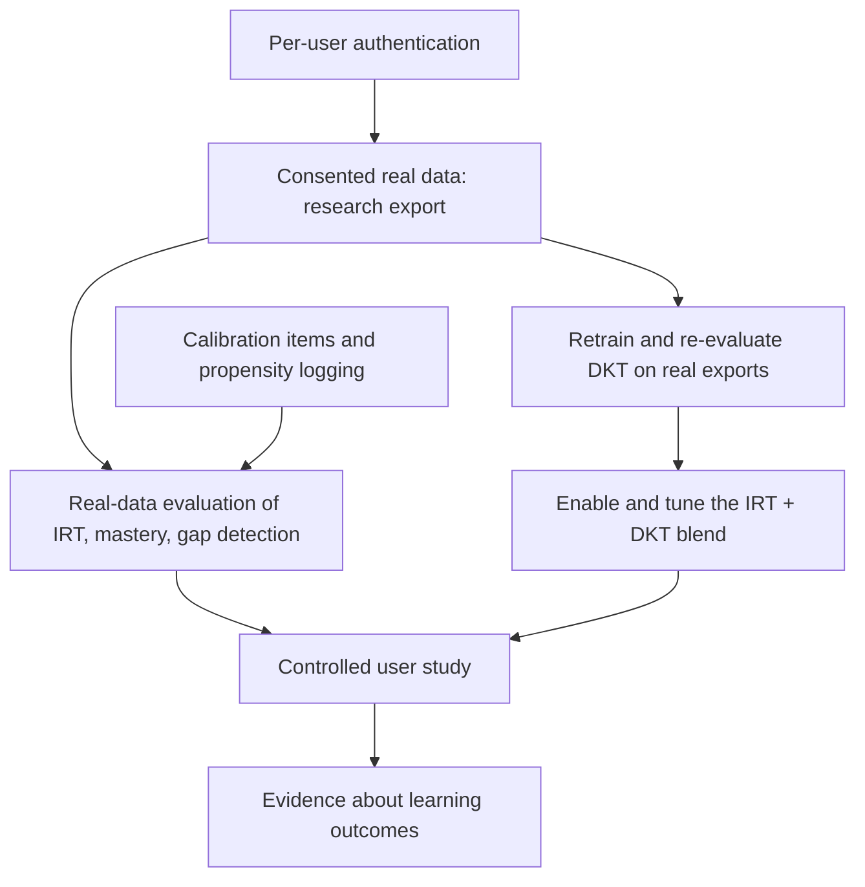

# Future work

**Everything on this page is future work: none of it is implemented.** Items are grouped
into next steps that build on the current code, then the longer-term extensions from
master plan §67. Each next step names the code it would start from. Limitations that
motivate them are in [limitations.md](limitations.md).

## Next steps grounded in the current code (future)

| # | future step | starting point in the code |
|---|---|---|
| 1 | **Retrain DKT on real exports.** Collect consented data, export it, train with `--real`, evaluate on held-out learners, then decide whether to set `KT_DKT_ENABLED=true`. Needs ≥ 1000 learners and ≥ 50 000 attempts (`MIN_LEARNERS`, `MIN_INTERACTIONS` in `model/kt/dkt.py`) | `scripts/export_events.py`, `model/dkt/train_dkt.py --real`, `model/evaluation/evaluate_kt.py --events … --catalog …`, `DktConfiguration` |
| 2 | **Evaluate and tune the deployed blend.** Add a `0.5·IRT + 0.5·DKT` predictor to the offline harness and tune `dkt.blend-weight` and `dkt.min-history` | `SuccessEstimator`, `run_online` in `evaluate_kt.py` |
| 3 | **Per-user authentication** instead of one shared `KT_API_KEY`, so a learner can read only their own state | `common/web/ApiKeyFilter`, `config/WebConfig`, [security.md](security.md) |
| 4 | **Real user study**: consent, pre/post assessment, randomised assignment of Jev providers (the audit already stores provider, candidates and reward) | `recommendations` table, `GET /api/research/decisions`, `OutcomeRewardService` |
| 5 | **Calibration items and controlled exploration** on the item side (master plan §63), plus logging selection probabilities so off-policy estimates become possible | `CandidateGenerationService`, `DecisionOutcome`, `BanditDecisionLayer` |
| 6 | **Record responder ability at response time** for item calibration | `IrtService.recalibrateItem`, `interaction_events` |
| 7 | **Re-localization**: reopen calibration after long inactivity or large residuals | `AdaptiveLocalizationService.updateCalibrationProgress` |
| 8 | **Time and forgetting** in mastery and DKT (decay between sessions, time-gap input feature) | `ConceptMasteryService`, `model/dkt/features.py` (`kt-dkt-v1` would need a new version) |
| 9 | **Richer gap detection**: transitive prerequisites, several weak concepts, emit `HIGH_ITEM_DIFFICULTY`, calibrate gap confidence against labelled cases | `KnowledgeGapService`, `KnowledgeGraphService.allPrerequisites` |
| 10 | **Data-validated graph**: test edges against learner data, add edge strength, concept groups, and use `downstreamConcepts` to explain what a gap blocks | `concept/`, `data/leetcode/tag_concept_map.json` |
| 11 | **Align the offline mirror** with the backend (direct prerequisites, strong-tag preference, sticky calibration) so offline ablations match | `model/kt/policies.py` `SystemPolicy` |
| 12 | **More evaluation**: time-to-mastery metric, several seeds per report, an "IRT + graph + DKT" configuration | `model/evaluation/run_evaluation.py`, `evaluate_kt.py` |
| 13 | **State rebuild command** that replays stored events through the current models after a model change | `LearnerStateService.applyEvent`, `interaction_events` |
| 14 | **Extension robustness**: DOM contract tests against saved LeetCode pages, `ABANDONED` events, configurable backend host, non-English verdict matching | `extension/src/content.js`, `extension/src/lib/extract.js`, `extension/manifest.json` |
| 15 | **Testcontainers profile** for CI machines with Docker (AD-7) | `support/AbstractIntegrationTest` |
| 16 | **Difficulty landscape** (master plan §39) beyond the current single-learner dashboard: population performance and per-problem uncertainty bands | `backend/src/main/resources/static/dashboard.html` |

## Extensions from master plan §67 (future)

| extension | what it would add | precondition in this repo |
|---|---|---|
| Redis | cache for catalog, graph and learner state | today every request reads PostgreSQL; no cache layer exists |
| Kafka | durable event log between ingestion and state updates | ingestion and state update share one transaction (`EventIngestionService` → `LearnerStateService`) |
| Docker | container images for backend and PostgreSQL | no Dockerfile or compose file exists |
| Kubernetes | orchestration of the containers | needs Docker first; the app is a single deployable ([architecture.md](architecture.md)) |
| Real-time event streaming | push recommendations to the extension instead of polling | the extension's popup requests `next-action` on demand |
| Advanced DKT | DKT+ variants, attention, multi-layer LSTMs | `kt-dkt-v1` contract and Java inference (`DktModel`) |
| Transformer-based KT | SAKT/AKT-style models | a new model contract and Java or remote inference |
| Knowledge graph embeddings | learned concept and problem embeddings | `problem_concepts` weights, DKT concept head |
| LLM-based feedback | natural-language explanations of gaps and recommendations | `HttpDecisionLayer` and `scripts/jev_llm_server.py --llm` already bound the LLM to candidate choice ([jev.md](jev.md)) |
| Multi-platform learning | platforms other than LeetCode | problems keyed by `problem_key` with a `source` column; extension is LeetCode-only |
| Organization-level analytics | cohort dashboards | pseudonymised research exports ([privacy.md](privacy.md)) |
| Teacher dashboard | instructor view of learners and gaps | per-user auth and roles (step 3) |
