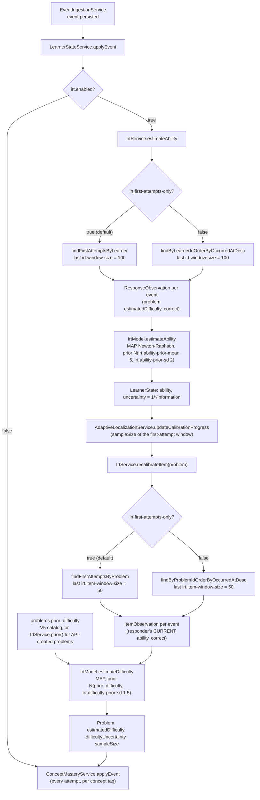

# IRT: ability and item difficulty

Rasch (1PL) model on a 0–10 scale: `P(correct | θ, b) = σ(θ − b)`. Ability and difficulty
are MAP estimates (Newton–Raphson, Gaussian priors); uncertainty is `1/√information`.
Java: `irt/IrtModel.java`, `IrtService.java`; Python reference: `model/kt/irt.py`.

| setting | default |
|---|---|
| ability prior | N(5, 2²) |
| difficulty prior sd | 1.5 around the problem's `prior_difficulty` |
| ability window | last 100 first-attempt responses |
| item window | last 50 first-attempt responses |

Each ingested event runs both updates inside `LearnerStateService.applyEvent`, ability first
so the item fit sees the newest estimate:



## One response per learner and problem

Rasch assumes independent responses. A retry after a wrong answer is not independent, and
counting it lets "retry until accepted" inflate ability (in simulation this is exactly
what a reward-maximising bandit exploits, see [jev.md](jev.md)). With
`irt.first-attempts-only: true` (default) only each learner's **first** attempt on a
problem enters ability estimation and item calibration. Concept mastery (Beta-Bernoulli)
and DKT still use every attempt; DKT models retries explicitly (`ρ·r_q`).
Cost: IRT no longer learns from retry outcomes, so it predicts retries less well; that
part of the signal is left to DKT (next-attempt AUC on the synthetic benchmark: IRT 0.718,
DKT 0.731).

## Acceptance-adjusted difficulty prior

LeetCode labels are coarse (a Hard problem with 60 % acceptance is easier than one with
20 %). Each problem's prior combines the label with its acceptance rate **within** the label:

```
z     = (logit(acceptance) − μ_label) / σ_label
prior = clamp(base_label − clamp(0.6·z, −1.2, +1.2), 0.5, 9.5)       base: EASY 3, MEDIUM 5, HARD 7
```

μ/σ of logit(acceptance) over all 3117 free algorithm problems: EASY 0.8929/0.6924,
MEDIUM 0.2570/0.6718, HARD −0.1888/0.6556. Examples: LC1 Two Sum 3.50, LC104 2.64,
LC3 5.60, LC4 6.91. The same formula is in `scripts/build_leetcode_catalog.py` (V5
migration), `IrtService.prior()` (problems created through the API) and is pinned by
`IrtPriorTest` and `model/tests/test_catalog_1000.py`.

On the synthetic benchmark the prior alone ranks true item difficulty with Spearman
0.910; online calibration from 20+ responses gives 0.902 (the prior is already good and
first-attempt data is thinner). `problems.prior_difficulty` keeps the prior;
`estimated_difficulty` is the calibrated value.
