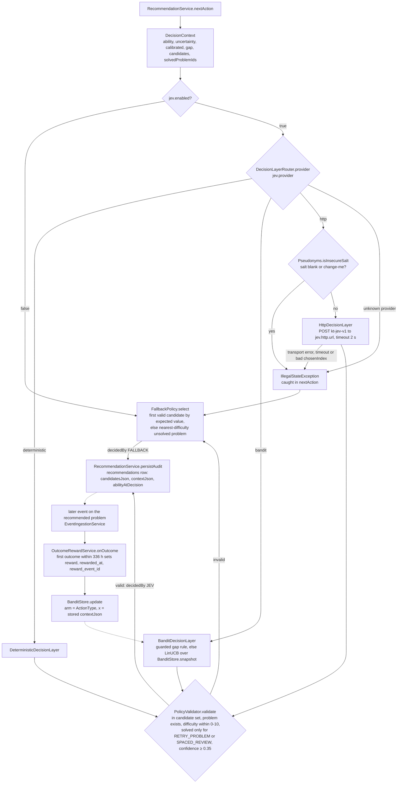

# Jev — the bounded decision layer

Jev chooses **one** action from the candidate set built by `CandidateGenerationService`
(see [recommendation.md](recommendation.md)). It can never invent problems or actions:
every provider returns one of the given candidates, `PolicyValidator` re-checks the
choice and confidence (threshold 0.35), and any failure falls back to the deterministic
policy (`decidedBy: FALLBACK`).

One decision and its later reward, including the HTTP provider's refusal to send pseudonyms
keyed with a blank or default salt:



## Providers (`knowledge-tracer.jev.provider`, env `KT_JEV_PROVIDER`)

| provider | class | behaviour |
|---|---|---|
| `deterministic` (default) | `DeterministicDecisionLayer` | prerequisite gap → prerequisite review; concept gap → easier problem; uncalibrated → calibration item; otherwise highest expected value |
| `bandit` | `BanditDecisionLayer` | LinUCB contextual bandit learning online from outcomes; **guarded** by default |
| `http` | `HttpDecisionLayer` | external service speaking `kt-jev-v1` (reference: `scripts/jev_llm_server.py`, heuristic or LLM) |

`DecisionLayerRouter` dispatches per request; `GET /api/models/jev` shows the provider,
bandit settings and per-arm statistics (updates, mean reward, θ).

## LinUCB (`decision/bandit`)

Disjoint LinUCB, one arm per `ActionType`, state in table `jev_bandit_arms` (V6, updated
under a pessimistic row lock).

```
A = λI + Σ x xᵀ,   b = λθ₀ + Σ r x,   θ = A⁻¹b
score = θ·x + α √(xᵀA⁻¹x)          α = 0.5, λ = 1
confidence = clamp(1 / (1 + width), 0.35, 0.95)
```

θ₀ puts weight 1 on `expectedValue`, so an untrained bandit ranks like the heuristic.
Context features (`BanditFeatures`, version 1, all bounded):
`bias, predictedSuccess, information = 4p(1-p), relativeDifficulty = clamp((d-θ)/3,±1),
abilityUncertainty = clamp(σ/2,0,1), calibrated, gapMatch (gap confidence if the candidate
targets the gap concept/prerequisite), expectedValue (≤ 1.5)`.

**Guarded mode** (`jev.bandit.guarded: true`): when a concept or prerequisite gap is
detected and a remediation candidate exists, the deterministic rule decides; the bandit
only chooses when there is no actionable gap.

## Reward (`OutcomeRewardService`)

The first outcome event on the recommended problem within 336 h is attributed to the
recommendation (stored in `recommendations.reward`, `rewarded_at`, `reward_event_id`),
and the arm is updated with the stored context vector.

```
quality = 1 accepted | 0.6 with hint | 0.3 after viewing the solution | 0 otherwise
growth  = (clamp((ability_after - ability_at_decision) / 0.5, -1, 1) + 1) / 2
reward  = w · quality + (1 - w) · growth           default w = 0 (growth only)
```

Why `w = 0` and first-attempt IRT ([irt.md](irt.md)): in the offline mirror
(`model/jev/`, 300 simulated learners × 40 decisions, identical learners per provider)
any weight on "accepted" makes the bandit farm easy wins — retries and reviews — so the
reward rises while true learning falls:

| quality weight w | guarded bandit: share of RETRY actions | guarded bandit: true mastery gain |
|---|---|---|
| 0.0 (default) | 22.5 % | 0.0331 |
| 0.3 | 53.3 % | 0.0308 |
| 0.7 | 54.1 % | 0.0306 |

The deterministic policy never retries and gains 0.0335 at every w (seed 7, first-attempt IRT).

With the defaults (`model/reports/jev-simulation.md`):

| provider | true mastery gain | weak-concept gain |
|---|---|---|
| random candidate | 0.0330 ± 0.0013 | 0.0292 ± 0.0046 |
| deterministic | 0.0335 ± 0.0013 | 0.0319 ± 0.0049 |
| LinUCB guarded | 0.0331 ± 0.0013 | **0.0357 ± 0.0068** |
| LinUCB unguarded | 0.0321 ± 0.0013 | 0.0295 ± 0.0060 |

Reading: the guarded bandit matches the rules on overall learning and does somewhat
better on the learner's weak concepts; the unguarded bandit is not recommended. The
immediate reward is a weak proxy for learning, so these are simulator results, not
evidence about real learners. Rewards are logged for every provider, which allows
offline comparison on real data (`GET /api/research/decisions`). The bandit also learns
from decisions it did not make (off-policy), a documented bias.

## HTTP protocol `kt-jev-v1`

`POST {jev.http.url}` with `X-API-Key` when `KT_JEV_HTTP_API_KEY` is set, timeout 2 s.

```json
{"protocol": "kt-jev-v1",
 "learner": {"id": "L-<32 hex HMAC pseudonym>", "ability": 4.2, "uncertainty": 0.8, "calibrated": true},
 "gap": {"type": "PREREQUISITE_GAP", "concept": "TREES", "prerequisite": "RECURSION", "confidence": 0.72, "evidence": ["..."]},
 "candidates": [{"index": 0, "action": "PREREQUISITE_REVIEW", "problemKey": "LC70", "conceptCode": "RECURSION",
                 "difficulty": 2.5, "predictedSuccess": 0.84, "expectedValue": 0.8, "reason": "..."}],
 "rules": ["choose exactly one candidate by index", "..."]}
```

Answer: `{"chosenIndex": 0, "confidence": 0.72, "rationale": "..."}`. Out-of-range index,
transport error or timeout → fallback. The layer also refuses to call out while
`research.pseudonym-salt` is blank or `change-me` (`Pseudonyms.isInsecureSalt`), so every
decision falls back until a real salt is set. The service sees only the pseudonym, estimates and
public problem keys ([privacy.md](privacy.md)).

```bash
python3 scripts/jev_llm_server.py --self-test
python3 scripts/jev_llm_server.py --port 8090                 # heuristic
KT_JEV_PROVIDER=http ./mvnw spring-boot:run
```

## Offline simulation

`python3 model/jev/simulate_jev.py` or `notebooks/Jev_bandit_simulation.ipynb` (Colab):
provider comparison, reward curves, action mix, learned θ, reward-weight and α sweeps.
