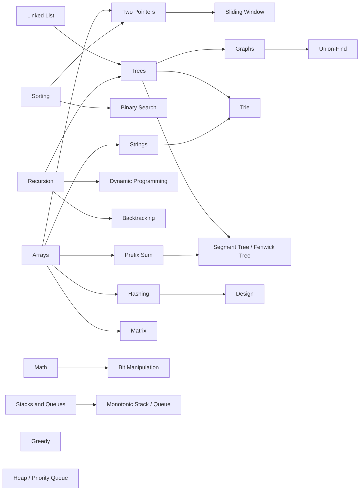
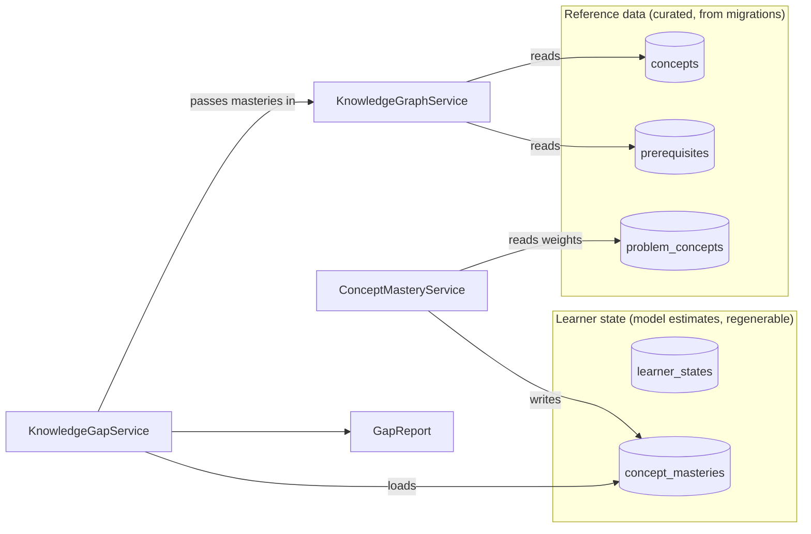
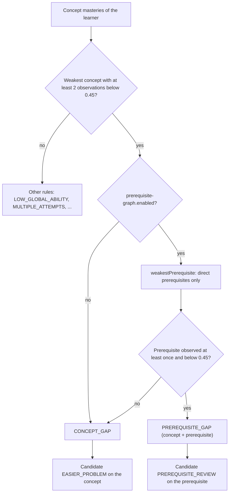

# Knowledge graph: concepts, prerequisites, problem tags

Static reference data: **25 concepts**, **21 directed prerequisite edges** and weighted
problem → concept tags (2653 tags over the 1000 catalog problems). It is curated domain
knowledge, not a model estimate, and it never stores anything about a learner.
Java: `concept/` (`KnowledgeGraphService`, `ConceptService`, `api/ConceptController`);
Python mirror: `model/kt/catalog.py`.

| table (V1) | row | notes |
|---|---|---|
| `concepts` | `code`, `name`, `description` | `code` is unique, e.g. `LINKED_LIST` |
| `prerequisites` | `(concept_id, prerequisite_id)` | "concept requires prerequisite"; `check (concept_id <> prerequisite_id)` |
| `problem_concepts` | `(problem_id, concept_id, weight)` | weight in [0, 1], default 1.0; strongest tag of a problem is normally 1.0 |

Seeding:

| migration | concepts | edges | problem tags |
|---|---|---|---|
| `V3__seed_dev_data.sql` | 15 (ARRAYS … HEAP) | 10 | curated tags for 28 seed problems |
| `V4__catalog_metadata_and_concepts.sql` | +10 (STRINGS … DESIGN) | +11 | — |
| `V5__leetcode_catalog_1000.sql` | none | none | generated tags for the other 972 problems (`where not exists`, so the 28 seed problems keep their curated tags) |

`data/seed/catalog_1000.json` carries the same 25 concepts, the same 21 edges and exactly
the same 2653 `(problem, concept, weight)` rows as V5; the simulator, DKT and notebooks
read the graph from there.

## The seeded prerequisite graph

Arrows point from the prerequisite to the concept that depends on it (`A --> B`: learn A
before B). In the database this is the row `(concept = B, prerequisite = A)`.



* Roots (no prerequisites): ARRAYS, SORTING, LINKED_LIST, RECURSION, STACKS_QUEUES, MATH,
  GREEDY, HEAP. GREEDY and HEAP have no edges at all.
* Longest chain: 3 edges (LINKED_LIST or RECURSION → TREES → GRAPHS → UNION_FIND).
* The two chains from master plan §14 (Arrays → Hashing / Two Pointers → Sliding Window,
  Linked List → Trees → Graphs) are both present.
* Acyclic by contract: `ConceptService.addPrerequisite` rejects self-loops and cycles
  (HTTP 422, `ApiContractIT.prerequisiteGraphRejectsSelfLoopsAndCycles`), and the catalog
  graph is checked by `test_prerequisite_graph_is_a_dag_over_known_concepts`
  (`model/tests/test_catalog_1000.py`). The database itself only forbids self-loops.

## Problem ↔ concept mapping

Each problem has 1–4 weighted concept tags. Generated tags come from LeetCode topic tags
via `data/leetcode/tag_concept_map.json` (81 tag rules; tiers A 1.0 / B 0.7 / C 0.5;
contextual DFS/BFS rule → TREES, GRAPHS or RECURSION; `maxConceptsPerProblem` 4), then
scaled so the strongest tag is 1.0. The 28 V3 problems keep hand-curated weights (LC53 is
the one problem whose strongest tag is 0.8). The extension's `mapTags`
(`extension/src/lib/extract.js`) ports the same rules for problems it registers through
`POST /api/problems`.

Distribution in `catalog_1000.json` (= V5):

| concepts per problem | 1 | 2 | 3 | 4 |
|---|---|---|---|---|
| problems | 141 | 325 | 274 | 260 |

Problems per concept range from 479 (ARRAYS) and 221 (DYNAMIC_PROGRAMMING) down to 20
(SEGMENT_TREE) and 18 (TRIE); per-concept evidence is therefore very uneven.

Where the weights are used:

| consumer | use |
|---|---|
| `ConceptMasteryService.applyEvent` | evidence added to a concept = tag weight × credit weight |
| `CandidateGenerationService.remediationProblem` | prefers problems with weight ≥ 0.7 (`STRONG_TAG_WEIGHT`) on the gap concept |
| `KnowledgeGapService` | counts recent failures on problems tagged with the weak concept (evidence text) |
| DKT (`dkt/ProblemFeatures`, `model/dkt/features.py`) | input and readout weights `w_q` ([dkt.md](dkt.md)) |

## Traversal operations (`KnowledgeGraphService`)

All traversals are breadth-first with a visited set, so they terminate even if a cycle
were inserted directly into the database.

| method | returns | used by |
|---|---|---|
| `directPrerequisites(conceptId)` | direct prerequisites | `ConceptService` responses, `weakestPrerequisite` |
| `allPrerequisites(conceptId)` | transitive prerequisites, closest first | `ConceptResponse.allPrerequisites`, cycle check in `addPrerequisite` |
| `downstreamConcepts(conceptId)` | concepts that transitively depend on the concept | nothing yet (no endpoint, no caller) |
| `weakestPrerequisite(conceptId, masteries)` | direct prerequisite with the lowest mastery; unobserved prerequisites count as mastery 0.5 with evidence 0 | `KnowledgeGapService` |
| `getByCode(code)` | concept or `ResourceNotFoundException` (404) | `ConceptService` |

Each BFS step is one repository query; fine for 25 concepts.

| endpoint | purpose |
|---|---|
| `GET /api/concepts` | all concepts with `directPrerequisites` and `allPrerequisites` |
| `GET /api/concepts/{code}` | one concept (`ApiContractIT.seededGraphExposesTransitivePrerequisites`: GRAPHS → TREES, LINKED_LIST, RECURSION) |
| `POST /api/concepts` | create a concept (409 if the code exists) |
| `POST /api/concepts/{code}/prerequisites` | add an edge; 422 self-loop or cycle, 409 duplicate, 404 unknown concept |
| `GET /api/problems/{problemKey}` | problem with `conceptTags`, strongest first |

Master plan §14 coverage: prerequisite lookup, downstream lookup (service only),
problem → concept mapping, learner concept mastery (separate state, below) and gap
identification are implemented. **Concept grouping is not implemented**: concepts are a
flat list with no group entity.

## Separation from learner state



The graph tables have no learner columns. `KnowledgeGraphService` has no mastery
repository; `weakestPrerequisite` receives the learner's `ConceptMastery` list as an
argument and returns a value, it writes nothing. Editing an edge therefore changes no
stored estimate, only future gap reports. Concept masteries live in `concept_masteries`
(V2), keyed by learner and concept, and are exposed as estimates
(`GET /api/learners/{userId}/state`: mastery, uncertainty, evidence count).

## How gap detection uses the graph



Thresholds are `knowledge-tracer.mastery.min-evidence` (2) and `weak-threshold` (0.45).
A prerequisite gap's confidence is `min(0.9, 0.5 + 0.08·n)` with n = evidence on the
concept plus evidence on the prerequisite; the evidence list says "prerequisite X also
weak (mastery 0.xx)". `CandidateGenerationService` then offers a `PREREQUISITE_REVIEW`
(easiest suitable unsolved problem on the prerequisite, target ability − 1.0) and the
deterministic Jev provider picks it before anything else ([recommendation.md](recommendation.md),
[jev.md](jev.md)).

Only the **single weakest** concept and its **direct** prerequisites are examined. A
prerequisite the learner has never practised (evidence 0) can never produce a
prerequisite gap. The offline mirror (`SystemPolicy._weak_prerequisite` in
`model/kt/policies.py`) walks *transitive* prerequisites, so offline ablations are
slightly more graph-aggressive than the backend.

## Toggle `knowledge-tracer.prerequisite-graph.enabled`

Default `true` (`application.yml`; no dedicated environment variable, use Spring relaxed
binding `KNOWLEDGETRACER_PREREQUISITEGRAPH_ENABLED=false` or a command-line property).

```bash
./mvnw spring-boot:run -Dspring-boot.run.arguments=--knowledge-tracer.prerequisite-graph.enabled=false
```

When `false`, only the gap step changes: `KnowledgeGapService` skips the prerequisite
check, so there is no `PREREQUISITE_GAP` and no `PREREQUISITE_REVIEW` candidate, and
`next-action` reports `models.prerequisiteGraph: DISABLED`. The graph is still stored,
the concept endpoints and cycle checks still work, and mastery updates are unaffected.
`GraphDisabledIT` pins the behaviour: four wrong answers (LC104, LC226, LC98, LC141) give
a `CONCEPT_GAP` on TREES and an `EASIER_PROBLEM` recommendation instead of a prerequisite
gap. Offline counterparts: `SystemPolicy(use_graph=...)` and the prerequisite term
`w_graph` of `IrtMasteryPredictor` ([evaluation.md](evaluation.md)).

## Limits

The graph and the tag rules are hand-curated and have not been validated against learner
data; edges carry no strength; tags for 972 problems are derived from LeetCode topic tags;
graph edits are not versioned. In the 28-problem offline harness the fitted weight of the
prerequisite term is 0.0 (synthetic data), i.e. the graph added no predictive signal
there. See [limitations.md](limitations.md) and [future-work.md](future-work.md).
