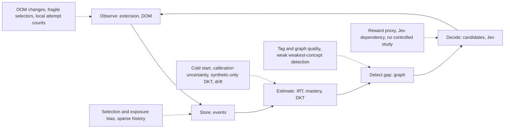

# Limitations

A **living** document (master plan §62): add an entry whenever implementation, testing or
evaluation reveals a new weakness. Knowledge Tracer is a research prototype; nothing below
has been validated on real learners. Every evaluation number quoted is from
`model/reports/` and is **synthetic data**; other numbers are configuration defaults or
catalog counts.

Where the limitations enter the evidence chain:

## Research limitations (master plan §62)

| limitation | how it shows up here | current mitigation |
|---|---|---|
| Limited learner data | No real learner dataset exists; every quantitative result is simulator output | Results are labelled synthetic; research export (`/api/research/*`) prepared for consented data ([privacy.md](privacy.md)) |
| Cold start | New learners start at θ = 5.0, σ = 2.0; items start at catalog priors | Acceptance-adjusted priors ([irt.md](irt.md)); calibration items ([adaptive-localization.md](adaptive-localization.md)) |
| Selection bias | Adaptive recommendations decide which items a learner sees (below) | IRT conditions on ability; first attempts only |
| Exposure bias | Only free problems become candidates; problems the system rarely recommends collect little data (below) | Priors from platform acceptance |
| Sparse interaction history | Concepts range from 479 (ARRAYS) to 18 (TRIE) catalog problems; gap detection needs ≥ 2 observations per concept | Evidence counts shown; `INSUFFICIENT_PRACTICE` below 5 events |
| Difficulty calibration uncertainty | Item calibration uses learners' **current** ability, not their ability at response time (`IrtService.recalibrateItem`); window of 50 first attempts | `difficulty_uncertainty` and `sample_size` stored per problem |
| Concept tagging quality | Tags for 972 problems are generated from LeetCode topic tags (`tag_concept_map.json`); only 28 are curated | Tag weights; remediation prefers weight ≥ 0.7 |
| Prerequisite graph quality | 25 concepts / 21 hand-written edges, no edge strength, GREEDY and HEAP isolated, never validated against data ([knowledge-graph.md](knowledge-graph.md)) | Graph can be switched off (`prerequisite-graph.enabled`) |
| DOM changes | The extension reads LeetCode's markup (`extension/src/content.js`, helpers in `extension/src/lib/extract.js`) | Fallback selectors; failures produce no event rather than a wrong one |
| Browser extension fragility | MV3 service worker, local queue, local attempt counter (below) | Durable queue with retries, backend idempotency by event id |
| Model drift | No forgetting in IRT or Beta-Bernoulli mastery; calibration flag never resets; DKT has no notion of time | Sliding IRT windows (100 responses / 50 per item) |
| Jev dependency | External `http` provider can be slow, wrong or down | Bounded candidates, `PolicyValidator`, `FallbackPolicy`, 2 s timeout ([jev.md](jev.md)) |
| Synthetic-data limitations | The simulator encodes our assumptions; DKT is trained **only** on synthetic data | DKT off by default (`KT_DKT_ENABLED=false`); banners in every report |
| Lack of controlled educational study | No user study, no A/B test, no learning-outcome measurement on humans | None yet ([future-work.md](future-work.md)) |

## Selection and exposure bias

Master plan §63: adaptive recommendation creates selection bias. Beginners mostly see easy
items and experts hard ones, so raw success rates are not intrinsic difficulty.

* **What the code does.** Items are chosen near the learner's estimate (calibration items
  at `b ≈ θ`, same-level items at predicted success ≈ 0.65). Difficulty is never estimated
  from raw success rate; `IrtService.recalibrateItem` fits a Rasch difficulty given each
  responder's ability, with a prior from the LeetCode label and acceptance rate, using first
  attempts only. The recommendation audit stores the full candidate list and the chosen
  index for later analysis.
* **What it does not do.** There are no item-side calibration items or randomised
  exploration, and no selection propensities are logged (the deterministic provider picks
  with probability 1), so off-policy corrections such as inverse propensity weighting are
  not possible. Responder abilities are taken at their current value. The bandit also
  learns from decisions it did not make ([jev.md](jev.md)).
* **Exposure.** Paid problems are never candidates or fallback choices; the catalog is the 28 curated problems
  plus the most-liked free algorithm problems ([data.md](data.md)). The extension only
  observes submissions made while tracking is on; a problem opened and abandoned without a
  submission produces no event (the schema has `ABANDONED`, but the content script never
  emits it). Activity on other devices or before installation is invisible.
* **Offline evaluation.** `run_evaluation.py` uses random-order evaluation sequences to
  keep this bias out of the evaluation set; the v2 simulator models learner-driven problem
  choice instead ([evaluation.md](evaluation.md)).

## Observed vs estimated

Master plan §64. The system keeps the two apart in storage and in wording:

| observed (append-only) | estimated (regenerable model state) |
|---|---|
| `interaction_events`: result, attempt number, time spent, hint used, solution viewed, self-reported confidence and blocker | `learner_states`: ability, uncertainty, calibrated |
| `feedback`: learner answers and comments | `concept_masteries`: mastery, evidence count; DKT concept mastery (`dktKnowledge`) |
| | problem `estimated_difficulty`, `difficulty_uncertainty` |
| | gap type, evidence list, confidence; candidate `predictedSuccess`, `expectedValue`; reward |

Example: "3 unsuccessful attempts on LINKED_LIST problems" is an observation;
"LINKED_LIST mastery estimate 0.31" is a model estimate. Gap evidence strings name the
estimate ("mastery estimate … is below threshold") and the prose uses "evidence suggests".
Caveats:

* Gap `confidence` is a heuristic, `min(0.9, 0.5 + 0.08·n)` (or fixed 0.5 / 0.4 / 0.6 for
  some rules), not a calibrated probability.
* The `next-action` `knowledge` map carries mastery only; per-concept uncertainty and
  evidence counts are only in `GET /api/learners/{userId}/state`.
* The `calibrated` flag reads like a fact about the learner but is a phase marker.

## Model limitations found in code and reports

* **Weakest-concept identification is weak for every estimator.** Hit rate of the
  estimated weakest practised concept being a true weak concept, over 253 learners
  (`model/reports/kt-evaluation.md`, synthetic data): truth 0.8458, beta 0.166,
  irt-residual 0.1739, dkt 0.083, dkt-relative 0.0949, random 0.0966. DKT is at or below
  chance here. In the 28-problem harness (`evaluation-report.md`, synthetic data) a flagged
  gap was the designated weak concept 0.147 of the time (chance 0.067); in the end-to-end
  replay the backend flagged the designated weak concept for 1/30 learners
  (`replay-results.json`, synthetic data). Treat concept-level gap reports as low-confidence.
* **Concept mastery recovery is moderate**: Spearman with true mastery 0.4512 (beta) and
  0.6578 (dkt) (`kt-evaluation.md`, synthetic data).
* **The graph adds no predictive signal offline**: fitted prerequisite weight
  w_g = 0.0 (`evaluation-report.md`, synthetic data).
* **Gap detection** looks only at the single weakest concept and its **direct**
  prerequisites; unpractised prerequisites never trigger a gap. `HIGH_ITEM_DIFFICULTY` is
  defined in `GapType` but never emitted.
* **IRT** is Rasch 1PL (no discrimination, guessing or slip), clamped to [0, 10], and with
  `irt.first-attempts-only` it does not learn from retries.
* **Beta-Bernoulli mastery** never decays; its credit weights (hint 0.7×, solution 0.4×,
  slow success 0.8×, …) are experimental.
* **DKT** (`LstmDktPredictor`) is trained only on synthetic data (`"trainedOn": "synthetic"`),
  has item offsets only for problems seen in training, ignores time, and the 0.5 IRT / 0.5
  DKT blend (`SuccessEstimator`) is untuned and not evaluated offline ([dkt.md](dkt.md)).
* **Adaptive localization** estimates global ability only; calibration ends at σ ≤ 0.9
  or 8 first-attempt responses and is never re-opened
  ([adaptive-localization.md](adaptive-localization.md)).
* **Jev**: the reward is a proxy for learning; any weight on "accepted" lets the bandit farm
  retries in simulation; the bandit almost never chooses calibration items
  (`CALIBRATION_PROBLEM` 4 times guarded vs 1433 deterministic, `jev-simulation.md`,
  synthetic data) ([jev.md](jev.md)).
* **Offline mirror drift**: `SystemPolicy` (`model/kt/policies.py`) walks transitive
  prerequisites, has no strong-tag preference and recomputes "calibrated" each step, while
  the backend uses direct prerequisites, prefers weight ≥ 0.7 and keeps a sticky flag.
  Offline ablations approximate, not reproduce, the backend.

## Engineering limitations

* **Integration tests use embedded PostgreSQL (zonky `embedded-postgres`, PostgreSQL 17
  binaries) instead of Testcontainers** (`AbstractIntegrationTest`, AD-7 in
  [architecture.md](architecture.md)). One server per JVM is shared by all Spring contexts,
  so tests isolate by unique learner ids and assertions on shared item difficulty must stay
  relative. `pom.xml` adds Apple-Silicon binaries explicitly; other platforms rely on the
  default binary set. See [testing.md](testing.md).
* **Scale**: `CandidateGenerationService` loads all problems per request and filters in
  memory; graph traversals issue one query per node; `KnowledgeGapService` queries tags
  per recent failure. Adequate for 1000 problems, not for large catalogs.
* **No state rebuild tool**: model state is updated incrementally per event; there is no
  command that replays stored events to rebuild estimates after a model change.
* **Feedback is write-only**: `POST /api/feedback` stores `feedback` rows, but no model, gap
  detector or export reads them yet.
* **Jev rationale is discarded**: the provider's `DecisionOutcome.rationale` is not persisted
  or returned, so an LLM decision cannot be explained after the fact from the audit alone.
* **Every next-action call is audited**: `RecommendationService.nextAction` inserts a
  `recommendations` row per call, so polling (popup, dashboard) grows the table and can leave
  several pending rewards for the same problem; only the most recent one is rewarded.
* **Remote decision inside a transaction**: with `KT_JEV_PROVIDER=http`, the call to the
  decision service (timeout `jev.http.timeout-ms`, 2000 ms) runs inside the `nextAction`
  database transaction, holding a connection for its duration.
* **Prerequisite cycle check is not concurrency-safe**: `ConceptService.addPrerequisite`
  checks for cycles before inserting, so two concurrent inserts could close a cycle, and
  migrations bypass the check. Traversals still terminate (visited sets).
* **Authentication**: one optional shared API key (`KT_API_KEY`, blank = disabled); no
  per-user authentication, so anyone with the key and a `userId` can read that learner's
  state ([security.md](security.md)).
* **Extension**:
  * Selectors: `[data-cy="question-title"]`, `div.text-title-large`,
    `[class*="text-difficulty-"]`, `a[href^="/tag/"]`,
    `[data-e2e-locator="submission-result"]`. Any LeetCode markup change can silently stop
    event collection.
  * Verdicts and hints are recognised by English text (`mapSubmissionResult`,
    `isHintToggle`); the title must look like `"21. Merge Two Sorted Lists"`.
  * Attempt numbers come from a per-browser counter (`kt.attempts` in `chrome.storage`), so
    they reset on reinstall and miss attempts made elsewhere.
  * `timeSpentSeconds` is wall-clock time since the problem page opened, idle time included.
  * The local queue keeps at most 500 events and drops the oldest.
  * `host_permissions` cover `http://localhost:8080` only; another backend URL needs a
    manifest change.

## Evaluation limitations

No real learner data, no controlled study and no online experiment. Learning-gain
metrics exist only inside the simulator and depend on its learning rule. The two
simulators (`kt/synthetic.py`, `kt/simulator.py`) are not comparable. Each report uses one
seed. "Time to mastery" is not measured. Details: [evaluation.md](evaluation.md).

## Adding an entry

State the limitation, where it lives in the code or which report shows it, and the
current mitigation (or "none"). Quote evaluation numbers only from `model/reports/`,
labelled synthetic data, and link the relevant doc.
