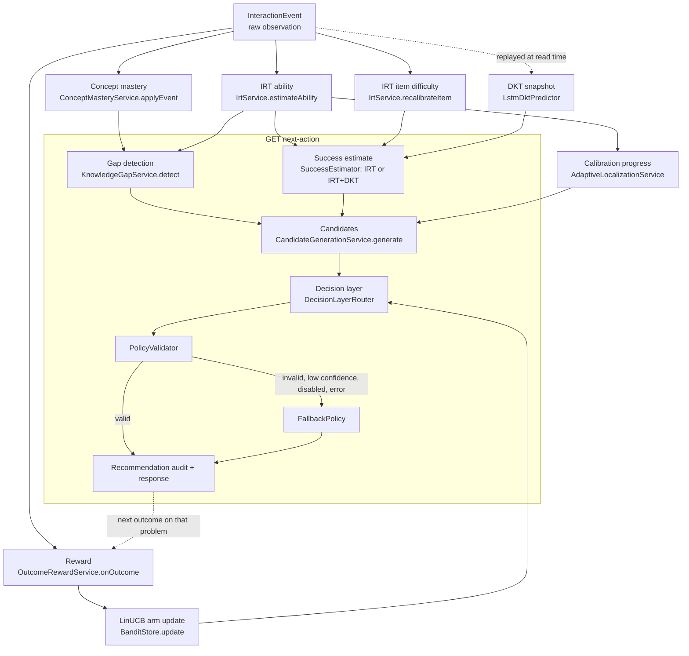
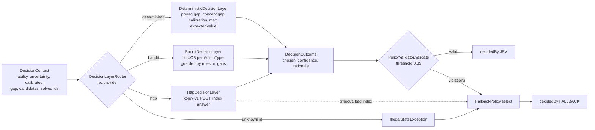
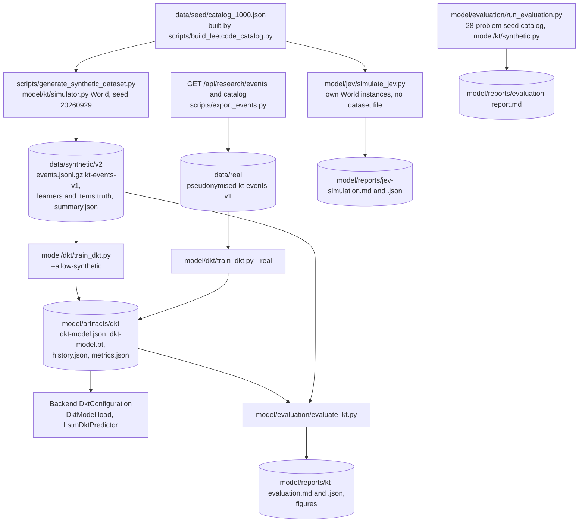

# Model flow

The intelligence pipeline in two parts: the **online** flow that runs inside the Java
backend for every event and every `next-action`, and the **offline** flow in Python that
generates synthetic data, trains DKT, exports it to the backend and evaluates all models.
Formulas and constants per component are in [irt.md](irt.md), [dkt.md](dkt.md),
[recommendation.md](recommendation.md) and [jev.md](jev.md); this page shows how they
connect and which switch turns each one off.

## 1. Online pipeline

Execution order and transactions are in [data-flow.md](data-flow.md). All numbers below
are defaults from `application.yml` / `KnowledgeTracerProperties`.

### 1.1 Interaction → IRT (`irt/`)

* `IrtService.estimateAbility` takes the learner's last 100 **first attempts**
  (`InteractionEventRepository.findFirstAttemptsByLearner`; all attempts if
  `irt.first-attempts-only: false`) and calls `IrtModel.estimateAbility`: Rasch
  `P = σ(θ − b)`, MAP Newton–Raphson (≤ 50 iterations) with prior N(5, 2²), clamped to
  [0, 10], uncertainty `1/√(prior precision + Σ p(1−p))`.
* `IrtService.recalibrateItem` re-estimates the problem's `estimated_difficulty` from the
  last 50 first attempts on it, prior = `prior_difficulty` with sd 1.5
  (`IrtModel.estimateDifficulty`). Responders' abilities are their current estimates.
* Problems created through the API get the acceptance-adjusted prior from `IrtService.prior`.

### 1.2 DKT, optional blend (`dkt/`)

* `DktConfiguration` picks the `DktPredictor` bean **at startup**: `UnavailableDktPredictor`
  when `dkt.enabled` is false or the model file is missing/invalid (never a startup failure),
  else `LstmDktPredictor` with the `kt-dkt-v1` JSON (`DktModel.load`).
* `LstmDktPredictor.snapshot` replays the learner's most recent `maxSequenceLength` (200)
  events from a zero state each request; problem inputs use catalog concept weights and
  `prior_difficulty`; nothing is persisted.
* `SuccessEstimator.forLearner` uses the snapshot only if DKT is enabled and the learner has
  ≥ `dkt.min-history` (3) events. `Estimate.predict(p) = 0.5·IRT + 0.5·DKT`
  (`dkt.blend-weight`), falling back to IRT for problems without a concept the model knows.
  `Estimate.irt(p)` (pure Rasch) is always used for calibration candidates.

### 1.3 Concept mastery (`mastery/`)

`ConceptMasteryService.applyEvent` runs once per concept tag of the problem: Beta(1, 1)
prior, success adds `tagWeight × creditWeight` to α, failure to β; mastery `α/(α+β)`.
`creditWeight` discounts assisted or doubtful successes (hint 0.7×, solution viewed 0.4×,
self-reported confidence ≤ 2 0.8×, > 45 min 0.8×) and failures after viewing the solution
(0.5×). Mastery sees **every** attempt, including retries.

### 1.4 Knowledge gap (`gap/`)

`KnowledgeGapService.detect` returns one `GapReport` (type, concept, prerequisite, evidence
strings, heuristic confidence `min(0.9, 0.5 + 0.08·n)`), first matching rule wins:
`UNKNOWN` (no events) → `PREREQUISITE_GAP` / `CONCEPT_GAP` (weakest concept with ≥ 2
observations below 0.45; prerequisite via `KnowledgeGraphService.weakestPrerequisite`) →
`LOW_GLOBAL_ABILITY` → `MULTIPLE_ATTEMPTS` → `TIME_PRESSURE` → `LOW_CONFIDENCE` →
`INSUFFICIENT_PRACTICE` → `NONE`. Thresholds: [recommendation.md](recommendation.md#gap-detection-knowledgegapservice).
The prerequisite graph is described in [knowledge-graph.md](knowledge-graph.md).

### 1.5 Adaptive localization (`localization/`)

`AdaptiveLocalizationService` has three hooks: `updateCalibrationProgress` (on ingestion:
`calibrated = true` once uncertainty ≤ 0.9 or ≥ 8 first-attempt IRT responses, never reset),
`needsCalibration` and `calibrationTargetDifficulty` (= current ability, clamped) for
candidate generation. See [adaptive-localization.md](adaptive-localization.md).

### 1.6 Candidate generation (`recommendation/`)

`CandidateGenerationService.generate` builds a bounded list of `CandidateAction`s over free
problems only (`paid_only = false`): up to 2 `CALIBRATION_PROBLEM`, one each of
`PREREQUISITE_REVIEW`, `EASIER_PROBLEM`, `SAME_LEVEL_PROBLEM` (predicted success closest to
0.65), `HARDER_PROBLEM` (after ≥ 3 successes in a row), `RETRY_PROBLEM`, `SPACED_REVIEW`,
each only when its condition holds. Every candidate carries `difficulty`, `reason`,
heuristic `expectedValue` and `predictedSuccess` from `SuccessEstimator`. Table:
[recommendation.md](recommendation.md#candidates-candidategenerationservice).

### 1.7 Decision layer (`decision/`)

* Providers only choose among the given candidates. `DeterministicDecisionLayer` uses the gap
  confidence for remediation, 0.8 for calibration and `min(0.9, expectedValue)` otherwise.
  `BanditDecisionLayer` scores `θ·x + α√(xᵀA⁻¹x)` on `BanditFeatures.of` (8 features,
  `α = 0.5`, `λ = 1`), confidence `clamp(1/(1+width), 0.35, 0.95)`; in guarded mode a
  concept/prerequisite gap with a remediation candidate is delegated to the deterministic
  rules. `HttpDecisionLayer` sends the pseudonymised context and accepts
  `{"chosenIndex", "confidence", "rationale"}`.
* `PolicyValidator.validate` rejects: no candidate, a choice not in the candidate set, an
  unknown problem, difficulty outside [0, 10] or NaN, an already-solved problem unless the
  action is `RETRY_PROBLEM` / `SPACED_REVIEW`, and confidence below the threshold.
* `FallbackPolicy.select` tries candidates in descending expected value and takes the first
  that passes validation at threshold 0 (confidence 0.5), else the unsolved problem nearest the ability
  (`SAME_LEVEL_PROBLEM`, 0.3), else `FEEDBACK_REQUEST` (0.1). This last-resort search skips
  paid-only and solved problems; failed attempts may be picked again.
* `RecommendationService.persistAudit` stores the decision, the candidate list and the
  chosen candidate's context vector.

### 1.8 Reward (`OutcomeRewardService`)

On every **new** event, `onOutcome` finds the most recent un-rewarded recommendation of
the same learner and problem created within `jev.reward.attribution-window-hours` (336) and
sets `reward = w·quality + (1 − w)·growth` with `w = jev.reward.quality-weight` (0) and
`growth = (clamp(Δability / 0.5, −1, 1) + 1)/2`, Δability measured against
`ability_at_decision`. If a context vector was stored, `BanditStore.update` applies it to the
arm of that action type, whichever provider decided (off-policy, see [jev.md](jev.md)).
Rewards are therefore collected even with the deterministic provider.

## 2. Ablation switches

Properties are bound once at startup (`@ConfigurationProperties`); changing them needs a
restart. Environment variables exist only where `application.yml` defines one.

| stage | property (env) | default | effect when switched off / changed | evidence |
|---|---|---|---|---|
| IRT | `knowledge-tracer.irt.enabled` | `true` | ability stays at the prior 5.0, items are not re-calibrated; mastery still updates; `models.irt = DISABLED`. The Rasch formula is still used to score candidates, now with θ = 5.0 | `IrtDisabledIT` |
| IRT first attempts | `knowledge-tracer.irt.first-attempts-only` | `true` | `false` uses every attempt (retries inflate ability, [irt.md](irt.md)) | — |
| DKT | `knowledge-tracer.dkt.enabled` (`KT_DKT_ENABLED`), `…dkt.model-path` (`KT_DKT_MODEL_PATH`) | `false` | `true` loads the model at startup and blends it into success estimates; `models.successModel = IRT+DKT` | `DktEnabledIT` (test fixture model) |
| prerequisite graph | `knowledge-tracer.prerequisite-graph.enabled` | `true` | no `PREREQUISITE_GAP`, so no `PREREQUISITE_REVIEW` candidates; weak concepts become `CONCEPT_GAP` | `GraphDisabledIT` |
| adaptive localization | `knowledge-tracer.adaptive-localization.enabled` | `true` | no `CALIBRATION_PROBLEM` candidates; `calibrated` is never set to true (the flag then carries no information) | `AdaptiveLocalizationServiceTest` |
| decision layer | `knowledge-tracer.jev.enabled` | `true` | every recommendation comes from `FallbackPolicy`, `decidedBy = FALLBACK`, `provider = null` | `JevDisabledIT` |
| provider | `knowledge-tracer.jev.provider` (`KT_JEV_PROVIDER`) | `deterministic` | `bandit` or `http`; any other value throws in the router → fallback | `DecisionLayerRouterTest`, `BanditLoopIT` |
| bandit guard | `knowledge-tracer.jev.bandit.guarded` | `true` | `false` lets LinUCB override gap remediation | `BanditDecisionLayerTest` |
| validator strictness | `knowledge-tracer.jev.confidence-threshold` | `0.35` | higher values send more decisions to the fallback | `PolicyValidatorTest`, `DecisionFallbackIT` |
| reward mix | `knowledge-tracer.jev.reward.quality-weight` | `0.0` | > 0 rewards "accepted"; the simulation shows reward farming ([jev.md](jev.md)) | `OutcomeRewardServiceTest` |

Concept mastery, gap detection, candidate generation, policy validation and the fallback have
**no switch**: they always run (`models.conceptMastery` is hard-coded to `ENABLED`). The
component report in every `next-action` response (`models`) records which configuration
produced it.

## 3. Offline ML flow (Python, `model/`, `scripts/`)

1. **Synthetic data.** `scripts/generate_synthetic_dataset.py` runs `model/kt/simulator.py`
   (`World`) over the 1000-problem catalog: 2500 learners by default, deterministic per seed,
   events in `kt-events-v1` plus a per-event `truth` block. The simulator is documented in
   [data.md](data.md). It is **synthetic / development data**.
2. **Training.** `model/dkt/train_dkt.py` (PyTorch, `model/requirements-dkt.txt`, or the
   Colab notebook `notebooks/DKT_train_and_visualize.ipynb`): learner-level 70/15/15 split,
   windows of 200, early stopping on validation AUC, test split evaluated once. It refuses
   to train (prints `UNAVAILABLE`, exit 2) without PyTorch, below 1000 learners or 50 000
   attempts, or on synthetic data without `--allow-synthetic`.
3. **Export.** `dkt_model.export` writes `dkt-model.json` (`format: kt-dkt-v1`, concepts,
   LSTM weights, `gamma`, `rho`, `bias`, item offsets, `trainedOn`, `conceptBaseline`,
   metrics). The committed artifact says `"trainedOn": "synthetic"`, 25 concepts, hidden 64.
4. **Java inference.** `DktModel` re-implements the forward pass; `DktModelTest` checks parity
   with Python on `backend/src/test/resources/dkt/fixture-*.json` (generated by
   `model/dkt/make_fixture.py`). `GET /api/models/dkt` reports what was loaded.
5. **Evaluation.** `model/evaluation/evaluate_kt.py` evaluates oracle, prior-only,
   success-rate, IRT (prior and calibrated), IRT+mastery and DKT online on held-out learners
   (predict before observe). `model/jev/simulate_jev.py` compares decision providers on
   learners it simulates itself (`World`, seed 20260929) rather than reading the dataset
   file. `model/evaluation/run_evaluation.py` is the earlier stdlib-only
   pipeline on the 28 seed problems (its report lists DKT as `UNAVAILABLE`).

Results from the committed reports — **all on synthetic data; they describe behaviour under
the simulator's assumptions, not real learners**:

| source | metric | value |
|---|---|---|
| `model/reports/kt-evaluation.md` (384 test learners, 15 534 events) | next-attempt AUC: IRT calibrated / IRT+mastery / DKT | 0.7178 / 0.7171 / 0.7309 |
| same | ECE: IRT calibrated / DKT | 0.0624 / 0.0164 |
| same | concept-mastery Spearman vs truth: Beta / DKT | 0.4512 / 0.6578 |
| same | item-difficulty Spearman: catalog prior / calibrated | 0.9102 / 0.9022 |
| `model/artifacts/dkt/metrics.json` | DKT test AUC | 0.7308 |
| `model/reports/jev-simulation.md` (300 learners × 40 decisions) | true mastery gain: deterministic / LinUCB guarded | 0.0335 ± 0.0013 / 0.0331 ± 0.0013 |

Discussion of what these numbers can and cannot show: [evaluation.md](evaluation.md),
[limitations.md](limitations.md).

## 4. Real-data loop (possible, not yet exercised)

With `KT_RESEARCH_EXPORT=true` and a secret `KT_PSEUDONYM_SALT`, the same scripts run on
real exports (`scripts/export_events.py` → `train_dkt.py --real` → `KT_DKT_MODEL_PATH`).
`GET /api/research/decisions` provides logged decisions with rewards for offline policy
evaluation. No real-data results exist in the repository.
