# Project status

> Status: **research prototype**, updated 2026-09-30. Evaluation results are on **synthetic data
> only**; there is no real-learner study. See [self-evaluation.md](self-evaluation.md) for the
> category scorecard and [final-report.md](final-report.md) for the full write-up.

## Summary

The full loop OBSERVE → STORE → ESTIMATE → TRACE → LOCALIZE → DETECT GAP → GENERATE OPTIONS →
DECIDE → RECOMMEND → OBSERVE AGAIN runs end to end and is covered by integration tests
(`LearningLoopIT`). All twelve phases of the master plan (§49) have an implementation, tests and
documentation. The open work is research validity (real learners, controlled study), a few
model gaps, and engineering hardening. It is listed under [Open items](#open-items).

```mermaid
flowchart LR
    P1["1 Foundation"] --> P2["2 Domain"] --> P3["3 Event ingestion"] --> P4["4 Learner state"]
    P4 --> P5["5 IRT"] --> P6["6 Adaptive localization"] --> P7["7 Knowledge graph"]
    P7 --> P8["8 Recommendation"] --> P9["9 Jev"] --> P10["10 Extension"]
    P10 --> P11["11 Evaluation"] --> P12["12 Visualization"]
```

## Test status

Last full run: 2026-09-30, all green.

| Suite | Command | Result |
|---|---|---|
| Backend unit (surefire) | `cd backend && ./mvnw test` | 92 / 92 pass |
| Backend integration (failsafe) | `cd backend && ./mvnw verify` | 45 / 45 pass |
| Python models and evaluation | `cd model && PYTHONPATH=pylib:. python3 -m unittest discover -s tests -t .` | 66 / 66 pass |
| Extension | `cd extension && node --test tests/` | 31 tests: 30 pass, 1 skipped (`live.test.js`, needs `KT_LIVE` and a running backend) |

Integration tests start an embedded PostgreSQL 17 server (zonky). Inside a restrictive sandbox,
`initdb` is blocked and every `*IT` class errors before running; that is an environment
limitation, not a test failure. Details: [testing.md](testing.md).

## Phase status (master plan §49)

| # | Phase | Status | Evidence |
|---|---|---|---|
| 1 | Foundation | Done | Spring Boot 3.5, PostgreSQL, Flyway `V1`–`V6`, `dev` / `prod` profiles, Actuator health, [README](../README.md) |
| 2 | Domain | Done | Learner, Problem, Concept, ProblemConcept, Prerequisite entities; decisions in [domain-model.md](domain-model.md) |
| 3 | Event ingestion | Done | `POST /api/events`, Bean Validation, idempotent by `eventId` (409 on reuse for another learner or problem), `ApiContractIT`, `LearningLoopIT` |
| 4 | Learner state | Done | `LearnerState`, `ConceptMastery` (Beta-Bernoulli), `LearnerStateService.applyEvent` |
| 5 | IRT | Done | Rasch MAP ability and item difficulty with uncertainty, first attempts only; `IrtModelTest` (28), [irt.md](irt.md) |
| 6 | Adaptive localization | Done | `AdaptiveLocalizationService`, calibration candidates, [adaptive-localization.md](adaptive-localization.md) |
| 7 | Knowledge graph | Done, partial scope | 25 concepts, 21 prerequisite edges, cycle check, gap detection; concept grouping not implemented ([knowledge-graph.md](knowledge-graph.md)) |
| 8 | Recommendation | Done | `CandidateGenerationService`, `PolicyValidator`, `FallbackPolicy`, explanations with evidence ([recommendation.md](recommendation.md)) |
| 9 | Jev | Done | Deterministic, LinUCB bandit and HTTP providers behind `DecisionLayer`; validation and fallback; `DecisionFallbackIT`, `BanditLoopIT` ([jev.md](jev.md)) |
| 10 | Extension | Done, not browser-tested here | Manifest V3 extension: DOM extraction, event queue with retry and auth pause, popup; library tests only ([user-flow.md](user-flow.md)) |
| 11 | Evaluation | Done on synthetic data | Baselines, metrics, ablation ITs, DKT and Jev simulations ([evaluation.md](evaluation.md)) |
| 12 | Visualization | Done | `/dashboard.html`: concept mastery, knowledge graph, difficulty landscape, recommendation and event history |

## Models

| Model | Condition | Enable |
|---|---|---|
| IRT (Rasch) | Live, on by default | `knowledge-tracer.irt.enabled` |
| Concept mastery (Beta-Bernoulli) | Live, always on | — |
| DKT (PyTorch LSTM) | Trained on **synthetic** data, exported to JSON, Java inference (`LstmDktPredictor`); off by default | `KT_DKT_ENABLED=true` |
| Jev deterministic | Live default decision provider | `KT_JEV_PROVIDER=deterministic` |
| Jev LinUCB bandit | Implemented, learns online from rewards; evaluated in simulation only | `KT_JEV_PROVIDER=bandit` |
| Jev HTTP | Client implemented; reference server `scripts/jev_llm_server.py` (heuristic, optional LLM) | `KT_JEV_PROVIDER=http`, `KT_JEV_HTTP_URL`, non-default `KT_PSEUDONYM_SALT` |

Retraining DKT on real exports needs at least 1000 learners and 50 000 attempts
([dkt.md](dkt.md)). Colab: `notebooks/DKT_train_and_visualize.ipynb`.

## Changes on 2026-09-30

Bugs fixed, each with a test:

| Fix | Where | Test |
|---|---|---|
| A valid Jev decision was saved as `FALLBACK` when the provider reported no name | `RecommendationService.persistAudit` | `DecisionFallbackIT.validHighConfidenceDecisionIsUsed` |
| Calibration could end after 8 retries of one problem (a single IRT response) | `AdaptiveLocalizationService`, `LearnerStateService` | `AdaptiveLocalizationServiceTest.retriesOfOneProblemDoNotEndCalibration` |
| Fallback could recommend paid-only problems | `FallbackPolicy.nearestUnsolved` | `FallbackPolicyTest` |
| Fallback ignored every candidate when the top one was invalid | `FallbackPolicy.select` | `FallbackPolicyTest` |
| Reusing an `eventId` for another learner or problem likely returned 500 and created a stray learner | `EventIngestionService.ingest` | `LearningLoopIT.eventIdReusedForAnotherLearnerOrProblemIsAConflict` |
| Non-positive `limit` returned 500; non-JSON body returned 500 | controllers, `GlobalExceptionHandler` | `ApiContractIT.nonPositiveLimitReturns400`, `nonJsonContentTypeReturns415` |
| `prod` profile started with no API key or the default salt | `ProductionSecretsCheck` | `ProductionSecretsCheckTest` |
| HTTP Jev provider sent pseudonyms built with the default salt | `HttpDecisionLayer` | `DecisionLayerRouterTest.httpProviderRefusesBlankOrDefaultSaltBeforeAnyRequest` |
| Extension silently dropped every event on a 401/403 | `extension/src/lib/queue.js`, popup | 8 new tests in `queue.test.js` |
| Research export test never produced a rewarded decision | `ResearchExportIT` | itself |

Also added: 14 new docs (the flow, security, graph, localization, evaluation, limitations,
future-work, testing and report docs), a rewritten `domain-model.md`, corrections across the
existing docs, a root README, `.gitignore`, `.env.example`, 5 Postman requests (36 in total),
and `mdplans/master.md` restored to disk (it was an empty file).

## Open items

Research:
- No real-learner data or controlled study; every result is on synthetic data.
- Weakest-concept identification is weak for every estimator (hit rate 0.083–0.174 against a
  random 0.0966, synthetic data, `model/reports/kt-evaluation.md`).
- The offline Python policy mirror differs from the backend in three rules, and the backend's
  IRT + DKT blend is not evaluated offline ([evaluation.md](evaluation.md)).

Model:
- `HIGH_ITEM_DIFFICULTY` gap type is never emitted; gap detection uses direct prerequisites only.
- No concept grouping; `KnowledgeGraphService.downstreamConcepts` has no caller.
- No re-localization after calibration; no forgetting or time decay.
- No command to rebuild state by replaying events.

Engineering ([limitations.md](limitations.md), [security.md](security.md)):
- One shared API key; no per-user authentication, rate limiting or TLS in the app.
- `/actuator/metrics` needs no key.
- Every `next-action` call writes an audit row; the HTTP Jev call runs inside the DB transaction.
- Feedback is stored but never read.
- Extension depends on LeetCode's DOM and English text; `host_permissions` cover
  `localhost:8080` only; the popup, content script and service worker were not run in Chrome.
- No coverage tool, no CI, no git repository yet.

## What needs a person

1. Load `extension/` unpacked in Chrome, solve a LeetCode problem, and confirm the event,
   state and popup recommendation ([README](../README.md)).
2. Run the full (non-quick) DKT notebook on Colab and compare with
   `model/artifacts/dkt/metrics.json`.
3. Collect real, consented learner data; export with `KT_RESEARCH_EXPORT=true` and a secret
   `KT_PSEUDONYM_SALT`; retrain and re-evaluate.
4. Initialise git and make the first commit (not done automatically, per master plan §73).
