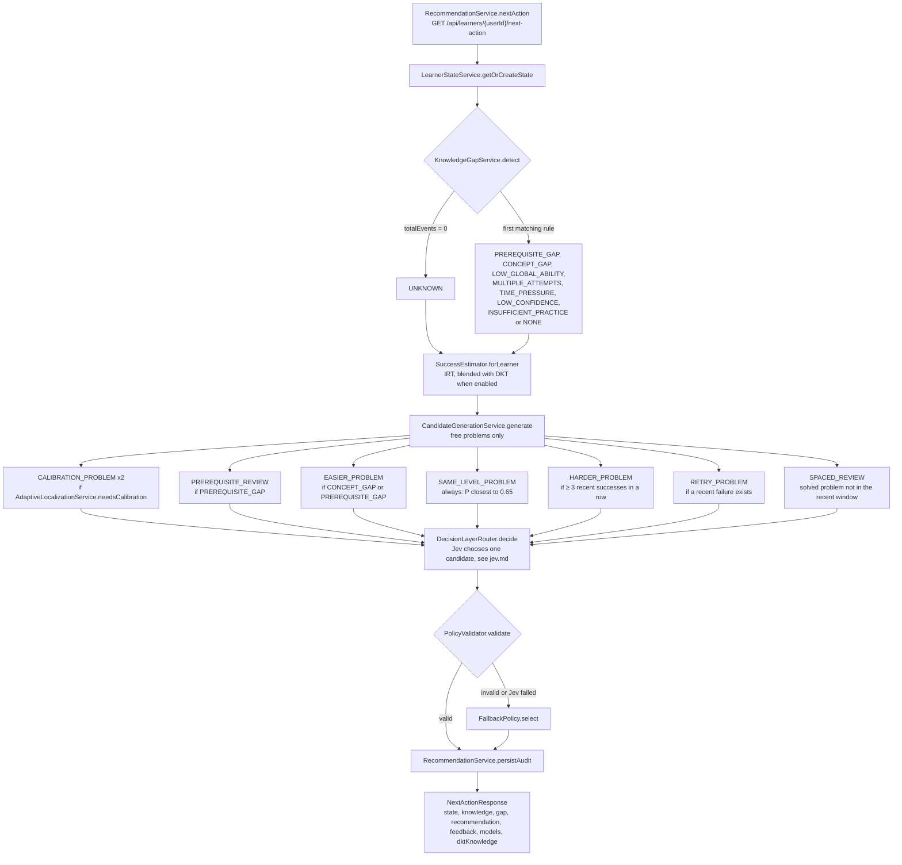

# Recommendation pipeline

`GET /api/learners/{userId}/next-action` runs:

```
learner state (IRT + mastery [+ DKT]) → gap detection → localization → candidates → Jev → policy validation → stored recommendation
```

In more detail, with the gap types that are actually emitted and every candidate action:



## Success estimate (`SuccessEstimator`)

`P(success on q)` = IRT `σ(θ − b_q)`, blended 50/50 with DKT once DKT is enabled and the
learner has ≥ 3 events ([dkt.md](dkt.md)). Calibration items always use pure IRT because
information is an IRT quantity.

## Gap detection (`KnowledgeGapService`)

Heuristic, evidence-counted; confidence = `min(0.9, 0.5 + 0.08·evidence)`. The response
says "evidence suggests", never "we know".

Rules are checked in this order; the first match wins (recent window = last 20 events).

| gap | trigger |
|---|---|
| PREREQUISITE_GAP | weakest concept with ≥ 2 observations has mastery < 0.45 and one of its prerequisites is weak too (prerequisite graph enabled) |
| CONCEPT_GAP | same weak concept, prerequisites fine |
| LOW_GLOBAL_ABILITY | ability < 3 and more than half of the recent events failed |
| MULTIPLE_ATTEMPTS | failed problems needed ≥ 3 attempts on average |
| TIME_PRESSURE | ≥ 2 time-limit failures and ≥ 30 % of recent failures |
| LOW_CONFIDENCE | ≥ 3 self-reports averaging ≤ 2/5 |
| INSUFFICIENT_PRACTICE | fewer than 5 events |
| NONE | nothing above |

`UNKNOWN` is emitted only for a learner with no events yet ("No interaction history yet").
`HIGH_ITEM_DIFFICULTY` exists in `GapType` but is not emitted yet.

## Candidates (`CandidateGenerationService`)

Only free problems. Target success probability 0.65, recent window 20 events.

| action | when | problem | expected value |
|---|---|---|---|
| CALIBRATION_PROBLEM | learner not yet calibrated (calibrated once uncertainty ≤ 0.9 or 8 first-attempt responses) | 2 unattempted items nearest the calibration target | 0.5 + information |
| PREREQUISITE_REVIEW | prerequisite gap | easiest unsolved item on the prerequisite, ≤ ability − 1 | 0.8 |
| EASIER_PROBLEM | concept or prerequisite gap | easiest unsolved item on the concept, ≤ ability − 1.5 | 0.75 |
| SAME_LEVEL_PROBLEM | always | unattempted item with P closest to 0.65 | 1 − \|P − 0.65\| |
| HARDER_PROBLEM | ≥ 3 recent successes in a row | unattempted item in (θ, θ + 2] | 0.55 |
| RETRY_PROBLEM | a recent failure exists | most recently failed problem | 0.5 |
| SPACED_REVIEW | a solved problem not seen recently | first such problem | 0.4 |

Remediation prefers problems that exercise the concept directly (tag weight ≥ 0.7), then
unattempted ones, then ones closest below the target difficulty.

## Decision and audit

Jev chooses one candidate ([jev.md](jev.md)). Every recommendation is stored with the
full candidate list, the chosen action and problem, the candidate's reason, provider,
`decidedBy` (`JEV` or `FALLBACK`), confidence, the bandit context vector and later its
reward, so decisions can be audited and re-evaluated offline
(`GET /api/learners/{userId}/recommendations`, `GET /api/research/decisions`). The
provider's own `DecisionOutcome.rationale` (for example the HTTP service's explanation) is
neither stored nor returned.
