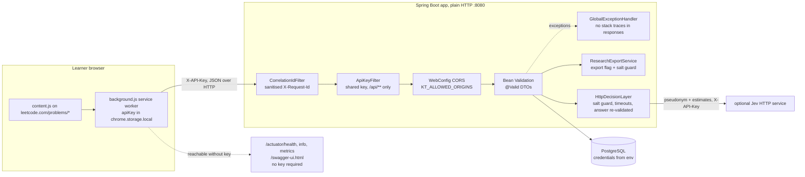

# Security

What the code implements today, and what it does not. Knowledge Tracer is a research
prototype meant to run on a developer machine or a trusted network; the controls below are
proportionate to that and are **not** sufficient for an internet-facing deployment.
Data-protection aspects (what is stored, pseudonyms, exports) are in [privacy.md](privacy.md).

## 1. Implemented

### Shared API key (`common/web/ApiKeyFilter.java`)

* Enabled when `knowledge-tracer.security.api-key` (env `KT_API_KEY`) is non-blank; blank
  (the default) disables the check for local development and Postman. The `prod` profile
  refuses to start with a blank key (see the start-up check below).
* Applies to request URIs starting with `/api/` except `OPTIONS` (CORS preflight). Not
  applied to `/actuator/**`, `/swagger-ui.html`, the OpenAPI document or `/dashboard.html`.
* The `X-API-Key` header is compared with `MessageDigest.isEqual` (constant time over the
  bytes). Missing or wrong key → `401` `ApiError` with `error: "UNAUTHORIZED"`, written
  directly by the filter (`ApiKeyIT` asserts 401 without and with a wrong key, 201 with the
  right key, and 200 for `/actuator/health` without a key).
* It authenticates **a client installation**, not a learner: everyone holding the key can
  read and write data for any `userId`.

### CORS (`config/WebConfig.java`)

* Origin patterns from `knowledge-tracer.security.allowed-origins` (env `KT_ALLOWED_ORIGINS`,
  comma-separated). Empty list (default profile) → no CORS mapping is registered at all, so
  browsers block cross-origin reads; same-origin use (`/dashboard.html`) is unaffected.
* The `dev` profile defaults to `chrome-extension://*,http://localhost:*`.
* When configured: mapping `/api/**`, methods `GET, POST, OPTIONS`, request headers
  `Content-Type, X-API-Key, X-Request-Id`, exposed header `X-Request-Id`, preflight cache
  3600 s. `allowedOriginPatterns` is used, so wildcards are allowed; `chrome-extension://*`
  admits every installed extension, not only this one.
* The extension's own `host_permissions` for `http://localhost:8080/*` let its service
  worker reach the default backend without relying on CORS.
* By code reading, a 401 from `ApiKeyFilter` is produced before Spring MVC applies CORS, so
  a browser client sees it as a failed cross-origin request rather than a readable 401.

### Input validation and error handling

* Every request body is a record validated with `@Valid` (sizes, `@NotBlank`, ranges,
  `UPPER_SNAKE_CASE` pattern for concept codes, enums for `result` and `staticDifficulty`);
  see the tables in [api-flow.md](api-flow.md). Violations → 400 with field-level `details`.
  The `limit` query parameters are `@Min(1)` on `@Validated` controllers (non-positive → 400).
* The schema adds database checks: `attempt_number >= 1`, `confidence` and
  `perceived_difficulty` in 1..5, `time_spent_seconds >= 0`, `mastery` in [0, 1], `reward`
  in [0, 1], no self-loop prerequisites, unique `external_ref`, `problem_key`, `code`,
  `event_id` (V1, V2, V6).
* Persistence goes through Spring Data repositories and JPQL with named parameters; there
  are no native or string-built queries in `backend/src/main`.
* Hibernate runs with `ddl-auto: validate` and Flyway owns the schema; `open-in-view: false`.
* `GlobalExceptionHandler` returns a fixed `Unexpected internal error` for unhandled
  exceptions and logs the stack trace server-side; the integrity-violation handler logs only
  the cause's class name.
* `CorrelationIdFilter` only accepts client ids matching `[A-Za-z0-9._-]{1,64}` before
  putting them in the log MDC (log-injection guard); request bodies are not logged.

### Secrets and configuration via environment

| variable | used for | default in `application.yml` |
|---|---|---|
| `DATABASE_URL`, `DATABASE_USERNAME`, `DATABASE_PASSWORD` | datasource | local dev values `ktuser` / `ktpass`; the `prod` profile has **no** defaults |
| `KT_API_KEY` | shared API key | blank (disabled; `prod` refuses to start) |
| `KT_ALLOWED_ORIGINS` | CORS origins | blank (`dev`: `chrome-extension://*,http://localhost:*`) |
| `KT_PSEUDONYM_SALT` | HMAC key for pseudonyms | `change-me` (rejected by the export guard, the HTTP Jev provider and the `prod` start-up check) |
| `KT_RESEARCH_EXPORT` | enables `/api/research/*` | `false` |
| `KT_JEV_HTTP_API_KEY` | `X-API-Key` sent to the external Jev service | blank |
| `KT_JEV_HTTP_URL`, `KT_JEV_PROVIDER`, `KT_DKT_ENABLED`, `KT_DKT_MODEL_PATH`, `SERVER_PORT` | non-secret configuration | see `application.yml` |

The `prod` profile (`application-prod.yml`) also disables springdoc (`/swagger-ui.html`
and the API docs).

### Production start-up check (`config/ProductionSecretsCheck.java`)

Active only under the `prod` profile. It fails application start-up with an
`IllegalStateException` naming every problem when `KT_API_KEY` is blank (the API-key check
would be off), or when `KT_PSEUDONYM_SALT` is blank or `change-me` while
`KT_RESEARCH_EXPORT=true` or `KT_JEV_PROVIDER=http` (both send salted pseudonyms out).
Other profiles keep the development defaults. `ProductionSecretsCheckTest` covers the pass
and fail cases.

### Pseudonymous learners

* A learner is `learners(id, external_ref, created_at)`; `external_ref` is an opaque client
  string ≤ 64 characters. No name, e-mail or LeetCode username field exists.
* The extension generates `ext-<crypto.randomUUID()>`; the options page lets the user
  replace it (which starts a new history).
* Data leaving the backend uses `Pseudonyms.of`: `"L-"` + first 16 bytes of
  `HMAC-SHA256(KT_PSEUDONYM_SALT, externalRef)`.

### Research export guard (`research/ResearchExportService.java`)

`requireEnabled()` runs before any export streams:

1. `knowledge-tracer.research.export-enabled` false → `ResourceNotFoundException` → **404** ✔
   (`ApiContractIT`), so the endpoints look absent.
2. Salt blank or equal to `change-me` (`Pseudonyms.isInsecureSalt`) → `BusinessRuleException`
   → **422** `Set a secret KT_PSEUDONYM_SALT before exporting research data`, because a
   public salt lets anyone re-identify learners by hashing guessed refs.

Exports never contain `external_ref`, `blocker`, `confidence`, `perceivedDifficulty` or
feedback text (`eventRow`, `decisionRow`). They are behind the API key only if one is set.

### Outbound decision service (`decision/http/HttpDecisionLayer.java`)

Before any request, `decide` throws `IllegalStateException` when the salt is blank or
`change-me` (`Pseudonyms.isInsecureSalt`, the same check as the export guard), so
pseudonyms keyed with a public salt are never sent and `FallbackPolicy` decides instead
(`DecisionLayerRouterTest`).
Only the bounded `DecisionContext` is sent (pseudonym, ability, uncertainty, calibrated,
gap summary, candidate list with public problem keys), with `X-API-Key` when
`KT_JEV_HTTP_API_KEY` is set, connect and read timeouts of `jev.http.timeout-ms` (2000).
The answer is untrusted: an index outside the candidate list throws, confidence is clamped
to [0, 1], the rationale is truncated to 500 characters, and `PolicyValidator` re-checks
the choice; any failure uses `FallbackPolicy`.

### Browser extension (`extension/manifest.json`)

| aspect | implementation |
|---|---|
| permissions | `storage`, `alarms` only; no `tabs`, `cookies`, `webRequest`, `scripting` |
| host permissions | `https://leetcode.com/*`, `http://localhost:8080/*` |
| content script | only on `https://leetcode.com/problems/*`; reads the verdict, title, difficulty, tag links and hint/solution navigation; no code or account data |
| tracking | off by default (`trackingEnabled: false`); events are only queued when enabled |
| remote code | none: scripts are packaged and loaded with `importScripts` / manifest entries |
| rendering | popup builds DOM with `textContent` / `replaceChildren`; no `innerHTML` or `eval` in `extension/` |
| API key storage | `chrome.storage.local`, unencrypted, readable by anyone with access to the browser profile |

## 2. Not implemented

Stated plainly so nobody mistakes the prototype for more than it is:

* **No per-user authentication or authorization.** There is no Spring Security dependency,
  no login, no sessions, no tokens per learner. Knowing a `userId` (and the shared key, if
  set) is enough to read that learner's state, history (including free-text `blocker`) and
  recommendations, or to post events in their name. Feedback accepts any
  `recommendationId` without checking it belongs to the learner.
* **No HTTPS in the application.** No `server.ssl` configuration exists; the app serves plain
  HTTP on `:8080` and the extension defaults to `http://localhost:8080`. TLS would have to be
  terminated by a reverse proxy, which is not part of the repository.
* **No rate limiting, quotas or request-size limits** beyond Bean Validation field sizes and
  the servlet container defaults. `GET /api/problems` returns the whole catalog unpaged, and
  every `next-action` call inserts an audit row, so a client can grow the database at will.
* **Unauthenticated operational endpoints.** `/actuator/metrics` and `/actuator/info` are
  exposed in every profile, `/actuator/health` too (details only in `dev`); Swagger UI is
  on except in `prod`.
* **Single static key.** One key for all clients, no rotation mechanism other than changing
  the environment and restarting, no per-client revocation, no access audit log.
* **Event idempotency is global, not per learner.** `event_id` is unique across all learners
  A replay with the same learner and problem returns the stored event; reusing the UUID for
  another learner or problem is rejected with 409 before any learner is created, so a
  replay cannot attach evidence to someone else. The 409 still reveals that the UUID exists,
  which client-generated random UUIDs make impractical to exploit. See [api-flow.md](api-flow.md#51-post-apievents--ingest-one-learning-event).
* **No data deletion or retention.** There are no `DELETE`/`PUT`/`PATCH` endpoints; events
  and feedback are append-only and there is no erasure workflow.
* **No encryption at rest** beyond whatever the PostgreSQL installation provides, and the
  default development database password is committed in `application.yml`.
* **No CSRF protection**, which is consistent with the absence of cookie-based auth but would
  be needed if session auth were added.
* **No dependency or container scanning** is configured in the repository.

Planned directions are in [future-work.md](future-work.md); the broader list of prototype
limits is in [limitations.md](limitations.md).
