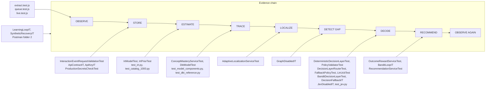

# Testing

> Status: research prototype. Tests check that the implementation does what the design says,
> including on synthetic learners with known ground truth. They are not evidence of real learning
> outcomes.

Three independent suites, one per language, plus the Postman collection as an API smoke test.

| Suite | Runner | Location | Verified result |
|---|---|---|---|
| Backend unit | JUnit 5 via surefire (`*Test`) | `backend/src/test/java` | 92 tests pass (84 methods; 2 parameterized) |
| Backend integration | JUnit 5 via failsafe (`*IT`), embedded PostgreSQL | `backend/src/test/java` | 45 tests pass (needs a shell that may run `initdb`, see below) |
| Python model | `unittest` | `model/tests/` | 66 pass |
| Extension | `node:test` | `extension/tests/` | 31 tests: 30 pass, 1 skipped (live) |
| API smoke | Postman / Newman | `postman/` | 36 requests with `pm.test` assertions; needs a running backend |

## Commands

```bash
cd backend && ./mvnw test                     # unit only; surefire excludes **/*IT.java
cd backend && ./mvnw verify                   # unit + integration (failsafe integration-test + verify goals)
cd model && PYTHONPATH=pylib:. python3 -m unittest discover -s tests -t .
cd extension && node --test tests/
KT_LIVE=1 node --test tests/                  # from extension/, with a backend at KT_BASE_URL (default :8080)
python3 scripts/build_colab_notebooks.py --smoke   # regenerates notebooks/*.ipynb, executes both with KT_QUICK=1
```

`--smoke` writes the notebooks before executing them, so it changes tracked files. Without
`model/pylib` on `PYTHONPATH`, the NumPy and PyTorch parity tests in `test_dkt_reference.py` skip
themselves instead of failing.

Both Maven plugins run with `-javaagent:${org.mockito:mockito-core:jar} -Xshare:off`: JDK 21 restricts
Mockito's dynamic self-attach (also in sandboxed shells), so the agent is loaded statically, resolved by
the `maven-dependency-plugin` `properties` goal. No coverage tool (JaCoCo) is configured.

### Integration tests need a real PostgreSQL

`support/AbstractIntegrationTest` starts one **embedded PostgreSQL 17** per JVM
(`io.zonky.test:embedded-postgres` 2.2.2, binaries 17.11.0, plus the `darwin-arm64v8` binaries for
Apple Silicon) and points `spring.datasource.*` at it through `@DynamicPropertySource`. No Docker is
needed, but zonky extracts the PostgreSQL binaries to a temp directory and runs `initdb` and `postgres`,
so the shell must be allowed to execute them and bind a local port; in a restricted sandbox the ITs fail
at startup, not in an assertion. All Flyway migrations and seed data (`V1`–`V6`) are applied, so ITs see
the real 1000-problem catalog. Spring contexts with different `@TestPropertySource` overrides share the
server; tests isolate themselves with unique learner ids (`uniqueUser`) and strictly increasing
timestamps (`nextTimestamp`), so assertions on shared item difficulty stay relative. Run outside a
restrictive sandbox, where embedded PostgreSQL may run `initdb`, all 45 integration tests pass.

### The live extension test is opt-in

`extension/tests/live.test.js` is declared with `{ skip: !process.env.KT_LIVE }`. With `KT_LIVE` set it
drives the real `extract.js` → `EventQueue` → `ApiClient` pipeline against `KT_BASE_URL`
(default `http://localhost:8080`, sending `KT_API_KEY` if set): it queues an event for a random unknown
problem number (`LC90000`–`LC99998`) with its registration payload, expects it to be delivered, replays
the same `eventId` and expects one duplicate, then checks `totalEvents == 1` and that next-action
returns a problem.

## Test-to-pipeline map



## Backend unit tests (`*Test`, surefire)

| Class | Tests | Verifies |
|---|---|---|
| `irt/IrtModelTest` | 28: 18 + 2 parameterized (7 + 3 cases) | Rasch `σ(θ − b)` values, output inside (0, 1) for extreme inputs, monotonicity in ability and difficulty, information peak at θ = b; ability MAP: prior with no evidence, success never lowers / failure never raises, easy-item failure is stronger evidence, first-order MAP condition, shrinking uncertainty, all-correct/all-wrong stay finite, recovery of θ = 2/5/8 from 300 synthetic responses; difficulty: prior with no evidence, direction of updates, recovery of b = 6.5; clamping of non-finite values |
| `irt/IrtPriorTest` | 3 | Acceptance-adjusted prior equals `scripts/build_leetcode_catalog.py` values; label prior without acceptance and bounded shift; `Pseudonyms` are stable, keyed and do not leak the external ref |
| `mastery/ConceptMasteryServiceTest` | 6 | Beta mastery rises on success / falls on failure; one failure after a streak does not wipe mastery; stays in [0, 1] with shrinking uncertainty; tag weight scales evidence; credit weights for hint (0.7), solution viewed (0.4), low confidence (0.8), slow success (0.8), failure after solution (0.5); concepts are independent |
| `localization/AdaptiveLocalizationServiceTest` | 8 | New learner needs calibration; target difficulty is the clamped estimate; calibrated by low uncertainty or by event count; sparse evidence stays uncalibrated; retries of one problem do not end calibration (the event count has reached `calibration-min-events` but only one first-attempt response is informative); disabled localization never calibrates; fail-then-pass steps down then up |
| `dkt/DktModelTest` | 3 | Java LSTM forward pass matches the Python reference fixture to 1e-9; input encoding separates correct/incorrect evidence; wrong format or shapes are rejected |
| `decision/DeterministicDecisionLayerTest` | 7 | Empty candidates → no choice; uncalibrated learner → calibration item; concept gap outranks calibration; prerequisite gap → prerequisite review, else easier problem; calibrated learner → highest expected value; choice always from the candidate set |
| `decision/PolicyValidatorTest` | 8 | Accepts valid choices; rejects null decisions, actions outside the candidate set, nonexistent problems, out-of-range difficulty, low confidence, already-solved problems except for retry / spaced review; feedback request without a problem is allowed |
| `decision/DecisionLayerRouterTest` | 4 | Dispatch by configured provider; unknown provider fails loudly so the fallback runs; the HTTP provider throws for a blank, whitespace or default (`change-me`) pseudonym salt before sending any request, so the fallback runs; the HTTP protocol sends only the bounded context |
| `decision/FallbackPolicyTest` | 3 | An invalid top candidate falls through to the next valid one; the last-resort search skips paid-only and solved problems; only paid problems left → `FEEDBACK_REQUEST` |
| `decision/bandit/LinUcbTest` | 3 | Fresh arm predicts its warm-start value; updates converge to a linear reward and shrink exploration; Cholesky solve inverts an SPD matrix |
| `decision/bandit/BanditDecisionLayerTest` | 4 | Without data it ranks like the heuristic; learned rewards override the warm start; guarded mode keeps gap remediation deterministic; features are bounded and mark gap matches |
| `recommendation/OutcomeRewardServiceTest` | 3 | Default reward is ability growth only; optional quality term; reward stays in [0, 1] |
| `recommendation/RecommendationServiceTest` | 2 | Concept codes map to camelCase knowledge keys; rounding to two decimals |
| `event/InteractionEventRequestValidationTest` | 4 | Valid event passes; optional fields may be null; required fields and ranges enforced; only `ACCEPTED` counts as correct |
| `config/ProductionSecretsCheckTest` | 6 | `prod` start-up check: passes with an API key and the default salt when no pseudonyms leave the system, and with a secret salt when research export and the `http` Jev provider are on; fails on a blank `KT_API_KEY`; fails on the default salt with research export enabled, and on a blank salt with the `http` provider (provider name trimmed, case-insensitive); reports every problem in one message |

## Backend integration tests (`*IT`, failsafe)

Every IT extends `AbstractIntegrationTest` and goes through MockMvc → controllers → services → JPA →
PostgreSQL.

| Type | Class | Tests | Verifies |
|---|---|---|---|
| Pipeline | `pipeline/LearningLoopIT` | 12 | End-to-end loop and edge cases: new learner (404 before registration, 201/200 registration, prior state, `UNKNOWN` gap, calibration item); sparse learner → `INSUFFICIENT_PRACTICE`; repeated linked-list failure → `CONCEPT_GAP` and an `EASIER_PROBLEM` on that concept, decided by Jev, with feedback requested; concept-specific failure lowers but does not collapse global ability; weak prerequisite → `PREREQUISITE_GAP` and `PREREQUISITE_REVIEW`; repeated success raises mastery monotonically; duplicate `eventId` replayed 3× leaves state identical; an `eventId` reused for another learner or another problem → 409, the other learner is not created (state 404) and the original learner still has one event; untagged problem accepted without mastery update; timeouts → `TIME_PRESSURE`; the next attempt is new evidence; item difficulty recalibrates from 4 responses |
| Synthetic recovery | `pipeline/SyntheticRecoveryIT` | 1 | SYNTHETIC: Rasch learners with θ = 2, 5, 8 answer 40 catalog problems through the API; estimated ability ordering is recovered (θ₂ < 4, θ₈ > 6) with invariants (calibrated, uncertainty in (0, 1), mastery in [0, 1], recommended problem exists) |
| API contract | `api/ApiContractIT` | 19 | Status codes and bodies: health, 201 event, 400 validation with field details, 400 malformed JSON / unknown enum, 415 `UNSUPPORTED_MEDIA_TYPE` for a `text/plain` event, 400 `VALIDATION_ERROR` for `limit` ≤ 0 on history, recommendations and research decisions, 422 unknown problem, 404 unknown learner / problem / path, documented state and next-action shapes, 409 duplicate problem / concept, 404 unknown concept on problem creation, prerequisite self-loop and cycle → 422 and duplicate edge → 409, weighted tags, transitive prerequisites, feedback, 405, LeetCode metadata and prior, research export 404 by default, public model status |
| API contract | `api/ApiKeyIT` | 1 | With an API key: missing or wrong key → 401 `UNAUTHORIZED`, correct key → 201 with `X-Request-Id`; health needs no key |
| Ablation | `ablation/IrtDisabledIT` | 1 | `irt.enabled=false`: ability stays 5.0 while mastery still updates; model status `DISABLED` |
| Ablation | `ablation/GraphDisabledIT` | 1 | `prerequisite-graph.enabled=false`: the evidence that gives `PREREQUISITE_GAP` becomes a `CONCEPT_GAP` on `TREES` |
| Ablation | `ablation/JevDisabledIT` | 1 | `jev.enabled=false`: the deterministic fallback alone still recommends (`decidedBy=FALLBACK`) |
| Decision | `decision/DecisionFallbackIT` | 4 | Unavailable Jev, an action outside the candidate set and low confidence all fall back; a valid confident decision is used |
| Decision | `decision/BanditLoopIT` | 2 | `provider=bandit`: acting on the recommendation rewards the decision (> 0.5 for a first-attempt success) and updates exactly one arm once; unrelated events produce no reward |
| Model | `dkt/DktEnabledIT` | 1 | With the fixture DKT model: `successModel` switches from `IRT` to `IRT+DKT` after enough history; 25 DKT mastery values in [0, 1]; `/api/models/dkt` reports it |
| Research | `research/ResearchExportIT` | 2 | Export enabled: events are kt-events-v1 with `L-` pseudonyms and no external refs; rewarded decisions exported as kt-decisions-v1; catalog export has ≥ 1000 problems, 25 concepts and the V5 weights / priors |

All 45 integration tests pass when embedded PostgreSQL is allowed to run `initdb` (outside a
restrictive sandbox).

## Python model tests (`model/tests/`)

| Module | Tests | Verifies |
|---|---|---|
| `test_irt.py` | 12 | Python Rasch port: probability, monotonicity, information peak, stable sigmoid, clamping, prior without evidence, update direction, bounded all-correct, shrinking uncertainty, ability recovery, difficulty direction, calibration recovers item order |
| `test_model_components.py` | 14 | Mastery prior 0.5, failures lower mastery and mark the weakest concept, shrinking uncertainty; seed catalog shape, transitive prerequisites, known primary concepts; `kt/synthetic.py` world determinism, stronger learners succeed more, practice never reduces skill; policies never recommend solved problems, route concept and prerequisite gaps, return `None` on an exhausted pool; DKT availability check on a small dataset |
| `test_simulator.py` | 10 | Simulator v2: 1000 free tagged problems, same seed → same dataset, valid chronological events, weak concepts are weaker, truth probability is calibrated, harder items solved less, forgetting decays skill; kt-events-v1 plain/gzip round-trip, inconsistent records rejected, deterministic disjoint 70/15/15 learner split |
| `test_catalog_1000.py` | 6 | Catalog shape; prerequisite graph is a DAG over known concepts; prior formula matches `docs/irt.md`; V5 migration contains every catalog problem; every catalog concept is one of the 25 seeded by V3/V4; weights follow the tag rules except the curated seeds |
| `test_dkt_reference.py` | 6 | kt-dkt-v1 contract: fixture format current, stdlib reference reproduces the Java fixture, NumPy evaluator and PyTorch forward match the reference (each skipped if the library is missing), encoder layout, unseen items get no offset |
| `test_jev.py` | 7 | LinUCB warm start and convergence match the backend `LinUcbTest` numbers; features match the backend definition; reward formula matches the backend default; retries do not move ability; candidates are bounded and the deterministic rules remediate; simulation is reproducible |
| `test_metrics.py` | 11 | AUC (perfect, inverted, constant, single class, known value), log loss (coin flip, finite on confident mistakes), accuracy and Brier, MAE / RMSE, ECE, Spearman |

## Extension tests (`extension/tests/`)

Only the DOM-free libraries in `src/lib/` are tested; `content.js`, `background.js`, the popup and the
options page have no automated tests.

| File | Tests | Verifies |
|---|---|---|
| `extract.test.js` | 12 | `"N. Title"` → `LC<N>`; non-problem titles and non-problem URLs rejected; difficulty normalisation; verdict → backend result mapping; tag → weighted concepts (strongest first, deduplicated, unknown tags dropped); DFS/BFS by context; mapping identical to the catalog builder for every catalog problem and to `data/leetcode/tag_concept_map.json`; hint / solution / editorial detection; `buildEvent` emits schema-v1 events, omits unobserved optional fields, rejects invalid input |
| `queue.test.js` | 18 | Delivered events leave the queue; enqueue dedupes by `eventId`; server-side duplicates count as delivered; network errors and 5xx retried with backoff, 400 dropped; 422 unknown problem registers once and re-sends (409 on registration = already registered, no payload = dropped); auth pausing (8 tests): 401 and 403 each stop at the first rejection, keep every item queued with its retry count unchanged and record the auth error; flushing stays paused while it is set; clearing it lets queued items deliver; a forced flush ignores the pause and clears the error only on success; a forced flush of an empty queue clears a stale error; a 401 while registering an unknown problem keeps the event; other 4xx are still dropped without pausing; queue is bounded; `ApiClient` sends the API key and surfaces error bodies |
| `live.test.js` | 1 (skipped by default) | Real pipeline against a running backend, see above |

## Coverage of the required test categories

Section numbers are the master-plan references cited in the test Javadoc.

| Requirement | Covered by | Assessment |
|---|---|---|
| Unit tests (§27) | 14 backend `*Test` classes, all Python and extension tests | Covered for models, decision layer, validation, the `prod` secrets check and extension libraries; controllers and repositories are exercised only through ITs |
| Integration: event → DB → state → gap → recommendation → new evidence (§28) | `LearningLoopIT.nextInteractionBecomesNewEvidence`, `SyntheticRecoveryIT`, `BanditLoopIT`, Postman folder 2 | Covered |
| API: status codes, structure, errors (§29) | `ApiContractIT` (including `nonJsonContentTypeReturns415`, `nonPositiveLimitReturns400`), `ApiKeyIT`, `LearningLoopIT.eventIdReusedForAnotherLearnerOrProblemIsAConflict` (409), Postman folders 4–6 | Covered for every controller |
| Edge case: new learner (§30) | `LearningLoopIT.newLearnerWithZeroHistoryGetsCalibrationItem`, `AdaptiveLocalizationServiceTest.newLearnerNeedsCalibration`, `IrtModelTest` "no evidence returns the prior" | Covered |
| Edge case: sparse data | `LearningLoopIT.sparseLearnerIsFlaggedAsInsufficientPractice`, `AdaptiveLocalizationServiceTest.notCalibratedWithSparseEvidence` | Covered |
| Edge case: repeated failure | `LearningLoopIT.repeatedFailureOnLinkedListIsDetectedAsConceptGapAndRemediated`, `IrtModelTest.failureNeverIncreasesAbility` | Covered |
| Edge case: repeated success | `LearningLoopIT.repeatedSuccessOnSameConceptRaisesMasteryMonotonically`, `IrtModelTest.allCorrectAndAllWrongPatternsStayFiniteAndInRange` | Covered |
| Edge case: concept-specific failure | `LearningLoopIT.conceptSpecificFailureDoesNotDestroyGlobalAbility`, `ConceptMasteryServiceTest.separateConceptsAreIndependent` | Covered; the test documents that unidimensional Rasch still lowers global ability somewhat |
| Edge case: unknown concept | `ApiContractIT.problemWithUnknownConceptReturns404`; the `GRAPHS` "no evidence = unknown, not weak" assertion in `LearningLoopIT`; unknown tags dropped in `extract.test.js` | Partial: covered at problem creation and in state reporting. Events carry problem ids, not concepts, so the event-level analogue is the unknown **problem** (422 in `ApiContractIT`, register-and-resend in `queue.test.js` / `live.test.js`) |
| Edge case: missing metadata | `LearningLoopIT.problemWithoutConceptMetadataIsAcceptedWithoutMasteryUpdate`, `InteractionEventRequestValidationTest.optionalFieldsMayBeNull`, `IrtPriorTest` prior without acceptance rate, `extract.test.js` omitted optional fields | Covered |
| Edge case: conflicting evidence | `ConceptMasteryServiceTest.assistedAndConflictingEvidenceIsDownWeighted` and `singleFailureDoesNotDestroyMastery`; `AdaptiveLocalizationServiceTest.failThenPassSequenceStepsDownThenUp` | Partial: unit level only. No IT sends contradictory signals (e.g. `ACCEPTED` with confidence 1, or success after a solution view) through the API and asserts the resulting state |
| Edge case: duplicate event | `LearningLoopIT.duplicateEventDoesNotCorruptLearnerState` (exact replay), `LearningLoopIT.eventIdReusedForAnotherLearnerOrProblemIsAConflict` (same `eventId` with a different learner or problem → 409, no learner created), `ApiContractIT.postEventReturns201WithStoredEvent` (`duplicate=false`), Postman "SAME eventId again", `queue.test.js` dedupe and server duplicates | Covered |
| Deterministic model tests (§31) | `IrtModelTest` (expected values from the formula), `DktModelTest` parity to 1e-9, `LinUcbTest`, `test_irt.py`, `test_dkt_reference.py`, `test_jev.py` | Covered |
| Model invariants (§32) | Probabilities in (0, 1), monotonicity, MAP first-order condition, mastery and reward in [0, 1], shrinking uncertainty (`IrtModelTest`, `ConceptMasteryServiceTest`, `OutcomeRewardServiceTest`); invariants over the synthetic run in `SyntheticRecoveryIT`; Python mirrors | Covered |
| Synthetic recovery (§33) | `SyntheticRecoveryIT`, `IrtModelTest` recovery tests, `test_simulator.py`; full benchmark in `model/evaluation/evaluate_kt.py` | Covered, on synthetic data only |
| Ablation (§36) | `IrtDisabledIT`, `GraphDisabledIT`, `JevDisabledIT`; offline ablation in `model/evaluation/run_evaluation.py` | Covered for IRT, graph and Jev; no DKT-off / localization-off IT (the default config already has DKT off) |

Not tested at all: concurrent events for the same learner, events arriving with out-of-order
timestamps, load or performance, the dashboard page, and the extension's content script, service worker
and popup. The Postman collection is not run automatically.
