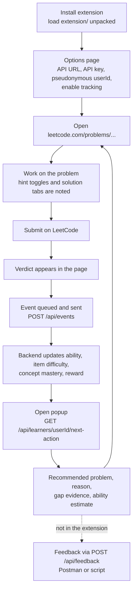
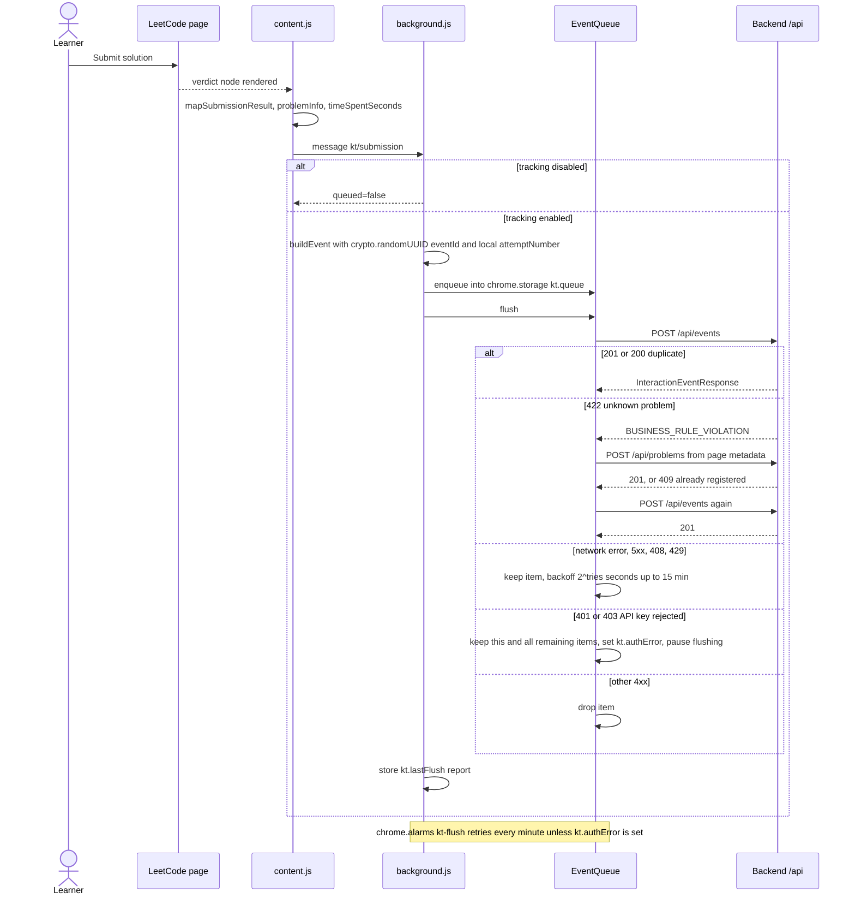
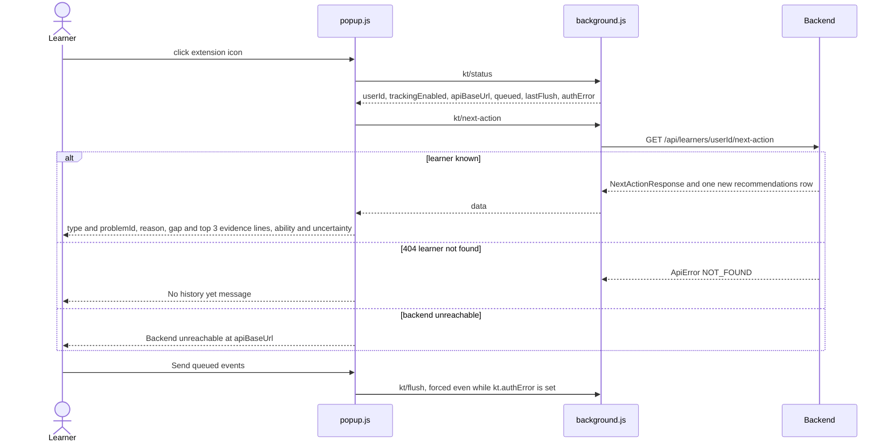
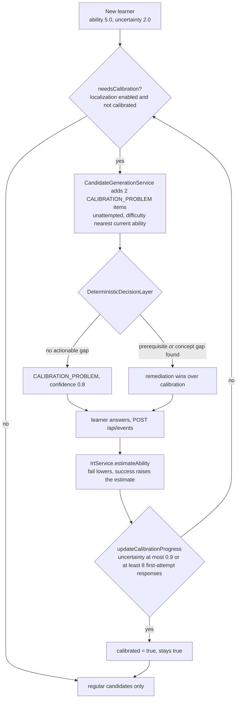

# User flow

The learner's journey through the Chrome extension (`extension/`, Manifest V3) and the
backend, as the code implements it today. The extension only **observes and displays**;
every estimate and decision is made by the backend ([architecture.md](architecture.md)).
The request/response details of each call are in [api-flow.md](api-flow.md).



## 1. Install

The extension is not published; load the `extension/` folder as an unpacked extension in
a Chromium browser (developer mode). `manifest.json` declares:

| key | value |
|---|---|
| `permissions` | `storage` (settings, queue, attempt counters), `alarms` (1-minute flush) |
| `host_permissions` | `https://leetcode.com/*`, `http://localhost:8080/*` |
| `content_scripts` | `src/lib/extract.js` + `src/content.js` on `https://leetcode.com/problems/*`, `document_idle` |
| `background` | service worker `src/background.js` (imports `lib/extract.js`, `lib/api.js`, `lib/queue.js`) |
| `action` | popup `popup/popup.html` |
| `options_page` | `options/options.html` |

## 2. Options page (`options/options.html`, `options.js`)

| field | default | stored as |
|---|---|---|
| Enable tracking | **off** | `trackingEnabled` |
| API base URL | `http://localhost:8080` | `apiBaseUrl` (must parse as a URL; trailing `/` removed) |
| API key | empty | `apiKey`, sent as `X-API-Key` when non-empty; only needed if the backend sets `KT_API_KEY` |
| Pseudonymous user ID | `ext-<random UUID>` | `userId` (required, cut to 64 characters); changing it starts a new learner history |

The page shows a notice of what is collected (problem number, title, difficulty label, topic
tags, verdict, attempt number, time on page, hint opened (`hintUsed`), solutions/editorial
opened).

If the base URL points anywhere other than `localhost:8080`, the manifest grants no host
permission for it, so requests depend on the backend's CORS configuration
(`KT_ALLOWED_ORIGINS`; the `dev` profile allows `chrome-extension://*`). See
[security.md](security.md).

## 3. Observe a LeetCode problem (`src/content.js`)

While a problem page is open the content script keeps, per problem slug:

* `pageOpenedAt` — reset when the slug in the URL changes (switching between the
  description, solutions and submissions tabs of the same problem keeps it);
* `hintUsed` — set when a click lands on an element (or up to 3 ancestors) whose text is
  `Hint`, `Hint 1`, … (`KTExtract.isHintToggle`);
* `solutionViewed` — set when the path is `/problems/<slug>/solutions` or `/editorial`
  (`KTExtract.isSolutionPath`);
* a random `sessionId` (`sess-…`) per page load.

A `MutationObserver` (debounced 400 ms) looks for `[data-e2e-locator="submission-result"]`
and maps its text with `KTExtract.mapSubmissionResult`:

| verdict text | `result` |
|---|---|
| `Accepted…` | `ACCEPTED` |
| `Wrong Answer` | `WRONG_ANSWER` |
| `Time Limit Exceeded` | `TIME_LIMIT_EXCEEDED` |
| `Runtime Error`, `Memory Limit Exceeded`, `Compile Error`, `Output Limit Exceeded` | `RUNTIME_ERROR` |

`ABANDONED` is accepted by the backend but never produced by the extension. The same
verdict node re-rendering is ignored (`pathname|text` key). Problem identity comes from the
title `"21. Merge Two Sorted Lists"` → `LC21` (`parseProblemTitle`); difficulty from a
`text-difficulty-*` element; topic tags from `a[href^="/tag/"]`, mapped to weighted concepts
by `mapTags` (same rules as the catalog builder, tested against all generated catalog
problems in `extension/tests/extract.test.js`). DOM selectors are fragile by nature; a
failed lookup means "no event", not a wrong one.

## 4. Submit → event → state update



Details from `background.js` and `lib/queue.js`:

* `attemptNumber` is a per-browser counter per problem (`kt.attempts`), not LeetCode's own
  count; reinstalling or a second browser restarts it at 1.
* The queue is persisted before sending, dedupes by `eventId`, holds at most 500 items
  (oldest dropped) and reports `delivered / duplicates / dropped / retrying`.
* The problem-registration payload is only attached when the page showed a difficulty label.
* A wrong or missing API key yields 401 (`ApiKeyFilter`, "Missing or invalid API key"); 401
  and 403 are **not** dropped. The queue keeps every pending event, stores `kt.authError`
  (`{ at }`) and stops sending: submissions are still queued and the minute alarm skips
  delivery. The popup shows "Backend rejected the API key" with the queued count. The pause
  ends when `apiKey` or `apiBaseUrl` changes in the options (the background listens on
  `chrome.storage.onChanged` and flushes at once), or when "Send queued events" forces a
  retry. That retry clears the flag if it succeeds and keeps it on another 401/403. While
  paused the 500-item bound still applies, so the oldest events are dropped once it is reached.
* The extension never sends `confidence`, `perceivedDifficulty` or `blocker`.

On the backend, one transaction stores the event and folds it into the learner's state
(IRT ability, calibration progress, item re-calibration, Beta concept mastery) and
attributes the outcome to a pending recommendation of the same problem (Jev reward). See
[data-flow.md](data-flow.md).

## 5. Next action in the popup (`popup/popup.js`)



What the popup renders: `recommendation.type: problemId (topic)`, `recommendation.reason`,
the gap type and concept with up to three evidence strings when the gap is not `NONE`, and
`Ability <ability> ± <uncertainty> (calibrated | calibrating)`. It does **not** show
`confidence`, `decidedBy`, `predictedSuccess` or the feedback questions, and it does not link
to the problem URL. Because `next-action` stores an audit row on every call, each popup
opening adds a recommendation to `GET /api/learners/{userId}/recommendations`.

The learner then opens the recommended problem on LeetCode; its outcome closes the loop
(the first outcome on that problem within 336 h becomes the recommendation's reward,
[jev.md](jev.md)).

## 6. Feedback

`next-action` returns `feedback.required` and questions for gap types other than `NONE`,
`UNKNOWN` and `INSUFFICIENT_PRACTICE` (e.g. prerequisite gap: "Did you understand the
prerequisite?"). There is **no feedback UI in the extension**; answers can only be sent with
`POST /api/feedback` (Postman folder "3. Feedback"). Stored feedback is not read by any model
yet ([limitations.md](limitations.md)).

## 7. Cold start and calibration

A new learner starts at the ability prior N(5, 2²): `ability 5.0`, `uncertainty 2.0`,
`calibrated false` (`LearnerStateService.getOrCreateState`, asserted in `LearningLoopIT`).
`AdaptiveLocalizationService` then drives the first recommendations:



* Items at `b ≈ θ` maximise Rasch information `p(1 − p)`; since ability is re-estimated
  after every response, the target follows the learner (fail → easier, pass → harder)
  without an explicit binary search.
* Before any event the gap is `UNKNOWN` ("No interaction history yet"); with fewer than 5
  events and no stronger signal it is `INSUFFICIENT_PRACTICE`.
* With `knowledge-tracer.adaptive-localization.enabled=false` no calibration items are
  generated and `calibrated` is never set to true.

More in [adaptive-localization.md](adaptive-localization.md).

## 8. Operating without the extension

Everything the extension does is plain HTTP, so the loop can be driven by hand or by scripts.

| tool | what it does |
|---|---|
| Postman `postman/KnowledgeTracer.postman_collection.json` | folders: 0 Health, 1 Catalog, 2 Learning loop (register learner → cold-start next action → events incl. an idempotent replay → gap → remediation → mastery recovers → history, audit trail), 3 Feedback, 4 Error handling (400, 404, 409, 422, 405), 5 Model status (DKT, Jev), 6 Research export (disabled by default) |
| `/dashboard.html` | static page served by the backend: state, next action, recommendation audit and history for one learner, plus the problem and concept lists |
| `scripts/replay_synthetic.py` | posts events of simulated learners (`SYN-<run>-…`) to a running backend exactly like the extension, then compares the backend's ability estimates with the simulator truth; writes `model/reports/replay-results.json` and exits non-zero if the ability Spearman is below 0.6 |
| `scripts/export_events.py` | downloads the research exports (needs `KT_RESEARCH_EXPORT=true` and a secret salt) |

Minimal manual loop (API key header only if `KT_API_KEY` is set):

```bash
curl -s -X POST localhost:8080/api/learners -H 'Content-Type: application/json' \
     -d '{"externalRef":"manual-001"}'
curl -s -X POST localhost:8080/api/events -H 'Content-Type: application/json' \
     -d '{"userId":"manual-001","problemId":"LC21","eventId":"'"$(uuidgen)"'",
          "timestamp":"2026-09-30T15:04:05Z","attemptNumber":1,"result":"WRONG_ANSWER"}'
curl -s localhost:8080/api/learners/manual-001/next-action
```

Last committed replay report (**synthetic data**, 30 simulated learners × 20 events): ability
Spearman 0.947, MAE 0.759 on the 0–10 scale (`model/reports/replay-results.json`). This
checks plumbing and estimator behaviour under the simulator's assumptions only; see
[evaluation.md](evaluation.md).

Synthetic *datasets* for training (`scripts/generate_synthetic_dataset.py`) never pass
through the API; they go straight to the offline pipeline in [model-flow.md](model-flow.md).
